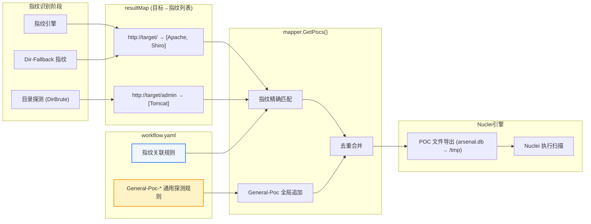
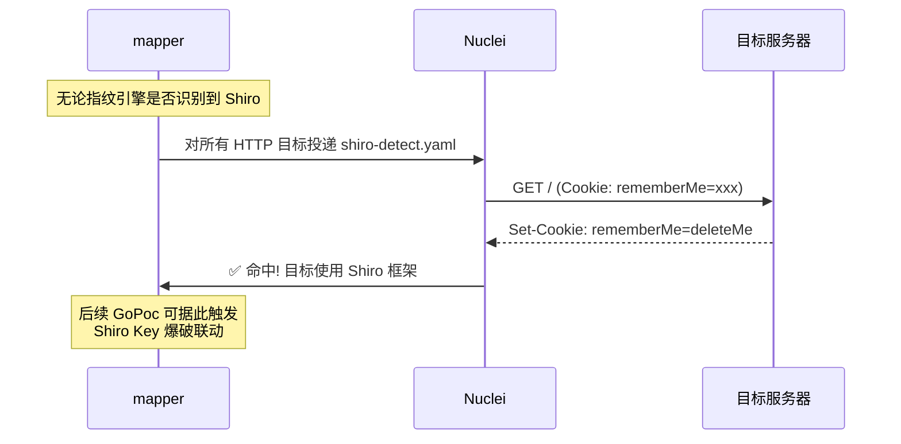
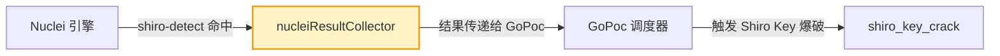

# Agent 扫描引擎流水线 (Pipeline) 流程图

> 相关架构文档：[project-structure.md](project-structure.md) | [distributed-scan-architecture.md](distributed-scan-architecture.md)

以下是 Argus Agent 端扫描任务流水线 (`scanner/internal/engine/pipeline.go`) 的核心执行流程图：

```mermaid
graph TD
    Start(["开始扫描"]) --> Init["上下文绑定 (bindAgentContext)"]
    
    Init --> CheckSearchEngine{"是否启用网络空间测绘?"}
    CheckSearchEngine -- 是 --> SearchEngine["Fofa/Hunter/Quake 检索"]
    SearchEngine --> ParseTarget
    CheckSearchEngine -- 否 --> ParseTarget["解析与分类目标 (IP/Domain/URL/CIDR)"]
    
    ParseTarget --> CheckSubdomain{"开启子域名探测?"}
    CheckSubdomain -- 是 --> Subdomain["子域名枚举 (SubFinder / Brute)"]
    Subdomain --> CheckCDN
    CheckSubdomain -- 否 --> CheckCDN{"包含域名?"}
    
    CheckCDN -- 是 --> CDN["CDN 识别与过滤"]
    CDN --> CheckHostDiscovery
    CheckCDN -- 否 --> CheckHostDiscovery{"是否启用存活探测?"}
    
    CheckHostDiscovery -- 是 --> ICMP["ICMP / TCP Ping 探活"]
    ICMP --> PortScan
    CheckHostDiscovery -- 否 --> PortScan["端口扫描 (SYN / TCP Masscan)"]
    
    PortScan --> Protocol["服务与协议识别 (Banner Grab)"]
    Protocol --> HTTPProbe["Web 探针 (HTTPX 探测)"]
    HTTPProbe --> HostBind["域名绑定探测 (Host-Bind)"]
    
    HostBind --> CheckFuzzyPoc{"是否为指定 POC 搜索?"}
    CheckFuzzyPoc -- 是 --> FuzzyNuclei["Nuclei 指定漏洞扫描"]
    FuzzyNuclei --> End(["结束扫描"])
    
    CheckFuzzyPoc -- 否 --> DirBrute["主动目录/指纹探测 (DirBrute)"]
    DirBrute --> Fingerprint["指纹识别 (Fingerprint)"]
    Fingerprint --> MergeFinger["合并回退指纹池 (Fallback Dir)"]
    
    MergeFinger --> CheckPoc{"开启漏洞探测?"}
    CheckPoc -- 是 --> Mapping["指纹→模板映射 (mapper.GetPocs)"]
    CheckPoc -- 否 --> End
    
    Mapping --> Nuclei["Nuclei 漏洞引擎扫描"]
    Nuclei --> GoPocTelnet["GoPoc: Telnet 弱口令探测"]
    GoPocTelnet --> GoPocDispatch["GoPoc: 漏洞引擎调度执行"]
    
    GoPocDispatch --> End
    
    classDef phase fill:#eff6ff,stroke:#3b82f6,stroke-width:2px,color:#1e40af;
    classDef decision fill:#fef3c7,stroke:#f59e0b,stroke-width:2px,color:#92400e;
    classDef endPoint fill:#dcfce7,stroke:#22c55e,stroke-width:2px,color:#166534;
    
    class Start,End endPoint;
    class CheckSearchEngine,CheckSubdomain,CheckCDN,CheckHostDiscovery,CheckFuzzyPoc,CheckPoc decision;
    class SearchEngine,ParseTarget,Subdomain,CDN,ICMP,PortScan,Protocol,HTTPProbe,HostBind,DirBrute,Fingerprint,MergeFinger,Mapping,Nuclei,GoPocTelnet,GoPocDispatch,FuzzyNuclei phase;
```



---

## 指纹→模板映射详细流程

扫描流水线中最关键的环节是 **指纹识别结果** 如何驱动 **Nuclei 模板选择**。这一过程由 `mapper.GetPocs()` 完成：



### 两类 Workflow 规则

| 类型 | 命名约定 | 触发条件 | 示例 |
|------|---------|---------|------|
| **指纹关联规则** | 与指纹库 product 名一致（如 `Apache`、`Tomcat`） | 必须命中对应指纹 | `Tomcat` → `tomcat-manager-weak.yaml` |
| **通用探测规则** | `General-Poc-` 前缀（如 `General-Poc-Shiro`） | **所有 HTTP 目标**均触发（不依赖指纹） | `General-Poc-Shiro` → `shiro-detect.yaml` |

### mapper.GetPocs() 核心逻辑

```
输入:
  resultMap   = {target → [fingerprint1, fingerprint2, ...]}
  workFlowDB  = workflow.yaml 解析后的 map
  disableGeneralPoc = bool

处理:
  1. 收集所有 General-Poc-* 条目的 key
  2. 遍历每个 target:
     a. 按 fingerprint 精确匹配 workFlowDB → 获取 POC 列表
     b. 追加所有 General-Poc-* 条目的 POC 列表 (如果未禁用)
     c. 按 type(root/base/dir) 决定 POC 作用的 URL 层级
     d. 按文件名去重

输出:
  TargetAndPocsName = {target → [poc1.yaml, poc2.yaml, ...]}
```

### General-Poc 工作原理

`General-Poc-*` 的核心价值是 **"反向指纹识别"**：不依赖指纹引擎，通过主动 Probe 请求判定目标技术栈。

以 `General-Poc-Shiro` 为例：



workflow.yaml 中的格式：

```yaml
# 通用探测规则：以 General-Poc- 前缀命名
General-Poc-Shiro:
  type:
    - base    # 对每个发现的路径都探测
    - root    # 也对根路径探测
  pocs:
    - shiro-detect
```

### Nuclei 结果 → GoPoc 联动

Nuclei 扫描结果通过 `nucleiResultCollector` 收集，传递给 GoPoc 引擎实现联动：



---

## 主要执行阶段说明

1. **目标发现与处理层**：包含空间测绘接入、原始目标的解析（自动区分 IP、CIDR、域名等）。
2. **侦察层 (Recon)**：负责子域名枚举、CDN 探测、主机存活探测（ICMP/TCP Ping）。
3. **服务识别层**：执行端口扫描（支持 SYN 和 TCP 模式），并对开放的端口进行深度的协议与服务指纹识别。
4. **Web 分析层**：利用 httpx 获取 HTTP 响应元数据，处理 Host 碰撞，再通过主动目录爆破获取深层目录和资产特征。
5. **漏洞扫描层**：
   - 提取识别到的所有"产品指纹"，通过 `mapper` 进行精确映射。
   - **General-Poc 通用探测**：不依赖指纹的 Nuclei 模板（如 Shiro 检测）会自动追加到所有目标。
   - 调用 **Nuclei 引擎**针对指纹投递特定的 CVE 模板进行验证。
   - Nuclei 结果通过 `nucleiResultCollector` 传递给后续的 GoPoc 引擎，实现漏洞联动（如 Shiro 检测→Key 爆破）。
   - 最后启动 **GoPoc 引擎**，用于执行 Nuclei 较难支持的特殊漏洞验证（例如 Telnet 交互式爆破、Java 反序列化漏洞及特定的复杂利用链）。
