# Agent 扫描引擎流水线 (Pipeline) 流程图

以下是 Argus Agent 端扫描任务流水线 (`scanner/internal/engine/pipeline.go`) 的核心执行流程图：

```mermaid
graph TD
    Start(["开始扫描"]) --> Init["上下文绑定 (bindAgentContext)"]
    
    Init --> CheckSearchEngine{"是否启用网络空间测绘?"}
    CheckSearchEngine -- 是 --> SearchEngine["Fofa/Hunter/Quake 检索"]
    SearchEngine --> ParseTarget
    CheckSearchEngine -- 否 --> ParseTarget["解析与分类目标 (IP/Domain/URL/CIDR)"]
    
    ParseTarget --> CheckSubdomain{"开启子域名探测?"}
    CheckSubdomain -- 是 --> Subdomain["子域名枚举 (SubFinder / Brute)"]
    Subdomain --> CheckCDN
    CheckSubdomain -- 否 --> CheckCDN{"包含域名?"}
    
    CheckCDN -- 是 --> CDN["CDN 识别与过滤"]
    CDN --> CheckHostDiscovery
    CheckCDN -- 否 --> CheckHostDiscovery{"是否启用存活探测?"}
    
    CheckHostDiscovery -- 是 --> ICMP["ICMP / TCP Ping 探活"]
    ICMP --> PortScan
    CheckHostDiscovery -- 否 --> PortScan["端口扫描 (SYN / TCP Masscan)"]
    
    PortScan --> Protocol["服务与协议识别 (Banner Grab)"]
    Protocol --> HTTPProbe["Web 探针 (HTTPX 探测)"]
    HTTPProbe --> HostBind["域名绑定探测 (Host-Bind)"]
    
    HostBind --> CheckFuzzyPoc{"是否为指定 POC 搜索?"}
    CheckFuzzyPoc -- 是 --> FuzzyNuclei["Nuclei 指定漏洞扫描"]
    FuzzyNuclei --> End(["结束扫描"])
    
    CheckFuzzyPoc -- 否 --> DirBrute["主动目录/指纹探测 (DirBrute)"]
    DirBrute --> Fingerprint["指纹识别 (Fingerprint)"]
    Fingerprint --> MergeFinger["合并回退指纹池 (Fallback Dir)"]
    
    MergeFinger --> CheckPoc{"开启漏洞探测?"}
    CheckPoc -- 是 --> Mapping["Nuclei 指纹与模板映射"]
    CheckPoc -- 否 --> End
    
    Mapping --> Nuclei["Nuclei 漏洞引擎扫描"]
    Nuclei --> GoPocTelnet["GoPoc: Telnet 弱口令探测"]
    GoPocTelnet --> GoPocDispatch["GoPoc: 漏洞引擎调度执行"]
    
    GoPocDispatch --> End
    
    classDef phase fill:#eff6ff,stroke:#3b82f6,stroke-width:2px,color:#1e40af;
    classDef decision fill:#fef3c7,stroke:#f59e0b,stroke-width:2px,color:#92400e;
    classDef endPoint fill:#dcfce7,stroke:#22c55e,stroke-width:2px,color:#166534;
    
    class Start,End endPoint;
    class CheckSearchEngine,CheckSubdomain,CheckCDN,CheckHostDiscovery,CheckFuzzyPoc,CheckPoc decision;
    class SearchEngine,ParseTarget,Subdomain,CDN,ICMP,PortScan,Protocol,HTTPProbe,HostBind,DirBrute,Fingerprint,MergeFinger,Mapping,Nuclei,GoPocTelnet,GoPocDispatch,FuzzyNuclei phase;
```

### 主要执行阶段说明：

1. **目标发现与处理层**：包含空间测绘接入、原始目标的解析（自动区分 IP、CIDR、域名等）。
2. **侦察层 (Recon)**：负责子域名枚举、CDN 探测、主机存活探测（ICMP/TCP Ping）。
3. **服务识别层**：执行端口扫描（支持 SYN 和 TCP 模式），并对开放的端口进行深度的协议与服务指纹识别。
4. **Web 分析层**：利用 httpx 获取 HTTP 响应元数据，处理 Host 碰撞，再通过主动目录爆破获取深层目录和资产特征。
5. **漏洞扫描层**：
   - 提取识别到的所有“产品指纹”，通过 `mapper` 进行精确映射。
   - 调用 **Nuclei 引擎**针对指纹投递特定的 CVE 模板进行验证。
   - 最后启动 **GoPoc 引擎**，用于执行 Nuclei 较难支持的特殊漏洞验证（例如 Telnet 交互式爆破、Java 反序列化漏洞及特定的复杂利用链）。
