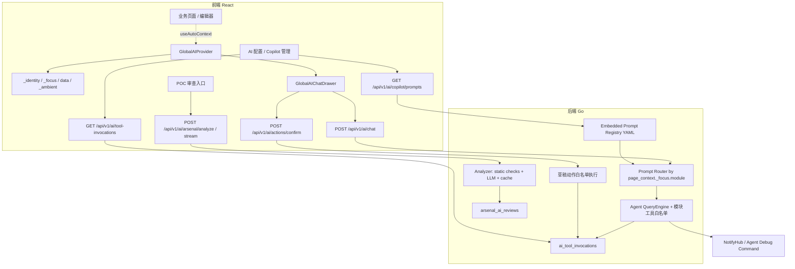

# Argus AI Copilot 架构与现状

本文描述 AI Copilot / POC AI 审查 / Yaksha EXP Workspace 协作能力的当前架构与边界。三者共用一致的草稿优先、人工确认、租户隔离和审计留痕约束。实现状态总览见 [implementation-status.md](implementation-status.md)，EXP 细节见 [yaksha-exp.md](yaksha-exp.md)。

## 1. 当前实现进度

| 模块 | 状态 |
|------|------|
| POC AI 结构化审查 | 静态检查、LLM 审查、缓存表、流式审查入口和兼容入口可用 |
| AI 配置页 | Base URL、API Key 脱敏、模型列表、连接测试；已扩展为 Copilot Prompt、动作白名单与审计管理入口 |
| 全局 Copilot 前端 | 分层 Context、悬浮入口、抽屉、Markdown 渲染、工具折叠、会话重置、POC/EXP 一键应用、pending_action 确认 UI 可用 |
| Agent / Tool Calling 后端 | Agent 循环、模块 Profile、工具白名单、沙箱调试、安全审计、只读工具、草稿动作确认层、审计查询和 Prompt Registry 已实现 |

已落地的主要能力：

- AI 配置：服务端保存 `ai_base_url`、`ai_api_key`、`ai_model`，支持脱敏展示、模型列表拉取和连接测试。
- POC 审查：静态检查、危险 payload 检测、重复候选匹配、Workflow 引用提示、OpenAI-compatible LLM 审查；结果按内容 hash 缓存并持久化到 `arsenal_ai_reviews`。
- 分层上下文：前端发送 `_identity`、`_focus`、`data`、`_ambient`，页面旧上下文字段合并进 `data`；发送前对 `token`、`api_key`、`authorization`、`password`、`secret` 等字段脱敏并裁剪超长内容；后端有 `_focus` 路由、分层注入与脱敏回归测试。
- 模块化 Profile 与 Prompt Registry：按 `page_context._focus.module` 选择系统提示词和工具白名单，集中维护在 `server/internal/api/prompts/copilot_profiles.yaml`（Go 侧 embed 加载）；`GET /api/v1/ai/copilot/prompts` 只读暴露当前配置。
- 工具面：文档检索、资产检索（`SearchAssets`）、任务洞察（`GetTaskInsight`）、Workflow 建议（`RecommendWorkflowRules`）、漏洞解释、节点容量分析、字典策略建议、Workflow 冲突检测等只读工具按模块挂载；`RunSandboxDebug` 复用 POC 调试通道并校验租户、节点状态、Agent 版本和目标。
- 指纹/弹药库调试：Workflow 规则调试面板、`/arsenals/finger-debug` 入口和 Agent `start_fingerprint_debug` 流程；自定义 POC 调试在前端、Server、Agent 三层校验挂载信息和文件名边界。
- 可控编辑：POC 应用 fenced `yaml`，EXP 只应用 fenced `yak` / `yaklang` 并校验 `cli.*` 与 `yaksha.result(`；EXP 修改先保留为内存草稿，通过离线 Fixture 验收后才能保存新的不可变 Draft Revision。
- 审计闭环:`ai_tool_invocations` 记录租户、用户、模块、工具/动作、参数摘要（正文只存 hash 与长度）、耗时、状态；`GET /api/v1/ai/tool-invocations` 支持按角色过滤查询（operator 看自己，admin 看同租户）。

## 2. 架构现状

两条互补链路共享 AI 配置和底层 LLM Client，但接口契约、返回形态和测试目标保持独立：

- **结构化审查链路**：面向 POC 审核闭环，输入 POC 内容，输出稳定 JSON 结果，可缓存、可审计、可用于审核门禁。
- **全局 Copilot 链路**：面向交互式辅助，输入聊天历史和页面上下文，输出流式回答与工具调用过程。

SSE 事件契约固定为：`status`（阶段消息）、`token`（增量文本）、`tool_start`/`tool_end`（工具过程）、`pending_action`（待确认动作）、`result`（结构化结果或会话摘要）、`error`。前端继续兼容全部事件类型。

## 3. 可控执行动作

模型不能直接调用业务写接口，只能在回答末尾输出 `pending_action`；前端解析后展示动作摘要、影响范围、参数和风险，用户确认后才调用 `/api/v1/ai/actions/confirm`，由后端按白名单执行并写入审计。每类动作定义 `action_type`、`title`、`summary`、`risk_level`、`params`、`preview`、`required_role` 和 `confirm_label`。

当前动作白名单（均为草稿类低风险动作）：

| action_type | 风险等级 | required_role | params | 执行语义 |
|-------------|----------|---------------|--------|----------|
| `create_poc_draft` | low | operator | `file_name`, `content` | 写入 `arsenals(poc)`，状态固定 `Draft`，审核仍走原有按钮 |
| `create_exp_draft` | low | operator | `name`, `content`，追加时可带 `exp_id` | 创建或定位 EXP 元数据，源码作为内存草稿返回；必须通过离线 Fixture test 后才能保存 Revision |
| `upsert_workflow_draft` | medium | operator | `product`, `type`, `pocs` | 更新 Workflow 草稿内容，状态固定 `Draft`，发布/审核不自动触发 |
| `create_task_draft` | medium | operator | `project_id`, `name`, `targets`, `policy`, `priority`, `timeout_sec` | `policy` 必须通过 Server 权威 `argus.scan-policy/v1` 编译器编译后保存扫描任务草稿，不会拆分子任务或入队 |
| `upsert_dir_draft` | low | operator | `product`, `paths` | 更新 Dir 字典草稿内容，状态固定 `Draft`，不会自动发布 |

边界约定：

- 用户确认前后端不产生业务副作用；取消、权限不足、参数校验失败和业务失败都有可理解提示。
- POC/EXP 一键应用只改变当前前端编辑器内容；保存草稿需再次确认，审核、发布和执行仍走原有流程。
- 删除、发布、审批、批量变更、云资源操作等高风险动作默认关闭，须单独评审后再开放。

## 4. 明确不做与待办

不做事项：

- Copilot Agent 循环内不引入子 Agent、插件市场、命令系统等重型框架（独立的 `mcp/` 代理与此无关，MCP App 是 Server 权威 API 的另一交互层）。
- 不为每个页面新增专用 AI HTTP 接口；新能力优先作为模块 Profile 内的后端工具。
- 不让 `/api/v1/ai/chat` 替代结构化 POC 审查 API。

待办（按优先级）：

- 浏览器级手动验证各页面 Copilot 上下文与工具白名单是否符合预期，并把真实阻断样例转为回归测试。
- 继续调优业务工具的结果摘要（任务、漏洞、资产、Workflow），避免原始大 JSON 进入聊天流。
- 补充漏洞处置知识库片段、节点版本兼容矩阵、字典命中率反馈和 Workflow 真实数据样例。
- 会话历史持久化如需跨页面/刷新保留，先限定本地存储大小和敏感上下文清理策略。

验证遵循 [AGENTS.md](../AGENTS.md) 的验证矩阵：AI 相关改动至少覆盖 `cd server && go test ./internal/ai ./internal/api`、`go test ./scanner/internal/agent`、`npm --prefix server-ui run build` 和 `git diff --check`。
