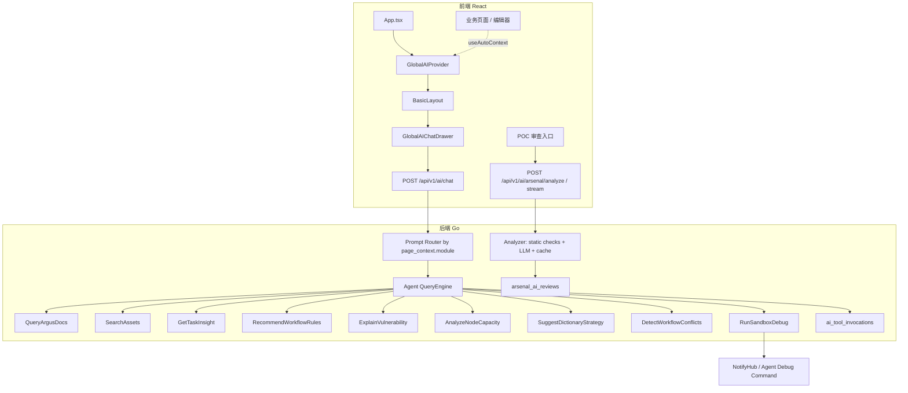

# Argus AI Copilot 当前进度与后续计划

> 分支：`feat/poc-ai-analysis`
>
> 更新时间：2026-04-25

本文用于同步当前 AI Copilot / POC AI 能力的实现状态、架构边界、收口风险和后续推进计划。当前阶段的重点不是重新定义愿景，而是把已经在分支中形成的能力梳理清楚，避免结构化 POC 审查和全局 Copilot 对话两条线互相覆盖。

> 关联文档：[implementation-status.md](implementation-status.md)

## 1. 当前实现进度

| 模块 | 进度 | 状态 |
|------|-----:|------|
| POC AI 结构化审查 | 80% | 静态检查、LLM 审查、缓存表、流式审查入口和兼容入口已恢复 |
| AI 配置页 | 85% | 支持 Base URL、API Key 脱敏、模型列表、连接测试 |
| 全局 Copilot 前端 | 86% | Context、悬浮入口、抽屉、Markdown、工具折叠、会话重置、POC 一键应用与保存草稿闭环已搭好 |
| Agent / Tool Calling 后端 | 85% | Agent 循环、模块 Profile、工具白名单、沙箱调试、安全审计、P2 首批只读业务工具已实现 |
| 测试与文档 | 75% | AI/API 测试、前端类型检查和 diff 空白检查已恢复通过，仍需补更多浏览器手测 |

### 1.1 已落地

- AI 配置能力：服务端保存 `ai_base_url`、`ai_api_key`、`ai_model`，前端支持读取、脱敏展示、保存、拉取模型列表和连接测试。
- POC AI 审查基础：已具备 POC 静态检查、危险 payload 检测、重复候选匹配、Workflow 引用提示、OpenAI-compatible LLM 审查和按内容 hash 缓存。
- 审查结果持久化：`arsenal_ai_reviews` 保存 suggestion、confidence、issues、duplicate_candidates、raw_response、provider、model 和 created_by。
- 全局上下文注入：`GlobalAIContext` / `useAutoContext` 已能让页面把当前任务、漏洞、节点统计、POC 编辑内容等状态注入 Copilot。
- 全局入口与抽屉：`BasicLayout` 已增加可拖拽悬浮按钮，`GlobalAIChatDrawer` 已支持打开、输入、SSE 读取、工具状态展示和流式取消。
- Copilot 抽屉体验：已支持 Markdown 标题、列表、引用、代码块、链接渲染，工具调用会以可折叠记录展示，支持停止生成和会话重置。
- 可控编辑体验：POC 编辑器会注册为 Copilot 可编辑目标；当 AI 输出完整 `yaml` 代码块时，聊天气泡会提供“应用到当前编辑器”按钮，应用后可继续由用户点击“保存草稿”，不会自动审核。
- 模块化 Copilot Profile：后端会根据 `page_context.module` 选择系统提示词和工具白名单，普通模块默认不启用工具，POC 模块启用文档查询、Workflow 推荐与沙箱调试。
- 上下文安全处理：发送给 LLM 前会脱敏 `token`、`api_key`、`authorization`、`password`、`secret` 等字段，并裁剪超长字符串和大型数组。
- 只读业务工具：已新增 `SearchAssets`、`GetTaskInsight`、`RecommendWorkflowRules`，分别支撑资产检索、任务洞察和 Workflow 挂载建议，不新增公开 HTTP 入口。
- P2 平台理解工具：已新增 `ExplainVulnerability`、`AnalyzeNodeCapacity`、`SuggestDictionaryStrategy`、`DetectWorkflowConflicts`，分别支撑漏洞证据解释、节点容量分析、字典策略建议和 Workflow 配置风险检测。
- 工具调用审计：已新增 `ai_tool_invocations` 内部审计表，记录 tenant、user、module、tool、参数摘要、耗时、状态和错误摘要；`poc_content` 只保存 hash 与长度。

### 1.2 WIP

- `/api/v1/ai/chat` 已作为全局 Copilot 对话入口接入，真实业务工具通过模块白名单挂载，不额外扩散公开接口。
- Agent 循环已支持模型 tool call、工具执行、tool 消息回写和多轮迭代，工具定义输出顺序已稳定化。
- `RunSandboxDebug` 工具已复用现有 POC 调试通道，并校验租户、节点在线状态、Agent 版本、目标 URL、代理和 POC 内容大小；成功、miss、失败、超时、取消都会进入工具审计。

### 1.3 待收口

- 还需要继续做浏览器级手动验证，确认 POC、资产、任务、Workflow 等页面打开 Copilot 时上下文和工具白名单符合预期。
- `ai_tool_invocations` 当前仅作为内部审计沉淀，暂不暴露查询界面；后续如要展示，应先设计 RBAC 与筛选策略。
- 前端仍可继续优化会话历史持久化、工具结果摘要的可读性和窄屏动效细节。

## 2. 架构现状

当前架构应保持两条互补链路：

- **结构化审查链路**：面向 POC 审核闭环，输入是 POC 内容，输出是稳定 JSON 结果，可缓存、可审计、可用于审核门禁。
- **全局 Copilot 链路**：面向交互式辅助，输入是聊天历史和页面上下文，输出是流式回答与工具调用过程，适合解释、生成、排错和引导操作。

两条链路共享 AI 配置和部分底层 LLM Client，但接口契约、返回形态和测试目标应保持独立。

## 3. P0 收口结果

- 已恢复并保留 `/api/v1/ai/arsenal/analyze` 与 `/api/v1/ai/arsenal/analyze/stream`，POC 审查继续返回 `AnalysisResponse`，并继续写入 `arsenal_ai_reviews`。
- `/api/v1/ai/chat` 已明确定位为全局 Copilot 对话入口，不替代结构化审查 API。
- 已统一 SSE 事件契约：
  - `status`：`{ "phase": "...", "message": "..." }`
  - `token`：`{ "content": "..." }`
  - `tool_start`：`{ "name": "...", "args": "..." }`
  - `tool_end`：`{ "name": "...", "result": "..." }`
  - `result`：结构化结果或会话结束摘要
  - `error`：`{ "message": "..." }`
- 已修复 `GlobalAIContext.openGlobalAI` 上下文覆盖问题，传入局部 payload 时会与已有 route/module/page state 合并。
- 已修复 `server/internal/ai/analyzer_test.go` 的 `fakeChatClient`，补齐 `CompleteWithTools` 和 `StreamWithTools`。
- 已清理 trailing whitespace，并保证 `git diff --check` 通过。

## 4. 后续开发路线

后续开发按“先稳定、再增能、最后可控执行”的顺序推进。每一阶段都应保持公开入口收敛：结构化 POC 审查继续走 `/api/v1/ai/arsenal/analyze`，全局交互继续走 `/api/v1/ai/chat`，新增能力优先作为后端工具挂载到模块 Profile，而不是为每个页面新增接口。

### 4.1 P1：体验与可靠性收口

目标：把当前 AI Copilot 从“可用”推进到“日常可依赖”，优先解决交互稳定性、上下文准确性和工具结果可读性。

交付项：

- 完成浏览器级手动验证：覆盖 `/api/v1/ai/config`、`/api/v1/ai/arsenal/analyze/stream`、`/api/v1/ai/chat`，以及 POC、资产、任务、Workflow、Dashboard、节点页面的 Copilot 打开与上下文注入。
- 优化工具结果摘要：`SearchAssets`、`GetTaskInsight`、`RecommendWorkflowRules` 的返回内容继续裁剪字段，优先给模型和前端可读摘要，避免把原始大 JSON 直接暴露到聊天流。
- 完善会话体验：保留当前会话历史，明确会话重置语义；后续如要跨页面/刷新保留历史，应先限定本地存储大小和敏感上下文清理策略。
- 收紧页面上下文类型：继续减少前端剩余 `any`，将常见上下文字段稳定为 `module`、`route`、`title`、`selected_data`、`entity_id`、`summary`。
- 强化失败恢复：AI 配置缺失、模型连接失败、工具执行失败、SSE 中断时，前端提示应可理解，后端错误仍统一走 `error` 事件。

验收标准：

- `go test ./server/internal/ai ./server/internal/api` 通过。
- `pnpm --dir server-ui exec tsc --noEmit` 通过。
- `git diff --check` 通过。
- 手动验证主链路无阻断：配置 AI、打开 Copilot、普通问答、工具调用、停止生成、重置会话、POC 流式审查。

### 4.2 P2：平台理解能力扩展

目标：让 Copilot 更懂 Argus 的安全业务对象，但仍以只读分析和建议为主，不默认执行写操作。

交付项：

- 已新增漏洞解释工具：按租户读取漏洞详情、请求/响应证据、严重性、命中位置和修复建议摘要，支持任务结果页和资产页调用。
- 已新增节点容量分析工具：读取节点在线状态、版本、任务数、容量、CPU/内存指标，帮助解释任务慢、任务堆积和节点不均衡。
- 已新增字典策略建议工具：结合目录探测、指纹规则、历史命中和当前资产类型，给出目录字典、指纹规则和 POC 组合建议。
- 已新增 Workflow 冲突检测：只读检查同一产品下重复挂载、无效 POC、禁用规则、match_type 不一致等风险。
- 已扩展模块 Profile：只在对应页面启用对应工具，保持默认模块无工具或少工具，避免模型误调用不相关能力。
- 后续可继续补充更细的漏洞处置知识库、节点版本兼容矩阵和字典命中率反馈，但应先完成浏览器验证和真实数据调优。

验收标准：

- 每个新增工具都至少覆盖 tenant 隔离、结果裁剪或风险检测测试；后续真实数据调优时继续补空数据与异常路径。
- `/api/v1/ai/chat` 的 SSE 契约不新增事件类型；前端继续兼容 `status`、`token`、`tool_start`、`tool_end`、`result`、`error`。
- 文档同步记录每个工具的用途、启用模块和安全边界。

### 4.3 P3：可控执行平台动作

目标：把 Copilot 从“解释和建议”推进到“可控执行”，但所有写操作必须有人确认、有审计、有回滚或取消路径。

交付项：

- 已完成 POC 编辑器的第一阶段可控编辑闭环：AI 根据当前 `poc_content` 生成完整 YAML，前端识别代码块后允许用户一键应用到当前 POC 编辑器；应用后用户可在 Copilot 内确认保存草稿，审核仍走原有按钮。
- 设计统一的动作确认模型：模型只能提出 `pending_action`，前端展示动作摘要、影响范围、参数和风险，用户确认后才调用真实业务接口。
- 首批写动作建议限制在低风险场景：创建扫描任务草稿、生成 POC 草稿、生成 Workflow 草稿、生成字典配置草稿；不要直接删除、审批、发布或改云资源。
- 所有执行类工具必须写入审计：记录用户、租户、模块、动作、参数摘要、执行结果、错误摘要和关联业务对象。
- 为高风险动作增加二次确认和 RBAC：规则发布、任务下发、批量资产操作、云资源操作必须至少 operator/admin 权限，并保留人工确认门槛。

验收标准：

- 默认情况下 Copilot 不会自动执行平台写操作。
- 用户确认前，后端不产生业务副作用。
- 审计记录能串联聊天工具调用、用户确认和最终业务操作。
- POC 一键应用只改变当前前端编辑器内容；保存草稿需要用户在 Copilot 内再次点击确认，审核仍走原有按钮和确认逻辑。

### 4.4 暂不做事项

- 不引入子 Agent、MCP、插件市场、命令系统等重型框架。
- 不为每个页面新增一个 AI HTTP 接口。
- 不让 `/api/v1/ai/chat` 替代结构化 POC 审查 API。
- 不默认开放删除、发布、审批、云资源变更等高风险动作。

## 6. 测试与验收标准

当前验证记录：

| 命令 | 当前结果 | 说明 |
|------|----------|------|
| `pnpm --dir server-ui exec tsc --noEmit` | 通过 | 前端类型检查已通过 |
| `go test ./server/internal/ai ./server/internal/api` | 通过 | AI 与 API 包测试已通过 |
| `git diff --check` | 通过 | 当前工作区无 trailing whitespace |

后续完成标准：

- `go test ./server/internal/ai ./server/internal/api` 通过。
- `pnpm --dir server-ui exec tsc --noEmit` 通过。
- `git diff --check` 无 trailing whitespace。
- 手动验证 `/api/v1/ai/config`、`/api/v1/ai/arsenal/analyze/stream`、`/api/v1/ai/chat` 三条主路径。

## 7. 明确假设

- 默认以当前分支 `feat/poc-ai-analysis` 和当前工作区内容为准。
- POC AI 结构化审查不会被全局 Copilot 取代，两者并行：前者负责审核闭环，后者负责交互式辅助。
- 后续开发优先在现有接口和模块 Profile 内扩展能力；接口清单、数据库 schema 文档可在审计表和工具能力稳定后单独补齐。
