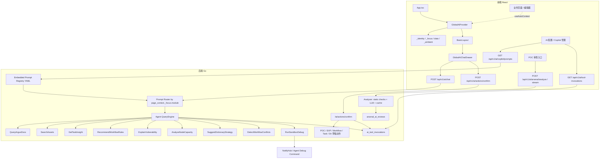

# Argus AI Copilot 当前进度与后续计划

> 分支：`main`
>
> 更新时间：2026-07-14

> 2026-07-14 复核说明：本次仅更新文档同步时间和可执行验证命令。当前代码未新增需要改变 Copilot 动作白名单、审计边界或上下文协议的能力；仍保持草稿优先、人工确认、租户隔离和审计留痕。

本文用于同步当前 AI Copilot / POC AI / EXP Builder 能力的实现状态、架构边界、收口风险和后续推进计划。当前阶段的重点不是重新定义愿景，而是把已经在分支中形成的能力梳理清楚，避免结构化 POC 审查、Python EXP 生成和全局 Copilot 对话几条线互相覆盖。

> 关联文档：[implementation-status.md](implementation-status.md)

## 1. 当前实现进度

| 模块 | 进度 | 状态 |
|------|-----:|------|
| POC AI 结构化审查 | 82% | 静态检查、LLM 审查、缓存表、流式审查入口和兼容入口已恢复 |
| AI 配置页 | 94% | 支持 Base URL、API Key 脱敏、模型列表、连接测试；已扩展为 Copilot Prompt、动作白名单与审计管理入口 |
| 全局 Copilot 前端 | 98% | 分层 Context、悬浮入口、抽屉、Markdown、工具折叠、会话重置、POC/EXP 一键应用、保存草稿、pending_action 确认 UI 和管理页入口已搭好 |
| Agent / Tool Calling 后端 | 98% | Agent 循环、模块 Profile、工具白名单、沙箱调试、安全审计、P2 只读工具、P3 草稿动作确认层、审计查询和 Prompt Registry 已实现 |
| 测试与文档 | 94% | AI/API 测试、P3 动作测试、Prompt Registry 测试、前端构建、Agent 调试测试和 diff 空白检查已通过；浏览器验证仍作为人工验收项 |

### 1.1 已落地

- AI 配置能力：服务端保存 `ai_base_url`、`ai_api_key`、`ai_model`，前端支持读取、脱敏展示、保存、拉取模型列表和连接测试。
- POC AI 审查基础：已具备 POC 静态检查、危险 payload 检测、重复候选匹配、Workflow 引用提示、OpenAI-compatible LLM 审查和按内容 hash 缓存。
- 审查结果持久化：`arsenal_ai_reviews` 保存 suggestion、confidence、issues、duplicate_candidates、raw_response、provider、model 和 created_by。
- 全局上下文注入：`GlobalAIContext` / `useAutoContext` 已升级为分层上下文，前端发送 `_identity`、`_focus`、`data`、`_ambient`，页面旧上下文字段会合并进 `data`。
- 全局入口与抽屉：`BasicLayout` 已增加可拖拽悬浮按钮，`GlobalAIChatDrawer` 已支持打开、输入、SSE 读取、工具状态展示和流式取消。
- Copilot 抽屉体验：已支持 Markdown 标题、列表、引用、代码块、链接渲染，工具调用会以可折叠记录展示，支持停止生成和会话重置。
- 可控编辑体验：POC 与 EXP 编辑器会注册为 Copilot 可编辑目标；POC 仍应用 fenced `yaml`，EXP 只应用 fenced `python`。应用后可继续由用户点击“保存草稿”，不会自动审核、发布或执行。
- 模块化 Copilot Profile：后端会优先根据 `page_context._focus.module` 选择系统提示词和工具白名单，兼容旧的 `page_context.module`；POC、EXP Builder、任务、资产、节点、结果、弹药库等模块按需启用工具。
- Prompt Registry：参考 `_ref_claude_code` 将 Copilot base prompt、模块追加段、工具白名单、别名和最大轮次集中维护在 `server/internal/api/prompts/copilot_profiles.yaml`，Go 侧仅负责 embed 加载、解析和路由，不再把提示词正文硬编码在 handler 中。
- 上下文安全处理：发送给 LLM 前会脱敏 `token`、`api_key`、`authorization`、`password`、`secret` 等字段，并裁剪超长字符串和大型数组。
- 只读业务工具：已新增 `SearchAssets`、`GetTaskInsight`、`RecommendWorkflowRules`，分别支撑资产检索、任务洞察和 Workflow 挂载建议，不新增公开 HTTP 入口。
- P2 平台理解工具：已新增 `ExplainVulnerability`、`AnalyzeNodeCapacity`、`SuggestDictionaryStrategy`、`DetectWorkflowConflicts`，分别支撑漏洞证据解释、节点容量分析、字典策略建议和 Workflow 配置风险检测。
- 工具调用审计：已新增 `ai_tool_invocations` 内部审计表，记录 tenant、user、module、tool、参数摘要、耗时、状态和错误摘要；`poc_content` 只保存 hash 与长度。
- 指纹/弹药库调试：已新增 Workflow 规则调试面板、`/arsenals/finger-debug` 调试入口和 Agent `start_fingerprint_debug` 流程；自定义 POC 调试已在前端、Server、Agent 三层校验挂载信息和安全文件名，避免无效挂载静默启动和临时文件路径逃逸。
- 可控执行动作：已新增 `pending_action` 协议和 `/api/v1/ai/actions/confirm` 确认执行入口；模型只能提出待确认动作，前端展示摘要、风险、预览和权限，用户确认后后端按白名单执行并写入 `ai_tool_invocations` 审计。
- 审计查询闭环：已新增 `/api/v1/ai/tool-invocations`，按租户、用户角色和筛选条件查询 Copilot 工具/动作审计；operator 默认只能看自己的记录，admin 可看同租户记录。
- Prompt 展示闭环：已新增 `/api/v1/ai/copilot/prompts` 只读接口，返回当前 Prompt Registry 的 base prompt、默认 profile、模块 profile、工具白名单、动作白名单、最终 system prompt 和来源文件，便于配置页展示与审阅。
- Copilot 管理页闭环：`/ai-config` 已向 operator 开放 Copilot 管理入口，admin 保留模型连接配置能力；operator 可查看 Prompt Registry、动作白名单和自己的工具/动作审计，admin 可查看同租户审计。

### 1.2 WIP

- `/api/v1/ai/chat` 已作为全局 Copilot 对话入口接入，真实业务工具通过模块白名单挂载，不额外扩散公开接口。
- Agent 循环已支持模型 tool call、工具执行、tool 消息回写和多轮迭代，工具定义输出顺序已稳定化。
- `RunSandboxDebug` 工具已复用现有 POC 调试通道，并校验租户、节点在线状态、Agent 版本、目标 URL、代理和 POC 内容大小；成功、miss、失败、超时、取消都会进入工具审计。
- 分层上下文协议已完成前后端对齐；新增后端测试覆盖 `_focus` 模块识别、`data` 注入、敏感字段脱敏和系统消息分层注入。

### 1.3 待收口

- 还需要继续做浏览器级手动验证，确认 POC、EXP Builder、资产、任务、Workflow 等页面打开 Copilot 时上下文和工具白名单符合预期。
- 还需要继续用真实数据调优各业务工具的结果摘要，特别是任务、漏洞、资产和 Workflow 检测结果的字段裁剪。
- 前端仍可继续优化会话历史持久化、工具结果摘要的可读性、窄屏动效细节和真实页面手测记录。
- P3 当前只开放草稿类白名单动作：`create_poc_draft`、`create_exp_draft`、`upsert_workflow_draft`、`create_task_draft`、`upsert_dir_draft`；高风险动作仍待后续单独评审。

## 2. 架构现状

当前架构应保持两条互补链路：

- **结构化审查链路**：面向 POC 审核闭环，输入是 POC 内容，输出是稳定 JSON 结果，可缓存、可审计、可用于审核门禁。
- **全局 Copilot 链路**：面向交互式辅助，输入是聊天历史和页面上下文，输出是流式回答与工具调用过程，适合解释、生成、排错和引导操作。

两条链路共享 AI 配置和部分底层 LLM Client，但接口契约、返回形态和测试目标应保持独立。

## 3. P0 收口结果

- 已恢复并保留 `/api/v1/ai/arsenal/analyze` 与 `/api/v1/ai/arsenal/analyze/stream`，POC 审查继续返回 `AnalysisResponse`，并继续写入 `arsenal_ai_reviews`。
- `/api/v1/ai/chat` 已明确定位为全局 Copilot 对话入口，不替代结构化审查 API。
- 已统一 SSE 事件契约：
  - `status`：`{ "phase": "...", "message": "..." }`
  - `token`：`{ "content": "..." }`
  - `tool_start`：`{ "name": "...", "args": "..." }`
  - `tool_end`：`{ "name": "...", "result": "..." }`
  - `pending_action`：`{ "action_type": "...", "title": "...", "params": {...} }`
  - `result`：结构化结果或会话结束摘要
  - `error`：`{ "message": "..." }`
- 已修复 `GlobalAIContext.openGlobalAI` 上下文覆盖问题，传入局部 payload 时会与已有 route/module/page state 合并。
- 已修复分层上下文协议不一致问题，前端请求体使用 `_identity/_focus/data/_ambient`，后端按层注入系统消息并兼容旧 flat context。
- 已修复页面上下文丢失问题，`useAutoContext` 仍写入的页面数据会合并进 `data` 层发送给 `/api/v1/ai/chat`。
- 已修复前端构建阻断问题，使用现有 `listTasks` / `API.RootTask`，修复 React 19 `useRef` 初始化和不存在的漏洞状态字段。
- 已加固自定义 POC 调试：前端要求有效产品名、触发阶段、POC ID 和 `include_poc`，Server 创建会话前兜底校验，Agent 写文件前校验安全文件名和临时目录边界。
- 已修复 `server/internal/ai/analyzer_test.go` 的 `fakeChatClient`，补齐 `CompleteWithTools` 和 `StreamWithTools`。
- 已清理 trailing whitespace，并保证 `git diff --check` 通过。

## 4. 后续开发路线

后续开发按“先稳定、再增能、最后可控执行”的顺序推进。每一阶段都应保持公开入口收敛：结构化 POC 审查继续走 `/api/v1/ai/arsenal/analyze`，全局交互继续走 `/api/v1/ai/chat`，新增能力优先作为后端工具挂载到模块 Profile，而不是为每个页面新增接口。

路线图的推进原则：

- 先保证当前分支可合并，再进入新能力开发；任何阻断构建、测试或主链路手测的问题都优先于功能扩展。
- 先做只读理解，再做可控执行；写操作能力必须有确认模型、权限校验、审计记录和失败回滚语义。
- 先完成真实页面验证，再调优模型提示词；避免在没有页面上下文证据的情况下继续堆 Prompt。
- 先复用已有业务接口和工具白名单，再考虑新增后端工具；公开 HTTP API 不因单个页面诉求扩散。

### 4.1 P1：体验与可靠性收口

目标：把当前 AI Copilot 从“可用”推进到“日常可依赖”，优先解决交互稳定性、上下文准确性和工具结果可读性。

范围边界：

- 只处理全局 Copilot、POC AI 审查、AI 配置、弹药库调试和当前已接入页面的稳定性。
- 不新增高风险写操作工具；审计与 Prompt 展示已作为 operator+ 管理入口落地，后续只做小幅体验优化。
- 所有修复必须继续维持 `_identity/_focus/data/_ambient` 分层协议。

交付项：

- 完成浏览器级手动验证：覆盖 `/api/v1/ai/config`、`/api/v1/ai/arsenal/analyze/stream`、`/api/v1/ai/chat`，以及 POC、资产、任务、Workflow、Dashboard、节点页面的 Copilot 打开与上下文注入。
- 优化工具结果摘要：`SearchAssets`、`GetTaskInsight`、`RecommendWorkflowRules` 的返回内容继续裁剪字段，优先给模型和前端可读摘要，避免把原始大 JSON 直接暴露到聊天流。
- 完善会话体验：保留当前会话历史，明确会话重置语义；后续如要跨页面/刷新保留历史，应先限定本地存储大小和敏感上下文清理策略。
- 收紧页面上下文类型：继续减少前端剩余 `any`，将常见上下文字段稳定为 `module`、`route`、`title`、`selected_data`、`entity_id`、`summary`。
- 增加分层上下文回归测试：覆盖 `_focus.module` 路由、`data` 层合并、敏感字段脱敏、超长字段裁剪和系统消息注入。
- 强化失败恢复：AI 配置缺失、模型连接失败、工具执行失败、SSE 中断时，前端提示应可理解，后端错误仍统一走 `error` 事件。

推荐开发顺序：

1. 浏览器手测当前主链路，先记录阻断和非阻断问题。
2. 修阻断问题：构建失败、接口 500、SSE 断流、上下文模块错误、工具无法注册。
3. 补工具结果摘要和错误提示，让真实页面输出可读。
4. 固化测试：把每个已修复阻断问题转成后端、前端或手测清单。
5. 最后做文档同步和合并准备。

验收标准：

- `go test ./server/internal/ai ./server/internal/api` 通过。
- `go test ./scanner/internal/agent` 通过。
- `npm run build`（`server-ui`）通过。
- `git diff --check` 通过。
- 手动验证主链路无阻断：配置 AI、打开 Copilot、普通问答、工具调用、停止生成、重置会话、POC 流式审查。
- 工作区干净，提交中不混入 P2/P3 新功能。

退出条件：

- `main` 可以作为稳定基线继续迭代。
- 已知问题只剩非阻断体验优化，并已记录到后续 P1/P2/P3 任务。
- 回归测试能覆盖上下文协议、工具白名单和敏感数据脱敏。

### 4.2 P2：平台理解能力扩展

目标：让 Copilot 更懂 Argus 的安全业务对象，但仍以只读分析和建议为主，不默认执行写操作。

范围边界：

- 只新增只读工具、工具摘要和模块 Profile，不让工具产生业务副作用。
- 工具结果必须按租户过滤，并做字段裁剪、敏感字段脱敏和大结果截断。
- 每个工具必须明确启用模块；默认 `global` 模块保持少工具或无工具。

交付项：

- 已新增漏洞解释工具：按租户读取漏洞详情、请求/响应证据、严重性、命中位置和修复建议摘要，支持任务结果页和资产页调用。
- 已新增节点容量分析工具：读取节点在线状态、版本、任务数、容量、CPU/内存指标，帮助解释任务慢、任务堆积和节点不均衡。
- 已新增字典策略建议工具：结合目录探测、指纹规则、历史命中和当前资产类型，给出目录字典、指纹规则和 POC 组合建议。
- 已新增 Workflow 冲突检测：只读检查同一产品下重复挂载、无效 POC、禁用规则、match_type 不一致等风险。
- 已扩展模块 Profile：只在对应页面启用对应工具，保持默认模块无工具或少工具，避免模型误调用不相关能力。
- 继续补充漏洞处置知识库：将常见漏洞类型、证据字段、复现路径、修复建议和误报提示整理成可被 `ExplainVulnerability` 引用的轻量知识片段。
- 补充节点版本兼容矩阵：让 `AnalyzeNodeCapacity` 能区分节点离线、版本过旧、容量不足、标签不匹配、队列拥堵等原因。
- 补充字典命中率反馈：让 `SuggestDictionaryStrategy` 能根据历史命中、资产类型和失败原因，输出更可执行的目录/弱口令/指纹策略建议。
- 补充 Workflow 真实数据调优：增加空产品、重复产品、禁用 POC、跨产品误挂载、无触发阶段等样例。

推荐开发顺序：

1. 先做真实数据样例收集，明确每个页面最常问的 3 到 5 个问题。
2. 逐个工具调优返回摘要，保证模型能用较短上下文回答关键问题。
3. 扩展模块 Profile，只在真实页面验证通过后开放对应工具。
4. 补测试：tenant 隔离、空数据、异常数据、大结果裁剪、敏感字段脱敏。
5. 同步文档：记录工具用途、输入参数、启用模块和安全边界。

验收标准：

- 每个新增工具都至少覆盖 tenant 隔离、结果裁剪或风险检测测试；后续真实数据调优时继续补空数据与异常路径。
- `/api/v1/ai/chat` 的 SSE 契约保持兼容；前端继续兼容 `status`、`token`、`tool_start`、`tool_end`、`pending_action`、`result`、`error`。
- 文档同步记录每个工具的用途、启用模块和安全边界。
- 不新增公开 AI HTTP API。

退出条件：

- 资产、任务、任务结果、节点、Workflow、弹药库等核心页面都能触发合适的只读工具。
- 模型即使误调用工具，也不会越租户、泄露敏感字段或返回不可控大结果。
- P2 工具的审计记录可支撑后续 P3 动作确认链路。

### 4.3 P3：可控执行平台动作

目标：把 Copilot 从“解释和建议”推进到“可控执行”，但所有写操作必须有人确认、有审计、有回滚或取消路径。

当前状态：P3 草稿类动作闭环已完成。模型仍不能直接调用业务写接口，只能在回答末尾输出 `pending_action`；前端解析后展示确认卡片，用户确认后调用 `/api/v1/ai/actions/confirm`，后端再按白名单执行。

前置条件：

- P1 已完成稳定合并，主链路无阻断问题。
- P2 只读工具和审计记录稳定，能证明工具调用链路可靠。
- 已明确 RBAC 策略、动作确认 UI、审计字段、失败提示和取消路径。

交付项：

- 已完成 POC 编辑器的第一阶段可控编辑闭环：AI 根据当前 `poc_content` 生成完整 YAML，前端识别代码块后允许用户一键应用到当前 POC 编辑器；应用后用户可在 Copilot 内确认保存草稿，审核仍走原有按钮。
- 已建立统一的动作确认模型：模型只能提出 `pending_action`，前端展示动作摘要、影响范围、参数和风险，用户确认后才调用后端确认入口。
- 已接入草稿类低风险动作：`create_poc_draft` 保存 POC 草稿，`create_exp_draft` 保存 EXP 草稿，`upsert_workflow_draft` 保存 Workflow 草稿，`create_task_draft` 保存扫描任务草稿，`upsert_dir_draft` 保存 Dir 字典草稿；当前不直接删除、审批、发布、执行 EXP、下发任务或修改云资源。
- 所有执行类动作必须写入审计：记录用户、租户、模块、动作、参数摘要、执行结果、错误摘要；`content` 正文只记录 hash 与长度。
- 为高风险动作增加二次确认和 RBAC：规则发布、任务下发、批量资产操作、云资源操作必须至少 operator/admin 权限，并保留人工确认门槛。
- 已建立动作 schema：每类动作定义 `action_type`、`title`、`summary`、`risk_level`、`params`、`preview`、`required_role` 和 `confirm_label`。
- 已建立动作执行层：确认后由后端按白名单执行，并把结果写回前端提示和审计表。
- 已建立草稿优先策略：POC、EXP、Workflow、扫描任务、Dir 字典默认保存为草稿，用户再走原有业务流程发布、审核、调试或执行。

当前动作白名单：

| action_type | 风险等级 | required_role | params | 执行语义 |
|-------------|----------|---------------|--------|----------|
| `create_poc_draft` | low | operator | `file_name`, `content` | 写入 `arsenals(poc)`，状态固定为 `Draft`，审核仍走原有按钮 |
| `create_exp_draft` | low | operator | `file_name`, `content` | 写入 `arsenals(exp)`，状态固定为 `Draft`，审核、发布和执行仍走原有 EXP 流程 |
| `upsert_workflow_draft` | medium | operator | `product`, `type`, `pocs` | 更新 `workflow.yaml` 草稿内容，状态固定为 `Draft`，发布/审核不由 Copilot 自动触发 |
| `create_task_draft` | medium | operator | `project_id`, `name`, `targets`, `config`, `priority`, `timeout_sec` | 写入 `root_tasks`，状态固定为 `Draft`，不会拆分子任务或入队 |
| `upsert_dir_draft` | low | operator | `product`, `paths` | 更新 `dir.yaml` 草稿内容，状态固定为 `Draft`，不会自动发布 |

推荐开发顺序：

1. 已完成 `pending_action` 协议和前端确认 UI。
2. 已接入 POC 草稿和 Workflow 草稿两个最低风险场景，验证确认链路。
3. 已复用 `ai_tool_invocations` 写入动作审计，并新增审计查询 API。
4. 已接 EXP 草稿、任务草稿、Dir 字典草稿等可取消动作。
5. 最后评估高风险动作，但默认仍不开放删除、发布、审批、云资源变更。

验收标准：

- 默认情况下 Copilot 不会自动执行平台写操作。
- 用户确认前，后端不产生业务副作用。
- 审计记录能串联聊天工具调用、用户确认和最终业务操作。
- POC/EXP 一键应用只改变当前前端编辑器内容；保存草稿需要用户在 Copilot 内再次点击确认，审核、发布和执行仍走原有按钮和确认逻辑。
- 取消动作、权限不足、参数校验失败和业务执行失败都能返回可理解的前端提示。

退出条件：

- 首批草稿类动作可用，并通过权限、审计、取消和失败路径测试。
- 高风险动作仍默认关闭，后续需要单独评审后再打开。
- 文档中明确动作白名单、风险等级和人工确认边界。

### 4.4 暂不做事项

- 不引入子 Agent、MCP、插件市场、命令系统等重型框架。
- 不为每个页面新增一个 AI HTTP 接口。
- 不让 `/api/v1/ai/chat` 替代结构化 POC 审查 API。
- 不默认开放删除、发布、审批、云资源变更等高风险动作。

## 5. 合并、发布与回归节奏

### 5.1 当前主线状态

Copilot Context、P2 只读工具、P3 草稿动作、Prompt Registry、审计查询和 Copilot 管理入口已合入 `main`。后续继续以短生命周期任务分支推进，不在主线直接堆叠实验性能力。

当前主线允许继续进入的小步改动：

- 浏览器手测发现的阻断级问题修复。
- 工具摘要、错误提示、上下文类型收紧等 P1/P2 稳定性改动。
- Prompt Registry 内容调优和文档同步。
- 审计与 Prompt 展示页的小幅体验优化。

仍不应直接进入主线的改动：

- 新高风险写操作工具。
- 按页面扩散的新公开 AI HTTP API。
- 会话持久化数据库 schema。
- 大规模样式重构或无关页面重构。

### 5.2 P1 合并后第一轮迭代

第一轮迭代以真实使用反馈为主，建议按以下顺序推进：

1. 建立浏览器手测记录：每个页面记录模块名、注入上下文、可用工具、实际回答和异常。
2. 优化工具摘要：优先处理资产、任务、漏洞和节点四类高频页面。
3. 补齐错误体验：配置缺失、模型不可用、工具失败、SSE 断开、用户取消都应有稳定提示。
4. 统一前端上下文字段：减少页面自行拼接不稳定字段。
5. 把真实阻断样例转为测试，避免回归。

### 5.3 P2 能力扩展节奏

P2 每次只扩展一个业务对象或一个工具，不建议多个模块并行大改：

1. 定义问题清单：这个页面用户会问什么，当前工具缺什么数据。
2. 定义工具输入输出：参数少、结果短、摘要稳定。
3. 加租户隔离和脱敏测试。
4. 接入模块 Profile。
5. 浏览器验证模型是否真的会调用，并观察回答质量。
6. 文档记录工具边界和样例。

### 5.4 P3 后续扩展门槛

P3 首批草稿动作已开启。后续扩展更多动作时仍必须同时满足以下条件：

- P1 主链路稳定，至少完成一次完整浏览器手测。
- P2 只读工具在真实数据下可用，工具审计记录稳定。
- `pending_action` 协议保持兼容。
- 前端确认 UI 能清楚展示动作类型、影响范围、风险和参数。
- 后端 RBAC、参数校验和审计写入有测试覆盖。

P3 首批动作必须是草稿类、可取消、低风险动作；发布、审批、删除、批量变更和云资源操作继续保持关闭。

## 6. 测试与验收标准

当前验证记录：

| 命令 | 当前结果 | 说明 |
|------|----------|------|
| `npm --prefix server-ui run build` | 通过 | 前端类型检查与生产构建已通过，覆盖 Copilot 管理 Tabs |
| `cd server && go test ./internal/ai ./internal/api` | 通过 | AI/Copilot API、P3 动作确认、Prompt Registry 与路由测试已通过 |
| `go test ./scanner/internal/agent` | 通过 | Agent 调试相关测试已通过 |
| `git diff --check` | 通过 | 当前工作区无 trailing whitespace |

后续完成标准：

- `cd server && go test ./internal/ai ./internal/api` 与 `go test ./scanner/internal/agent` 通过。
- `npm --prefix server-ui run build` 通过。
- `git diff --check` 无 trailing whitespace。
- 手动验证 `/api/v1/ai/config`、`/api/v1/ai/arsenal/analyze/stream`、`/api/v1/ai/chat`、`/api/v1/ai/copilot/prompts`、`/api/v1/ai/tool-invocations` 五条主路径，以及 `/ai-config` 动作白名单和 `/config/exploit` 的 EXP Builder Copilot 上下文。

## 7. 明确假设

- 默认以当前 `main` 分支和当前工作区内容为准。
- POC AI 结构化审查不会被全局 Copilot 取代，两者并行：前者负责审核闭环，后者负责交互式辅助。
- 后续开发优先在现有接口和模块 Profile 内扩展能力；接口清单、数据库 schema 文档可在审计表和工具能力稳定后单独补齐。
