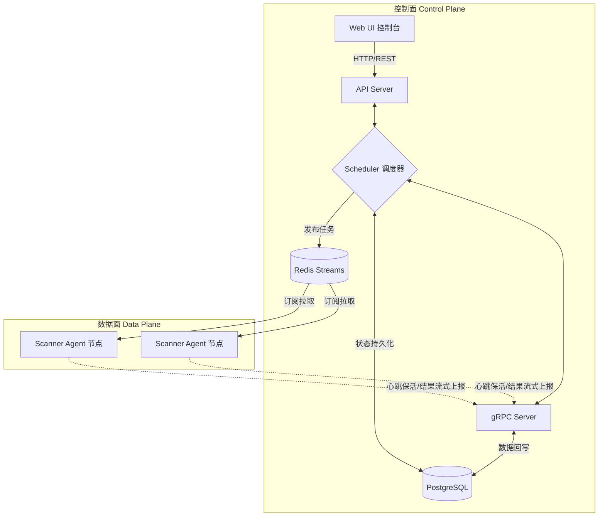
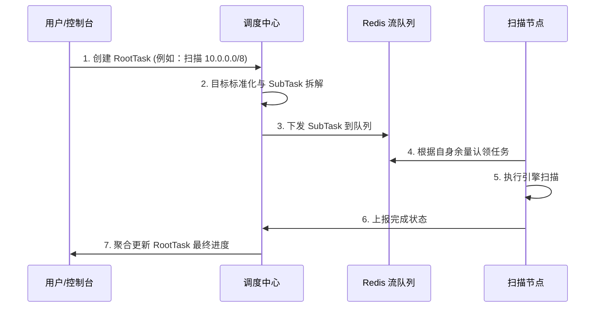
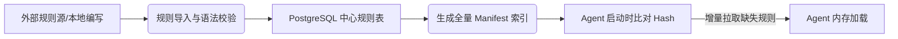

# Argus 分布式攻击面管理与漏洞巡航平台技术白皮书
> 从单机扫描工具到企业级分布式 ASM 控制面的架构演进与实践

---

## 1. 项目背景与问题定义

在当今企业网络安全面临日益复杂的挑战背景下，传统的单机式漏洞扫描和攻击面发现工具在应对大规模、高频次的检测需求时逐渐显得力不从心。

单机工具如 Nuclei、Xray 等，在安全测试的“单点作战”中表现优异，但随着企业数字化转型和资产规模的扩大，它们在企业级应用中暴露出明显的边界：
1. **性能瓶颈**：面对动辄上万甚至百万级的外部资产，单机带宽和 CPU 成为扫描速度的硬性瓶颈。
2. **状态难追踪**：由于缺乏中心化的任务管理，扫描中断后难以恢复，更无法有效追踪长期扫描进度。
3. **数据碎片化**：单次扫描生成的报告分散在各处，缺乏聚合、归档与持续性的时间轴对比，难以形成有效的安全资产画像。
4. **规则治理混乱**：不同安全人员维护各自的规则集（PoC），版本各异，难以进行中心化的质量控制和统一更新。

**因此，Argus 应运而生。** Argus 的设计初衷是为了解决上述问题，引入“控制面（Control Plane）”与“数据面（Data Plane）”分离的云原生架构理念，将原本孤立的扫描节点转变为一个可治理、可调度、可扩展的统一攻击面管理（ASM）平台。

---

## 2. Argus 的平台定位

**Argus 是一个开源的分布式攻击面管理（ASM）与漏洞巡航平台。**

虽然 Argus 依然兼容并吸纳了单机 CLI 工具的高效扫描能力，但其核心价值在于**平台化、分布式、规则中心化与结果聚合化**。它不仅仅是一个执行扫描动作的工具集，更是一个能够纳管资产、编排任务、调度节点并沉淀安全知识库的指挥中心。

### 核心能力边界
- **可横向扩展的数据面**：支持随时随地接入无数个 Scanner Agent 节点，动态感知算力并分配扫描任务。
- **中心化的大脑控制面**：通过 Web UI 与 API，统一下发配置，回收海量结果。
- **统一漏洞知识库**：通过中心化的规则仓库（Arsenal）统一发放与校验规则，保证所有节点动作的一致性。
- **实时结果感知**：结果数据流式回传，落库分析，实现资产画像的自动构建。

| 典型使用场景 | 说明 |
| --- | --- |
| **企业安全基线巡检** | 调度多地机房内的探针节点，进行周期性（Daily/Weekly）的无差别内网或外网资产探活与漏洞扫描。 |
| **0day 漏洞应急响应** | 规则中心导入紧急漏洞 PoC，一键全网下发，分钟级完成数万资产的针对性排查。 |
| **红队攻击面信息收集** | 高并发任务调度，结合多节点分布式 IP 出口，防止单点 IP 被封禁，全面梳理目标资产暴露面。 |

---

## 3. 总体架构设计

Argus 采用了控制面与数据面彻底分离的设计，整体架构具有极强的弹性和解耦特性。

### 3.1 控制面（Control Plane）
控制面是整个 Argus 平台的大脑，主要由 API Server、调度器和 gRPC Server 组成。
- **职责**：负责接管用户交互（API/Web）、保存长效状态（PostgreSQL）、处理任务拆分与调度（Redis）、以及对接所有 Agent 节点的心跳与鉴权验证（gRPC）。
- **组件分工**：
  - **PostgreSQL**：作为唯一事实来源（Source of Truth），存放用户、资产目录、节点状态、规则清单和漏洞告警。
  - **Redis Streams**：作为高性能任务下发队列，利用消费者组（Consumer Group）机制保证分布式任务的不重复、不丢失。

### 3.2 数据面（Data Plane）
数据面由多个分布式的 Scanner Agent 构成。
- **职责**：负责从 Redis Streams 拉取由控制面拆分好的轻量级子任务（SubTask），执行真实的 TCP 探活、指纹识别、PoC 验证等操作，并将结果及自身健康度实时反馈给 gRPC Server。
- **设计哲学**：Agent 被设计为“无状态且用后即抛”的，任何 Agent 断线不会导致任务彻底失败，控制面会通过 Redis 队列的超时重写机制进行回收补发。

---

## 4. 核心业务闭环

Argus 的系统运转并不依赖于混乱的网状通信，而是基于四条清晰的主线业务闭环。

### 4.1 任务闭环（Task Lifecycle）
控制面接收任务，通过调度器削峰填谷。

### 4.2 节点闭环（Node Lifecycle）
节点生命周期严格受控，杜绝“僵尸节点”占用资源。
1. **注册（Register）**：Agent 启动，向 gRPC 端口发起注册请求，上报 CPU/内存余量及并发上限。
2. **心跳（Heartbeat）**：每隔指定秒数向控制面发送存活脉冲包。
3. **掉线识别与回收**：若控制面连续未收到心跳，将节点标为 Offline，并在 Redis 中收回该节点认领但未完成的任务（Dead Letter Queue 处理机制）。

### 4.3 规则闭环（Rule Lifecycle）
规则治理不再是把 yaml 文件拷贝到服务器，而是真正的中心化同步。

### 4.4 结果闭环（Result Lifecycle）
摒弃单机大文件生成的做法，采用流式、分层落库方案。
1. **流式回传**：Agent 扫出一个结果便通过 gRPC 吐出一个结果，不占本地内存。
2. **防洪落库**：控制面接收到海量结果后不立即 Insert DB，而是放入 `BatchWriter` 进行内存缓冲，批量持久化。
3. **三层建模**：结果被立体化地归类存储在“资产（Host/IP）”、“指纹（Service/Web）”、“漏洞（Vulnerability）”三个表中，为前端数据看板提供结构化支撑。

---

## 5. 关键技术设计

### 5.1 Redis Streams 分布式调度模型
为什么不使用 RabbitMQ 或 Kafka？在 ASM 场景下，任务通常具有突发性。Redis Streams 原生支持 Consumer Group 机制，不仅提供了完善的 `XACK`（消息确认）和 `XCLAIM`（未响应消息所有权转移），而且具备极低的部署维护成本。通过合理利用这些特性，Argus 确保了分布式任务分发的“至少执行一次”语意和崩溃恢复能力。

### 5.2 并发解耦的无状态执行器
Argus 扫描引擎抛弃了传统工具中常见的全局变量锁定，实现了真正的全量并发。任何 `scanner/internal` 下的任务执行完全依赖 Context 的上下文传递，确保各并发协程之间互不干涉，充分榨干单机硬件的 CPU 性能。

### 5.3 BatchWriter 防洪存储机制
当全网进行扫描时，数千个 Agent 同时回调大量端口和服务信息，直接对接 RDBMS 将造成巨大的 I/O 阻塞。为此，系统在数据写入链路加入了 `BatchWriter` 层，将高频单次 Insert 转换为基于时间和数量双重阈值的批量事务提交（Bulk Insert），在大幅提升写入 TPS 的同时保护了底层 PostgreSQL 的稳定性。

---

## 6. 前端控制台与运营能力

Argus 不仅强调后端的健壮，同样注重前端的人机交互体验与高阶呈现。Web 界面遵循现代化、Glassmorphism 设计语言。

- **动态工作台（Dashboard）**：呈现当前所有在线 Agent 的实时负载、近期任务完成概览与漏洞告警分布图。
- **资产画像系统**：不仅是枯燥的表格，前端支持对 IP 历史暴露面变迁、端口服务指纹变化进行追溯与搜索聚合。
- **任务大盘**：支持查看根任务与子任务的下发进度与错误日志溯源。
- **角色权限控制**：基于角色的 UI 管理能力（展示与操作鉴权，*此链路正在持续优化完善中*）。

---

## 7. 当前实现状态与边界

为了清晰认知，以下是对 Argus 平台当前能力的真实呈现：

### 7.1 已落地并跑通的主链路
- [x] 分布式微服务架构底座建设。
- [x] 基于 gRPC 的 Agent 动态注册、心跳保活与状态同步。
- [x] Redis Streams 的任务并发下发、削峰填谷与消费组调度。
- [x] PostgreSQL 中目标扫描结果的三层模型化存储。
- [x] Argus UI 现代化玻璃态视觉交互与多套管理页面。

### 7.2 正在优化与闭环中的能力
- [ ] **Agent 鉴权链路增强**：目前 Agent 注册主要依赖基础可达性，更严格的 JWT/Token 加密校验正在集成中。
- [ ] **前端假接口替换**：如云管理（CloudManagement）等界面的后端实际对接正在逐步填充。
- [ ] **RootTask 终态收敛逻辑**：强化从千万级 SubTask 中准确判定并修改父级 RootTask 完成状态的高效算法。

### 7.3 暂未包含（规划中）的边界
- 当前未内置原生基于 LLM 的全自动漏洞审核机制。
- 当前不直接承担云资源编排（如调用 K8s API 自动弹容）。

---

## 8. 典型落地场景

### 场景 A：红队外网资产高频巡航
- **痛点**：红队任务期间需频繁探测数千子域名与开放端口，使用同一出口 IP 极易被防火墙封禁。
- **Argus 方案**：将 Agent 部署在多个不同云厂商的低配 VPS 上，通过控制台下发资产列表，调度器会自动将目标切片分配给各地 Agent，实现分散 IP 的高频指纹与漏洞探测，有效规避单点防护策略。

### 场景 B：安服企业内定期基线排查
- **痛点**：对于跨越多地数据中心的企业，单点排查工具无法触达隔离网段，导致安全排查费时费力。
- **Argus 方案**：在每个网段或机房部署内部 Agent。运维团队只需在中央控制面一键下发新的高危漏洞 PoC 任务，各网段 Agent 会拉取针对自身网段的目标进行检查，最终结果汇总于统一控制面板，极大降低人力成本。

### 场景 C：安全团队漏洞规则统一治理
- **痛点**：安全研究员产出的漏洞脚本无法标准化分发，各人手里的工具能力参差不齐。
- **Argus 方案**：设立中心化的 Arsenal（武器库），所有 PoC 入库并通过验证后，平台自动分发至全量 Agent 节点进行热加载。实现“一处更新，全网具备拦截检测能力”。

---

## 9. 演进路线图

Argus 将沿着云原生、高自治方向持续演进。

### 近端计划（近期核心目标）
- 打通和加固 Agent 与控制面的强安全双向鉴权。
- 完善并修复 Cloud、Build 页面对应 API，实现全 UI 闭环。
- 优化 RootTask 的精确进度计算和终态收敛效率。

### 中期计划
- **节点容量与标签化调度**：支持依据不同 Agent 的“性能标签”、“网络位置标签”进行靶向任务投递。
- **全链路遥测与可观测性**：集成 OpenTelemetry，对分布式任务执行性能、延迟进行深度 Trace 监控。
- **Clean Architecture 深度重构**：将现有数据流逻辑进一步分层，提升代码的长期可维护性。

### 远期愿景
- 真实融入云资源调度：与 K8s 等容器平台联动，任务积压时自动拉起新 Pod，消费完毕自动销毁。
- 基于容器级隔离的恶意插件/规则安全执行环境。
- 融合 AI 辅助能力：对复杂资产关联进行分析与对误报漏洞进行智能预判。

---
> Argus 致力成为企业安全资产与漏洞管理的基石，用技术消除安全运营过程中的重复劳动与盲区。
