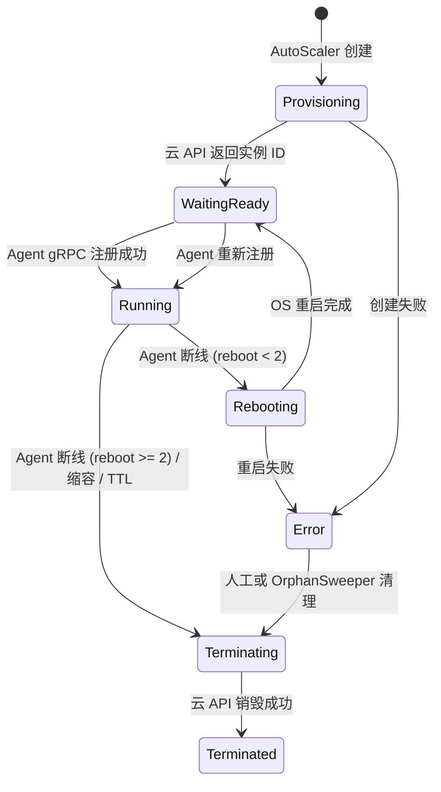
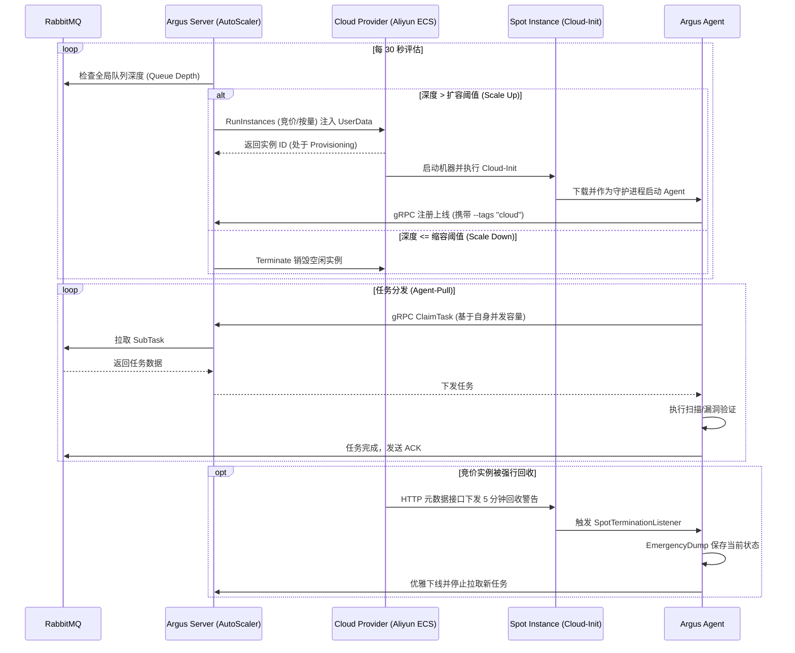

# Argus 云资源动态调度 (Cloud Resource Scheduling)

本文档专门记录 Argus 平台从静态 Docker/节点接入向云原生弹性伸缩架构（云资源动态调度）演进的设计理念、架构细节与实现状态。

## 1. 架构目标

随着分布式扫描的推进，单靠静态配置的 Agent 节点难以应对以下场景：
1. **突发高并发任务**：遇到十万级目标时，固定节点处理过慢。
2. **成本控制**：任务空闲时，大量闲置计算节点浪费云资源。
3. **红队规避封禁**：单一出口 IP 极易被目标安全设备拦截，需要动态切换大量分散的公网 IP。

**目标**：实现一个高度自治的 **AutoScaler (自动伸缩引擎)**，根据队列深度、伸缩策略，自动向云厂商 (如阿里云、AWS) 申请竞价实例 (Spot Instances)，自动注入配置并拉起 Agent，并在任务空闲或实例生命周期到达后自动销毁，实现算力的**按需分配与随用随弃**。

---

## 2. 核心架构设计

### 2.1 模块构成

云资源调度逻辑集中在 `server/internal/cloud/`，由以下核心模块组成：

| 模块 | 职责 | 实现文件 |
|------|------|----------|
| **AutoScaler** | 核心调度引擎，负责 30s 一次的评估决策（扩缩容判定）、实例对账、孤儿回收。 | `autoscaler.go` |
| **Provider Factory** | 注册表模式工厂，提供各云厂商实现的创建入口，打破包循环依赖。 | `provider_factory.go` |
| **CloudProvider** | 屏蔽底层云厂商差异的抽象接口（定义 `Provision` / `Terminate` / `List`）。 | `provider.go` |
| **Aliyun ECS** | 阿里云的具体 Provider 实现，负责调用阿里云 SDK 执行实例生命周期、**多可用区+多规格 NoStock 重试**、可用区库存路由和价格查询。 | `aliyun/ecs.go` |
| **Aliyun OSS** | 阿里云 OSS 客户端，负责 Agent 二进制分片上传和预签名 URL 生成。 | `aliyun/oss.go` |
| **OSS Distribute** | Agent 二进制分发抽象层，OSSUploader 接口 + 预签名 URL 生成。 | `oss_distribute.go` |
| **ResourceManager** | 实例级管理器，桥接 Provider API 与 PostgreSQL 数据库状态同步。 | `manager.go` |
| **Cloud-Init** | 实例初始化模板引擎，注册 systemd 服务并注入 OSS 下载 URL。 | `cloudinit.go` |
| **Crypto** | AES-256-GCM 凭证加解密层，保护云厂商 AccessKey 落库安全。 | `crypto.go` |

### 2.2 数据库模型

数据模型存储在 `server/internal/db/cloud_models.go` 中，分为三层：

1. **`CloudAccount` (云账号)**：存储不同云厂商的访问凭证 (AK/SK 加密存储)，并记录凭证 owner。
2. **`CloudAccountBinding` (凭证绑定)**：记录当前租户内哪些用户可使用某个 AK/SK。
3. **`CloudScalingPolicy` (伸缩策略)**：配置扩缩容阈值 (`scale_up_threshold`, `scale_down_threshold`)、最大最小实例数、竞价策略、TTL 以及基础模板（如镜像、安全组）。
4. **`CloudInstance` (云实例)**：映射真实的云主机，维护其从 `Provisioning` 到 `Running` 再到 `Terminated` 的状态机，并与 `AgentID` 绑定。

---

## 3. 核心流转机制

### 3.1 自动扩缩容决策 (30s 评估循环)

AutoScaler 作为一个守护协程，每 30 秒执行一次全局评估：

- **Scale Up (扩容)**：
  - 条件：`queue_depth > scale_up_threshold` 且 `running_instances < max_instances`。
  - 动作：计算所需实例数（每实例承载约 256 个目标），并发调用 Provider 创建实例，并向新实例写入 Cloud-Init UserData。
- **Scale Down (缩容)**：
  - 条件：`queue_depth <= scale_down_threshold` 且存在空闲实例（关联的 Node.RunningTasks == 0，且运行时长 > 10 分钟）。
  - 动作：向云厂商发起 Terminate 请求，销毁底层实例。

### 3.2 实例状态收敛与三重兜底

为了防止因为网络异常或进程崩溃导致云端计费流失，设计了三套兜底机制：

1. **HeartbeatReaper (心跳判死 + 梯度容错 - 30s)**：每 30 秒扫描所有 `Alive` 状态但超过 60 秒无心跳的 Agent 节点。一旦判定死亡：
   - 回收该节点持有的所有 `Running` 子任务，退回队列重新调度给其他存活节点。
   - **查询 `cloud_instances` 表**：若该 `agent_id` 关联了一条活跃的云实例记录，执行**梯度容错策略**：
     - `reboot_count < 2`：调用云厂商 `RebootInstance` API 对实例执行 OS 级强制重启。由于 Agent 进程通过 systemd `Restart=always` 配置守护，系统重启后 Agent 将自动拉起并重新注册。实例状态转为 `Rebooting` → `WaitingReady`。
     - `reboot_count >= 2`：已经重启过 2 次仍然无法恢复，说明可能是底层硬件故障或镜像损坏，直接调用 `TerminateInstance` 销毁机器。
   - 10 分钟无心跳的 `Offline` 节点将从数据库中彻底删除。
2. **Reconciler (实例对账 - 5min)**：查询数据库中标记为 `Running` 的实例，向云厂商拉取真实列表；若云端已不存在，则修正数据库状态为 `Terminated`。
3. **OrphanSweeper (孤儿回收 - 10min)**：扫描存活时间超过策略设定的 `instance_ttl_minutes` 的实例。若实例仍有运行中任务，会先延后回收；超过 `instance_ttl_minutes + 30min` 宽限期仍未空闲才强制销毁，防止异常实例无限计费。

> **设计意图**：三重机制形成梯度防御——HeartbeatReaper 以**先重启、再销毁**的柔性策略提供分钟级响应，避免因短暂的进程崩溃就浪费一台已预热的机器；Reconciler 覆盖**云端状态偏差**的修复；OrphanSweeper 是最终的**兜底安全网**。

**当前实现约束（已与代码同步）**

- `WaitReady` 只表示云主机在 OS 层面可达，控制面此时只会回填实例 IP，并保持 `cloud_instances.status = WaitingReady`。
- 只有当 Agent 成功调用 gRPC `Register` 后，服务端才会同时更新 `nodes` 与对应的 `cloud_instances`，把实例提升为 `Running` 并写入 `ready_at`。
- 人工重启与 HeartbeatReaper 触发的重启都会先进入 `Rebooting`，待云主机重新 ready 后回到 `WaitingReady`，继续等待 Agent 重新注册，而不是直接视为恢复完成。

### 3.3 Agent 二进制分发机制

云实例通过 Cloud-Init 脚本在启动时自动下载并部署 Agent。**OSS 预签名 URL 是唯一的分发通道**：

| 方式 | 下载速度 | 安全性 | 备注 |
|------|----------|--------|------|
| **OSS 预签名 URL** | 内网 > 200MB/s | 预签名 URL，1 小时过期 | CloudAccount 必须配置 `oss_bucket` + `oss_endpoint` |

> **设计决策**：早期版本曾设计 Server HTTP Fallback 作为未配置 OSS 时的兜底下载方式，但在实践中发现：(1) Server 本身没有注册文件下载端点，该路径实际不可用；(2) 走公网带宽下载 ~100MB 二进制在高并发冷启动场景下必然成为瓶颈。因此在 v5.4 修订中移除 Fallback 逻辑，**ProvisionInstance 在 OSS 未配置时直接报错**，强制要求凭证配置 OSS 或通过一键配置自动创建。

**当前实现约束（已与代码同步）**

- Cloud-Init 中注入给 Agent 的 `--server` / `--api` 地址必须是可路由地址。系统会优先使用 `ARGUS_PUBLIC_IP` 与 `ARGUS_PUBLIC_API`；未设置时会自动探测本机的出站地址，不再把 `0.0.0.0` 写入实例脚本。
- 默认 Cloud-Init 模板与前端模板保持一致，Agent 启动参数使用 `--tags "cloud=true,auto_scaled=true,target_type=all"`；若配置了 PSK，则额外追加 `--psk`。
- 一键配置在返回成功前会同步校验 `argus/agent/argus-agent-linux-amd64` 是否已经可用；缺失时会尝试上传，仍不可用则直接报错，避免后续新实例反复下载 404。

**OSS 分发完整流程：**

**操作步骤：**

1. 在 **云凭证管理** 中创建凭证时填写 OSS Bucket 和 Endpoint
2. 点击凭证行的 **"上传 Agent"** 按钮，将 `release/` 中的 Agent 二进制上传到 OSS
3. 也可以直接执行 **OneClickSetup**；若 OSS 已配置，服务端会先验证所需 Agent 制品已经可用，再继续创建默认伸缩策略
4. 后续所有通过该凭证创建的云实例，Cloud-Init 将自动从 OSS 下载 Agent

**一键配置的失败处理：**

- 缺少交换机时，优先选择 `DescribeZones` 明确支持创建 `VSwitch` 的可用区；能力字段缺失的旧响应仅作为后备。遇到 `OperationDenied.ZoneIsDisabled` 时，在同一地域、同一 VPC 内尝试下一候选；权限拒绝、CIDR 冲突及其他错误直接返回，不盲目重试创建。
- 一键配置页面单独等待最多 180 秒，以容纳资源发现、网络资源轮询和 Agent 上传；其他接口维持原有超时。超时并不撤销后端已创建的资源，请先刷新配置和云端资源状态再重试。
- OSS 返回 `UserDisable` / `0003-00000801` 时，应由账号所有者检查 OSS 开通、欠费或账号停用状态，参见 [阿里云错误说明](https://help.aliyun.com/zh/oss/user-guide/0003-00000801)。增加 RAM 权限不能替代开通服务。
- 服务端必须能读取 `release/argus-agent-linux-amd64`（或 OSS 已有对应制品）。容器部署需将该发布文件纳入镜像或以只读目录挂载到服务工作目录下的 `release/`；可用 `./build.sh agent --target linux/amd64` 构建，不能用 macOS 或 ARM 二进制替代。
- 一键配置保持默认伸缩策略关闭，不创建 ECS 实例。启用策略前还需确认 Agent 能访问 Server 的 API/gRPC 地址。

### 3.4 Spot 竞价实例回收感知

- **Agent 侧**：启动时检测到环境变量 `ARGUS_SPOT=1` 或 `cloud` 标签时，激活 `StartSpotTerminationListener`（`scanner/internal/agent/signal.go`）。
- **中断响应**：Agent 每 30 秒轮询阿里云元数据接口 `http://100.100.100.200/latest/meta-data/instance/spot/termination-time`，感知到回收警告后立即触发 `EmergencyDump` gRPC。
- **Server 端处理**（`server/internal/grpc/server.go:EmergencyDump`）：
  1. 将 Node 立即标记为 `Offline`，防止 HeartbeatReaper 60 秒超时后重复处理
  2. 回收该 Agent 所有 `Running` 子任务，ACK 旧消息并重新入队给其他存活节点
  3. 通过 `NotifyHub` 广播回收的任务数量，触发在线 Agent 立即认领
  4. 将关联的 `CloudInstance` 标记为 `Terminating`（Spot 回收后云端会自动销毁）
- **零任务丢失**：整个流程从 Agent 感知到 Server 完成任务回收，耗时 < 1 秒，远在 5 分钟回收窗口内。

### 3.5 云端任务分发逻辑 (Agent-Pull 协同)

虽然计算资源（实例）是云端动态创建的，但 Argus 的任务分发核心依旧严格遵循**按需拉取 (Agent-Pull)** 架构，结合 RabbitMQ 实现对云端动态实例的无缝分发：

1. **去中心化认领**：Server 端（AutoScaler）只负责根据全局队列深度（Queue Depth）来决定是否要“买机器”。它**绝对不会**硬性指定某台云主机去执行特定的任务。
2. **实例自启动与融入**：通过 Cloud-Init 拉起的 Agent，启动后会自动通过 gRPC 连接 Server，成为一个标准算力节点。
3. **基于信号量的弹药消耗**：Agent 一旦上线，就和普通的物理机节点一样，通过 `NotifyHub` 接收队列更新广播，并根据自身的并发池限制，主动向 Server 发起 `ClaimTask`。
4. **中断容错**：即使发生极端情况（云实例直接被底层基础设施强杀、无响应），该节点上正在执行的子任务也会因为未能向 RabbitMQ 发送 `ACK`，在超时后被 RabbitMQ 和服务端抢救协程（staleSalvage）自动安全回收，并重新投递给其他存活节点，实现**零状态丢失**。

---

## 4. API 设计 (31 项能力)

云管控 REST API 当前由 `server/internal/api/handler_cloud_*.go` 各领域处理器实现，并通过 `server/internal/api/cloud_handler.go` 统一注入运行依赖；通用云服务编排位于 `server/internal/api/cloud_services.go`，Provider 与 AutoScaler 位于 `server/internal/cloud/`。

| 领域 | 动作 | API 路径 | 备注 |
|------|------|----------|------|
| **凭证** | List | `GET /cloud/accounts` | 返回脱敏 AK |
| **凭证** | Create | `POST /cloud/accounts` | AES-256-GCM 加密存储 |
| **凭证** | Update | `PUT /cloud/accounts/:id` | 更新凭证配置（区域、镜像、安全组等） |
| **凭证** | Delete | `DELETE /cloud/accounts/:id` | 仅当无活跃实例且无绑定伸缩策略时允许删除 |
| **凭证** | Test | `POST /cloud/accounts/:id/test` | 测试云端连通性 |
| **凭证** | Bindings | `GET/PUT /cloud/accounts/:id/bindings` | 查询或更新同租户用户绑定关系 |
| **凭证** | OSS Upload | `POST /cloud/accounts/:id/oss/upload` | 从 Server release/ 上传 Agent 到 OSS |
| **凭证** | OSS Local Upload | `POST /cloud/accounts/:id/oss/upload-local` | 前端本地文件直传 OSS |
| **凭证** | OSS Test | `POST /cloud/accounts/:id/oss/test` | 测试 OSS 连通性 |
| **凭证** | OSS Files | `GET /cloud/accounts/:id/oss/files` | 列出 OSS 中的 Agent 制品 |
| **凭证** | OSS Delete | `POST /cloud/accounts/:id/oss/delete` | 删除 OSS 中指定文件 |
| **凭证** | Release Files | `GET /cloud/accounts/:id/release-files` | 列出 Server 本地 release/ 目录 |
| **凭证** | Regions | `GET /cloud/accounts/:id/regions` | 查询云厂商所有可用地域 |
| **凭证** | Discover | `GET /cloud/accounts/:id/discover` | 自动探测云资源（ECS 规格、镜像、安全组、交换机） |
| **凭证** | AutoConfigure | `POST /cloud/accounts/:id/auto-configure` | 保存探测结果到凭证配置 |
| **凭证** | OneClickSetup | `POST /cloud/accounts/:id/one-click-setup` | 一键配置：探测 + 自动创建网络/OSS + 校验 Agent 制品就绪 + 建策略 |
| **凭证** | Permissions | `GET /cloud/accounts/:id/permissions` | AK/SK 权限检查（STS 身份 + RAM 策略比对） |
| **凭证** | Price | `GET /cloud/accounts/:id/price` | 实时价格查询（按量/竞价），支持 `region` 参数覆盖 |
| **凭证** | InstanceTypes | `GET /cloud/accounts/:id/instance-types` | 有库存的实例规格列表（含 CPU/内存），支持 `region`、`spot_strategy` 参数覆盖 |
| **凭证** | Recommendations | `GET /cloud/accounts/:id/recommendations` | 只查询单个地域的库存与价格；默认使用凭证地域，支持 `region`、`spot_strategy` 参数覆盖 |
| **策略** | List | `GET /cloud/policies` | - |
| **策略** | Create | `POST /cloud/policies` | - |
| **策略** | Update | `PUT /cloud/policies/:id` | - |
| **策略** | Delete | `DELETE /cloud/policies/:id` | - |
| **策略** | Toggle | `POST /cloud/policies/:id/toggle` | 动态启停伸缩策略 |
| **实例** | List | `GET /cloud/instances` | 实例列表查询 |
| **实例** | Create | `POST /cloud/instances` | 手动弹容（含可用区智能路由 + 价格预估 + 地域/规格覆盖） |
| **实例** | Delete | `DELETE /cloud/instances/:id` | 人工强制缩容 |
| **实例** | Reboot | `POST /cloud/instances/:id/reboot` | OS 级重启；重启后回到 `WaitingReady` 等待 Agent 重注册 |
| **实例** | Cleanup | `POST /cloud/instances/cleanup` | 清理当前用户可访问范围内的终态实例记录 |
| **大屏** | Dashboard | `GET /cloud/dashboard` | 活跃账号数、实例统计与最新事件 |

### 云凭证删除与策略依赖

在「API 凭证管理」删除凭证前，服务端先校验当前租户及凭证管理权限，再检查实例和策略引用。**停用 AutoScaler 策略不会解除其对凭证的引用**；有活动实例或仍有绑定策略时，删除继续被拒绝。

策略依赖导致删除受阻时，API 保留 HTTP 400 和原 `error` 字段，并附带 `code: "cloud_account_has_policies"`、`cloud_account_id`、`policy_count`、`policies` 及 `policies_truncated`。明细只包含当前租户、当前凭证下策略的 `id`、`name`、`enabled`，按名称和 ID 排序，最多返回 20 条；不包含密钥或策略脚本。依赖查询失败时拒绝删除，不将数据库错误作为无依赖处理。

前端显示关联策略名称、启停状态和「查看策略」入口。点击后重新读取有权访问的策略，并核对策略仍绑定该凭证后再定位，避免打开已经删除或改绑的旧记录。刷新失败时保留提示并显示请求错误，可再次查看或关闭。超过 20 条时提示明细未全部展示，可进入策略页核对其余策略的绑定凭证。查看或关闭提示均不会删除策略、修改启停状态或终止实例。

确认不再需要的策略应在策略页按原确认流程处理，再返回凭证页重新尝试删除。最终删除仍重新检查服务端的最新依赖；本功能不自动解除引用或级联删除。

---

## 5. 实现现状与边界

Phase 1-10 已全部合入 `main`：DB 迁移与凭证加密、AutoScaler 决策循环、阿里云 ECS Provider、Cloud-Init 拉起、前端 `CloudManagement` 全量对接、一键配置、OSS 分发管理和 AK/SK 权限检查。历史修订细节见 git 历史与 CHANGELOG。

当前行为要点（补充 §3 未展开的部分）：

- **运行态收敛**：OS ready 只把实例维持在 `WaitingReady`；Agent gRPC `Register` 成功后才进入 `Running`。gRPC `Register` 按 Agent 启动标签 `--tags tenant_id=xxx` 提取租户，回退 CloudInstance 记录，最终兜底 `default`。
- **扩容保护**：AutoScaler 有单轮扩容实例数量上限和统一的扩容冷却记录，避免队列突增导致过量创建。
- **库存韧性**：手动弹容先做可用区兼容预检（`resolveCompatibleVSwitch`）；`NoStock`/规格不可用时自动切换同 VPC 其他可用区并按 c/g/r/e/t/s 系列代际降级重试（`generateFallbackTypes`）；可用区筛选接受 `ClosedWithStock` 限量库存。
- **分发通道**：统一为 OSS。OSS 未配置时 `ProvisionInstance` 直接失败，不存在 Server HTTP 下载回退；公网高并发冷启动下 HTTP 分发必然成为瓶颈，且 Server 从未注册下载路由。
- **默认弹性预设**：前后端统一「经济型弹性扫描策略」——`SpotAsPriceGo` 竞价 + `min_instances=0` + `scale_down_threshold=0` + `instance_ttl_minutes=60`（忙碌实例最多再宽限 30 分钟）。
- **权限检查**：一键配置所需的 19 项 Action（ECS 8 + VPC 5 + OSS 6）通过 STS 身份识别与 RAM 策略比对自动核验，前端提供最小权限策略 JSON。
- **地址注入**：支持 `ARGUS_PUBLIC_IP` / `ARGUS_PUBLIC_API` 显式注入；未设置时自动探测可路由地址，避免向 Cloud-Init 注入 `0.0.0.0`。
- **验证边界**：控制面逻辑以 Cloud Provider mock smoke 和依赖注入测试覆盖；真实云账号下的弹容、回收与 OSS 分发按 [发布检查清单](release-checklist.md) 单独 smoke。

后续扩展（原 Phase 11b）：

- 多云扩展：基于 `CloudProvider` 注册表抽象横向接入 AWS EC2、腾讯云 CVM 等 Provider。
- EventBridge 集成：见 §6.4 Spot 回收感知演进。

---

## 6. 现有架构局限与未来演进

从系统架构和生产级高可用的角度来看，当前的云资源调度设计虽然实现了业务闭环，但在大规模、高并发扫描场景下，仍存在以下优化空间：

### 6.1 扩缩容指标过于单一
- **局限**：AutoScaler 目前仅根据 `queue_depth`（队列深度）单一维度进行判定。这种一刀切的方式无法准确评估算力缺口（例如：大量轻量级的存活探测任务 vs 少数耗时的 Web 漏洞扫描）。
- **演进**：引入多维度评估。结合**预计排队时间 (Estimated Wait Time)**、**现有节点的 CPU/Mem 负载水位**以及**任务类型的耗时权重**进行加权决策。

### 6.2 粗粒度的缩容策略
- **局限**：当前的缩容条件是队列为空且实例处于空闲状态即发起销毁。这在面临“脉冲式”突发任务时，容易引发集群频繁抖动（频繁创建与销毁），不仅增加冷启动开销，还可能浪费云厂商的最低计费时长。
- **演进**：引入**阶梯式缩容 (Cooldown)**，并结合云厂商计费周期的**踩点回收**（如：在按小时计费周期结束前 5 分钟再执行释放），最大化利用已购资源。

### 6.3 冷启动效率瓶颈
- **局限**：当前 Cloud-Init 通过 OSS 内网下载 Agent 二进制（约 100MB），正常耗时约 10-30 秒。跨地域 OSS 下载可能更慢。
- **演进**：优化 Agent 二进制体积（UPX 压缩、按架构拆分），或利用 OSS 多地域同步实现就近下载。

> **关于「黄金镜像」方案**：该方案（将 Agent 预烘焙到系统镜像中）已被评估后放弃。原因：Argus Agent 是单一 Go 二进制，体积约 100MB，通过 OSS 内网下载仅需数秒，预烘焙带来的秒级提升不值得承担镜像维护和版本同步的复杂度。当前架构使用**公共镜像 + OSS 分发**，兼容所有实例系列（含 `ecs.e` 经济型），无需自定义镜像。

### 6.4 Spot 实例回收感知的盲区
- **局限**：系统依赖 Agent 侧 30 秒轮询元数据接口获取 5 分钟警告。`EmergencyDump` 已实现完整的任务回收和云实例状态同步，但在极端资源枯竭情况下，云厂商可能跳过警告直接强杀，导致 `EmergencyDump` 无法执行。此时 HeartbeatReaper 60 秒超时仍为兜底。
- **演进**：在管控层面打通云厂商的事件总线（如 Aliyun EventBridge / AWS EventBridge）。当底层基础设施产生实例释放事件时，通过 Webhook 毫秒级推给 Server 端，实现对 Agent 无法触发 EmergencyDump 场景的补充覆盖。

### 6.5 异构算力池支持不足
- **局限**：当前单套调度策略仅支持一种实例规格设定，无法区分“计算密集型”（如暴破）和“网络密集型”（如端口扫描）任务的特定机型需求。
- **演进**：引入 **Node Pools (节点池)** 的概念。根据全局任务的标签要求（如 `requires: compute-optimized`），定向申请高算力或高带宽的异构资源，并为对应的云实例打上专属处理标签，实现精细化负载路由。
