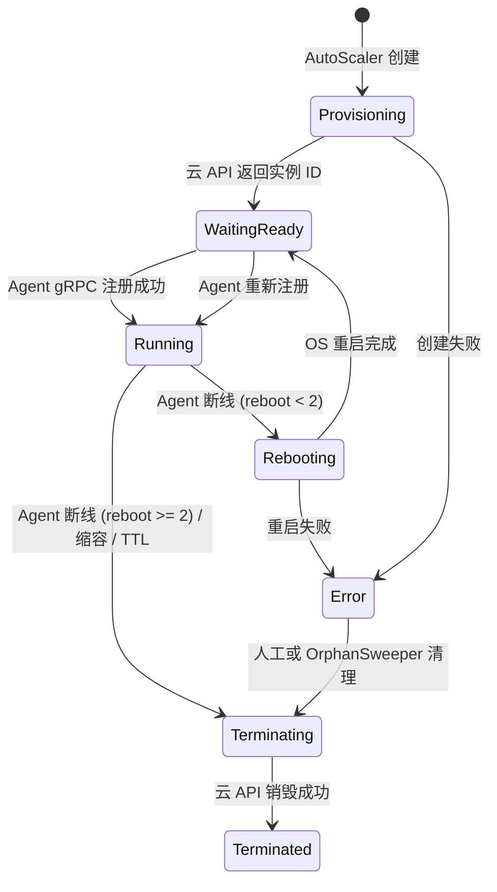
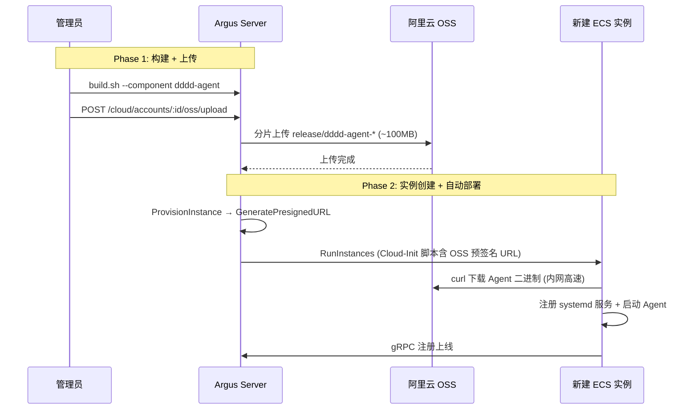
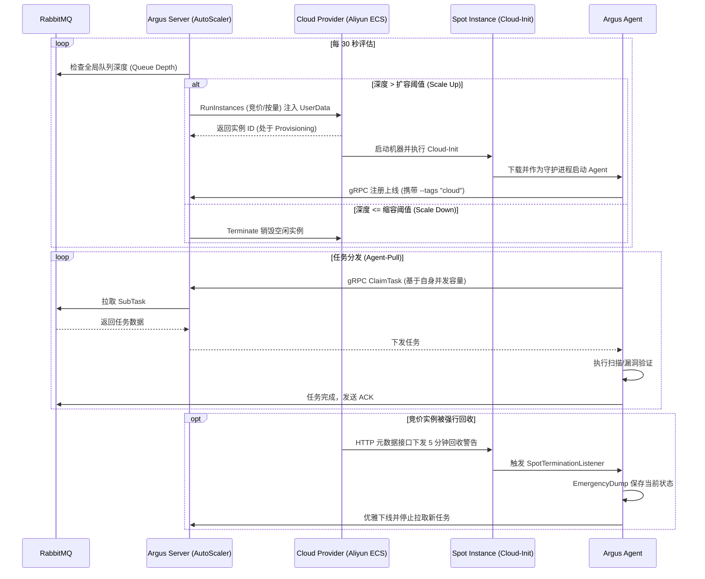

# Argus 云资源动态调度 (Cloud Resource Scheduling)

本文档专门记录 Argus 平台从静态 Docker/节点接入向云原生弹性伸缩架构（云资源动态调度）演进的设计理念、架构细节与实现状态。

## 1. 架构目标

随着分布式扫描的推进，单靠静态配置的 Agent 节点难以应对以下场景：
1. **突发高并发任务**：遇到十万级目标时，固定节点处理过慢。
2. **成本控制**：任务空闲时，大量闲置计算节点浪费云资源。
3. **红队规避封禁**：单一出口 IP 极易被目标安全设备拦截，需要动态切换大量分散的公网 IP。

**目标**：实现一个高度自治的 **AutoScaler (自动伸缩引擎)**，根据队列深度、伸缩策略，自动向云厂商 (如阿里云、AWS) 申请竞价实例 (Spot Instances)，自动注入配置并拉起 Agent，并在任务空闲或实例生命周期到达后自动销毁，实现算力的**按需分配与随用随弃**。

---

## 2. 核心架构设计

### 2.1 模块构成

云资源调度逻辑集中在 `server/internal/cloud/`，由以下核心模块组成：

| 模块 | 职责 | 实现文件 |
|------|------|----------|
| **AutoScaler** | 核心调度引擎，负责 30s 一次的评估决策（扩缩容判定）、实例对账、孤儿回收。 | `autoscaler.go` |
| **Provider Factory** | 注册表模式工厂，提供各云厂商实现的创建入口，打破包循环依赖。 | `provider_factory.go` |
| **CloudProvider** | 屏蔽底层云厂商差异的抽象接口（定义 `Provision` / `Terminate` / `List`）。 | `provider.go` |
| **Aliyun ECS** | 阿里云的具体 Provider 实现，负责调用阿里云 SDK 执行实例生命周期、**多可用区+多规格 NoStock 重试**、可用区库存路由和价格查询。 | `aliyun/ecs.go` |
| **Aliyun OSS** | 阿里云 OSS 客户端，负责 Agent 二进制分片上传和预签名 URL 生成。 | `aliyun/oss.go` |
| **OSS Distribute** | Agent 二进制分发抽象层，OSSUploader 接口 + 预签名 URL 生成。 | `oss_distribute.go` |
| **ResourceManager** | 实例级管理器，桥接 Provider API 与 PostgreSQL 数据库状态同步。 | `manager.go` |
| **Cloud-Init** | 实例初始化模板引擎，注册 systemd 服务并注入 OSS 下载 URL。 | `cloudinit.go` |
| **Crypto** | AES-256-GCM 凭证加解密层，保护云厂商 AccessKey 落库安全。 | `crypto.go` |

### 2.2 数据库模型

数据模型存储在 `server/internal/db/cloud_models.go` 中，分为三层：

1. **`CloudAccount` (云账号)**：存储不同云厂商的访问凭证 (AK/SK 加密存储)，并记录凭证 owner。
2. **`CloudAccountBinding` (凭证绑定)**：记录当前租户内哪些用户可使用某个 AK/SK。
3. **`CloudScalingPolicy` (伸缩策略)**：配置扩缩容阈值 (`scale_up_threshold`, `scale_down_threshold`)、最大最小实例数、竞价策略、TTL 以及基础模板（如镜像、安全组）。
4. **`CloudInstance` (云实例)**：映射真实的云主机，维护其从 `Provisioning` 到 `Running` 再到 `Terminated` 的状态机，并与 `AgentID` 绑定。

---

## 3. 核心流转机制

### 3.1 自动扩缩容决策 (30s 评估循环)

AutoScaler 作为一个守护协程，每 30 秒执行一次全局评估：

- **Scale Up (扩容)**：
  - 条件：`queue_depth > scale_up_threshold` 且 `running_instances < max_instances`。
  - 动作：计算所需实例数（每实例承载约 256 个目标），并发调用 Provider 创建实例，并向新实例写入 Cloud-Init UserData。
- **Scale Down (缩容)**：
  - 条件：`queue_depth <= scale_down_threshold` 且存在空闲实例（关联的 Node.RunningTasks == 0，且运行时长 > 10 分钟）。
  - 动作：向云厂商发起 Terminate 请求，销毁底层实例。

### 3.2 实例状态收敛与三重兜底

为了防止因为网络异常或进程崩溃导致云端计费流失，设计了三套兜底机制：

1. **HeartbeatReaper (心跳判死 + 梯度容错 - 30s)**：每 30 秒扫描所有 `Alive` 状态但超过 60 秒无心跳的 Agent 节点。一旦判定死亡：
   - 回收该节点持有的所有 `Running` 子任务，退回队列重新调度给其他存活节点。
   - **查询 `cloud_instances` 表**：若该 `agent_id` 关联了一条活跃的云实例记录，执行**梯度容错策略**：
     - `reboot_count < 2`：调用云厂商 `RebootInstance` API 对实例执行 OS 级强制重启。由于 Agent 进程通过 systemd `Restart=always` 配置守护，系统重启后 Agent 将自动拉起并重新注册。实例状态转为 `Rebooting` → `WaitingReady`。
     - `reboot_count >= 2`：已经重启过 2 次仍然无法恢复，说明可能是底层硬件故障或镜像损坏，直接调用 `TerminateInstance` 销毁机器。
   - 10 分钟无心跳的 `Offline` 节点将从数据库中彻底删除。
2. **Reconciler (实例对账 - 5min)**：查询数据库中标记为 `Running` 的实例，向云厂商拉取真实列表；若云端已不存在，则修正数据库状态为 `Terminated`。
3. **OrphanSweeper (孤儿回收 - 10min)**：扫描存活时间超过策略设定的 `instance_ttl_minutes` 的实例。若实例仍有运行中任务，会先延后回收；超过 `instance_ttl_minutes + 30min` 宽限期仍未空闲才强制销毁，防止异常实例无限计费。

> **设计意图**：三重机制形成梯度防御——HeartbeatReaper 以**先重启、再销毁**的柔性策略提供分钟级响应，避免因短暂的进程崩溃就浪费一台已预热的机器；Reconciler 覆盖**云端状态偏差**的修复；OrphanSweeper 是最终的**兜底安全网**。

**当前实现约束（已与代码同步）**

- `WaitReady` 只表示云主机在 OS 层面可达，控制面此时只会回填实例 IP，并保持 `cloud_instances.status = WaitingReady`。
- 只有当 Agent 成功调用 gRPC `Register` 后，服务端才会同时更新 `nodes` 与对应的 `cloud_instances`，把实例提升为 `Running` 并写入 `ready_at`。
- 人工重启与 HeartbeatReaper 触发的重启都会先进入 `Rebooting`，待云主机重新 ready 后回到 `WaitingReady`，继续等待 Agent 重新注册，而不是直接视为恢复完成。

### 3.3 Agent 二进制分发机制

云实例通过 Cloud-Init 脚本在启动时自动下载并部署 Agent。**OSS 预签名 URL 是唯一的分发通道**：

| 方式 | 下载速度 | 安全性 | 备注 |
|------|----------|--------|------|
| **OSS 预签名 URL** | 内网 > 200MB/s | 预签名 URL，1 小时过期 | CloudAccount 必须配置 `oss_bucket` + `oss_endpoint` |

> **设计决策**：早期版本曾设计 Server HTTP Fallback 作为未配置 OSS 时的兜底下载方式，但在实践中发现：(1) Server 本身没有注册文件下载端点，该路径实际不可用；(2) 走公网带宽下载 ~100MB 二进制在高并发冷启动场景下必然成为瓶颈。因此在 v5.4 修订中移除 Fallback 逻辑，**ProvisionInstance 在 OSS 未配置时直接报错**，强制要求凭证配置 OSS 或通过一键配置自动创建。

**当前实现约束（已与代码同步）**

- Cloud-Init 中注入给 Agent 的 `--server` / `--api` 地址必须是可路由地址。系统会优先使用 `ARGUS_PUBLIC_IP` 与 `ARGUS_PUBLIC_API`；未设置时会自动探测本机的出站地址，不再把 `0.0.0.0` 写入实例脚本。
- 默认 Cloud-Init 模板与前端模板保持一致，Agent 启动参数使用 `--tags "cloud=true,auto_scaled=true,target_type=all"`；若配置了 PSK，则额外追加 `--psk`。
- 一键配置在返回成功前会同步校验 `argus/agent/dddd-agent-linux-amd64` 是否已经可用；缺失时会尝试上传，仍不可用则直接报错，避免后续新实例反复下载 404。

**OSS 分发完整流程：**

**操作步骤：**

1. 在 **云凭证管理** 中创建凭证时填写 OSS Bucket 和 Endpoint
2. 点击凭证行的 **"上传 Agent"** 按钮，将 `release/` 中的 Agent 二进制上传到 OSS
3. 也可以直接执行 **OneClickSetup**；若 OSS 已配置，服务端会先验证所需 Agent 制品已经可用，再继续创建默认伸缩策略
4. 后续所有通过该凭证创建的云实例，Cloud-Init 将自动从 OSS 下载 Agent

### 3.4 Spot 竞价实例回收感知

- **Agent 侧**：启动时检测到环境变量 `ARGUS_SPOT=1` 或 `cloud` 标签时，激活 `StartSpotTerminationListener`（`scanner/internal/agent/signal.go`）。
- **中断响应**：Agent 每 30 秒轮询阿里云元数据接口 `http://100.100.100.200/latest/meta-data/instance/spot/termination-time`，感知到回收警告后立即触发 `EmergencyDump` gRPC。
- **Server 端处理**（`server/internal/grpc/server.go:EmergencyDump`）：
  1. 将 Node 立即标记为 `Offline`，防止 HeartbeatReaper 60 秒超时后重复处理
  2. 回收该 Agent 所有 `Running` 子任务，ACK 旧消息并重新入队给其他存活节点
  3. 通过 `NotifyHub` 广播回收的任务数量，触发在线 Agent 立即认领
  4. 将关联的 `CloudInstance` 标记为 `Terminating`（Spot 回收后云端会自动销毁）
- **零任务丢失**：整个流程从 Agent 感知到 Server 完成任务回收，耗时 < 1 秒，远在 5 分钟回收窗口内。

### 3.5 云端任务分发逻辑 (Agent-Pull 协同)

虽然计算资源（实例）是云端动态创建的，但 Argus 的任务分发核心依旧严格遵循**按需拉取 (Agent-Pull)** 架构，结合 RabbitMQ 实现对云端动态实例的无缝分发：

1. **去中心化认领**：Server 端（AutoScaler）只负责根据全局队列深度（Queue Depth）来决定是否要“买机器”。它**绝对不会**硬性指定某台云主机去执行特定的任务。
2. **实例自启动与融入**：通过 Cloud-Init 拉起的 Agent，启动后会自动通过 gRPC 连接 Server，成为一个标准算力节点。
3. **基于信号量的弹药消耗**：Agent 一旦上线，就和普通的物理机节点一样，通过 `NotifyHub` 接收队列更新广播，并根据自身的并发池限制，主动向 Server 发起 `ClaimTask`。
4. **中断容错**：即使发生极端情况（云实例直接被底层基础设施强杀、无响应），该节点上正在执行的子任务也会因为未能向 RabbitMQ 发送 `ACK`，在超时后被 RabbitMQ 和服务端抢救协程（staleSalvage）自动安全回收，并重新投递给其他存活节点，实现**零状态丢失**。

---

## 4. API 设计 (28 个端点)

云管控的 REST API 均在 `server/internal/api/handler_cloud.go` 中实现：

| 领域 | 动作 | API 路径 | 备注 |
|------|------|----------|------|
| **凭证** | List | `GET /cloud/accounts` | 返回脱敏 AK |
| **凭证** | Create | `POST /cloud/accounts` | AES-256-GCM 加密存储 |
| **凭证** | Update | `PUT /cloud/accounts/:id` | 更新凭证配置（区域、镜像、安全组等） |
| **凭证** | Delete | `DELETE /cloud/accounts/:id` | 仅当无活跃实例且无绑定伸缩策略时允许删除 |
| **凭证** | Test | `POST /cloud/accounts/:id/test` | 测试云端连通性 |
| **凭证** | OSS Upload | `POST /cloud/accounts/:id/oss/upload` | 从 Server release/ 上传 Agent 到 OSS |
| **凭证** | OSS Local Upload | `POST /cloud/accounts/:id/oss/upload-local` | 前端本地文件直传 OSS |
| **凭证** | OSS Test | `POST /cloud/accounts/:id/oss/test` | 测试 OSS 连通性 |
| **凭证** | OSS Files | `GET /cloud/accounts/:id/oss/files` | 列出 OSS 中的 Agent 制品 |
| **凭证** | OSS Delete | `POST /cloud/accounts/:id/oss/delete` | 删除 OSS 中指定文件 |
| **凭证** | Release Files | `GET /cloud/accounts/:id/release-files` | 列出 Server 本地 release/ 目录 |
| **凭证** | Regions | `GET /cloud/accounts/:id/regions` | 查询云厂商所有可用地域 |
| **凭证** | Discover | `GET /cloud/accounts/:id/discover` | 自动探测云资源（ECS 规格、镜像、安全组、交换机） |
| **凭证** | AutoConfigure | `POST /cloud/accounts/:id/auto-configure` | 保存探测结果到凭证配置 |
| **凭证** | OneClickSetup | `POST /cloud/accounts/:id/one-click-setup` | 一键配置：探测 + 自动创建网络/OSS + 校验 Agent 制品就绪 + 建策略 |
| **凭证** | Permissions | `GET /cloud/accounts/:id/permissions` | AK/SK 权限检查（STS 身份 + RAM 策略比对） |
| **凭证** | Price | `GET /cloud/accounts/:id/price` | 实时价格查询（按量/竞价），支持 `region` 参数覆盖 |
| **凭证** | InstanceTypes | `GET /cloud/accounts/:id/instance-types` | 有库存的实例规格列表（含 CPU/内存），支持 `region`、`spot_strategy` 参数覆盖 |
| **策略** | List | `GET /cloud/policies` | - |
| **策略** | Create | `POST /cloud/policies` | - |
| **策略** | Update | `PUT /cloud/policies/:id` | - |
| **策略** | Delete | `DELETE /cloud/policies/:id` | - |
| **策略** | Toggle | `POST /cloud/policies/:id/toggle` | 动态启停伸缩策略 |
| **实例** | List | `GET /cloud/instances` | 实例列表查询 |
| **实例** | Create | `POST /cloud/instances` | 手动弹容（含可用区智能路由 + 价格预估 + 地域/规格覆盖） |
| **实例** | Delete | `DELETE /cloud/instances/:id` | 人工强制缩容 |
| **实例** | Reboot | `POST /cloud/instances/:id/reboot` | OS 级重启；重启后回到 `WaitingReady` 等待 Agent 重注册 |
| **大屏** | Dashboard | `GET /cloud/dashboard` | 活跃账号数、实例统计与最新事件 |

---

## 5. 开发里程碑与现状

> 相关提交：`feat(cloud): implement dynamic cloud resource scheduling` (Phase 1-7)

✅ **Phase 1-7 (已完成)**
- 完成底层所有基础设施：DB 迁移、凭证加密、AutoScaler 核心算法。
- 完成阿里云 ECS 的 Provider 接入，实现 Cloud-Init 的无缝拉起。
- 替换所有的 mock HTTP 接口为真实调度逻辑。
- 将 AutoScaler 与守护协程注入 `main.go` 并与 API 层绑定。
- 采用 Provider 注册表模式（`init()` 自注册）打通包循环依赖。

✅ **Phase 8 (已完成)**
- **前端对接**：Server-UI (`CloudManagement` 页面) 已全面对接后端 API，实现凭证管理、连通性测试、策略全量配置与仪表盘大屏的数据闭环。
- **一键配置**：实现自动探测云资源 → 自动创建安全组/VPC/交换机 → 自动创建 OSS Bucket → 自动上传 Agent 到 OSS → 自动创建伸缩策略的全自动流程。
- **OSS 分发管理**：支持 Agent 二进制分片上传与 OSS 连通性测试，避免在云调度页面引入通用文件管理器。

✅ **Phase 9 (已完成)**
- **权限检查与凭证诊断**：通过 STS `GetCallerIdentity` 识别 AK/SK 身份（Root / RAM 用户 / RAM 角色 / STS 临时凭证），结合 RAM `ListPoliciesForUser/Group/Role` 获取绑定策略，自动比对一键配置所需的 19 项 Action（ECS 8 + VPC 5 + OSS 6），前端提供可视化权限比对面板和一键复制最小权限策略 JSON。
- **核心模块**：`server/internal/cloud/aliyun/permission.go`

✅ **Phase 10 (已完成)**
- **全链路打通优化**：
  - Cloud-Init 模板同步：前端默认模板与后端 `DefaultCloudInitTemplate` 保持一致，使用 Go template 变量（`{{.DownloadURL}}` `{{.ServerAddr}}` 等）。
  - 最经济方案默认预设：前后端统一为「经济型弹性扫描策略」—— `SpotAsPriceGo` 竞价（节省 70-90%）+ `min_instances=0`（零保底）+ `scale_down_threshold=0`（队列清空立即缩容）+ `instance_ttl_minutes=60`（1 小时进入回收窗口，忙碌实例最多再宽限 30 分钟）。
  - 凭证管理增强：操作列新增「上传 Agent」「OSS 测试」按钮；展开行增加全链路就绪状态指示和 Agent 分发方式展示。
  - Server 地址注入优化：`ARGUS_PUBLIC_IP` / `ARGUS_PUBLIC_API` 环境变量支持；未显式设置时自动探测可路由地址，避免把 `0.0.0.0` 注入到 Cloud-Init。

### 5.1 2026-04-28 稳定性修订

- **运行态收敛修正**：实例只有在 Agent gRPC `Register` 成功后才会从 `WaitingReady` 进入 `Running`；OS ready 仅回填 IP，不再提前报运行中。
- **账号删除保护**：删除云账号前会校验该账号下是否仍存在活跃实例或绑定策略，防止回收链路失联后继续计费。
- **账号用户绑定**：operator 可创建并使用自己的 AK/SK；admin 可把同一凭证绑定给多个同租户 admin/operator 用户。
- **重启恢复安全化**：人工重启改为显式传递非空 `context.Context`，避免恢复协程因 `ctx.Done()` 崩溃。
- **OneClickSetup 就绪校验**：一键配置在返回成功前会同步校验 OSS 中的必需 Agent 制品，校验失败会中止流程并返回错误。
- **Cloud-Init 启动参数修正**：默认模板与前端模板统一为 Agent 当前支持的参数集，云实例默认标签改为 `cloud=true,auto_scaled=true,target_type=all`。
- **前端 Form 稳定性修复**：策略表单提取为 `useMemo` + `useRef` 架构——`useMemo` 隔离无关 state 更新导致的 Tabs re-render，`useRef` 持有 handler 最新引用避免 stale closure；`initialValues` 补全全部字段（含 `name`）作为 Form 重建兜底。

### 5.2 2026-04-28 全链路审查修复

- **[P0] reboot_count Migration 缺失修复**：`CloudInstance` GORM 模型中定义了 `RebootCount` 字段（梯度容错策略用于判定"先重启还是直接销毁"），但 `060_add_cloud_tables.sql` 遗漏了对应的 SQL 列。新增 `080_add_cloud_instance_reboot_count.sql` 补齐，修复生产 `apply` 模式下的 SQL 执行错误。
- **[P1] 多租户 Register 修复**：gRPC `Register` 原先将 Node 的 `tenant_id` 硬编码为 `"default"`，导致非默认租户的云实例注册后 Node 记录与 CloudInstance 记录租户不匹配。修复后优先从 Agent 启动标签 `--tags tenant_id=xxx`（Cloud-Init 注入）提取，回退到关联 CloudInstance 记录的 `tenant_id`，最终兜底 `"default"`。
- **可用区智能路由**：`CreateInstance` 前新增 `resolveCompatibleVSwitch` 预检步骤：调用 `DescribeAvailableResource` 查询实例规格在当前地域下哪些可用区有库存，若配置的 VSwitch 所在可用区不支持该规格，则自动在同 VPC 下查找或创建兼容可用区的 VSwitch。解决 `InvalidResourceType.NotSupported` 错误（如 `ecs.c6.large` 在 `cn-shanghai-k` 不存在）。
- **实时价格查询**：新增 `GET /cloud/accounts/:id/price` API，调用 `DescribePrice` + `DescribeSpotPriceHistory` 返回单台小时价、竞价折扣率；前端弹容 Modal 选择凭证后自动查价，展示「单台小时价 + 总费用预估 + 竞价折扣」。

### 5.3 2026-04-28 库存韧性与弹性选择增强

- **[P0] NoStock 多维重试**：`CreateInstance` 重写为**多规格 × 多可用区**重试循环。当 `RunInstances` 返回 `OperationDenied.NoStock` 或 `InvalidResourceType.NotSupported` 时，自动切换到下一个可用区；穷尽后切换到同族更新代规格（如 c6→c7→c8y→c8i→c7a→c8a），直至找到有库存的组合或全部失败。新增 `getOrCreateVSwitchForZone` 按需解析/创建目标可用区的 VSwitch。
- **[P0] 实例规格降级引擎**：新增 `generateFallbackTypes()` 函数，内置主流 6 大系列（c/g/r/e/t/s）的代际升级路径映射表，未知系列自动按代际号 +1/+2 尝试。`resolveCompatibleVSwitch` 升级为 `(vSwitchID, resolvedInstanceType, error)` 三元返回，降级后在日志中标注规格变更。
- **[P1] 可用规格实时查询**：新增 `GET /cloud/accounts/:id/instance-types` API + `QueryAvailableInstanceTypes()` 方法，交叉比对 `DescribeAvailableResource`（库存状态）与 `DescribeInstanceTypes`（CPU/内存详情），返回 10 个主流系列中 2~16 核且有库存的规格列表（含 `WithStock` / `ClosedWithStock` 状态标记）。
- **[P1] 弹容地域可选**：手动弹容 Modal 新增地域 Select 下拉框，选择凭证后自动加载全部可用地域列表；切换地域联动刷新可用规格和实时价格。创建请求支持 `region` 和 `instance_type` 参数覆盖，通过 `ScaleUpManual` 的 `regionOverride` / `instanceTypeOverride` 临时注入（不修改数据库凭证配置）。
- **[P2] 库存过滤放宽**：`queryAvailableZones` 新增接受 `ClosedWithStock` 状态（限量库存但仍可购买），扩大可用区搜索范围。
- **[P2] 价格/规格 API Region 覆盖**：`queryCloudPrice` 和 `listAvailableInstanceTypes` 均支持 `?region=xxx` 查询参数覆盖凭证默认地域，供前端跨地域比价/选规格。

### 5.4 2026-04-28 Phase 11a 文档与功能修订

- **移除 Server HTTP Fallback**：统一 Agent 分发通道为 OSS。`ProvisionInstance` 在 OSS 未配置时直接返回错误，不再尝试构造 Server HTTP 下载 URL。设计理由：Server 端从未注册文件下载路由，该路径实际不可用；且公网带宽在高并发冷启动场景下必然成为瓶颈。
- **EmergencyDump 数据持久化**：从空壳日志改为实际的紧急回收逻辑——Agent 感知 Spot 回收后调用 `EmergencyDump` RPC，Server 端立即将 Node 标记 Offline、回收所有 Running 任务重新入队、标记 CloudInstance 为 Terminating。整个流程 < 1 秒完成，实现零任务丢失。
- **文档修订**：API 端点表从 21/23 条补齐至实际的 28 条；修复 §3.4 章节编号重复；更新 §3.3 和 §3.4 描述与代码同步。

⏳ **Phase 11b (待实施)**
- **多云扩展**：基于已有的 `CloudProvider` 抽象，横向补充 AWS EC2、腾讯云 CVM 等实现。
- **EventBridge 集成**：打通云厂商事件总线，实现 Spot 回收的毫秒级推送通知。

---

## 6. 现有架构局限与未来演进

从系统架构和生产级高可用的角度来看，当前的云资源调度设计虽然实现了业务闭环，但在大规模、高并发扫描场景下，仍存在以下优化空间：

### 6.1 扩缩容指标过于单一
- **局限**：AutoScaler 目前仅根据 `queue_depth`（队列深度）单一维度进行判定。这种一刀切的方式无法准确评估算力缺口（例如：大量轻量级的存活探测任务 vs 少数耗时的 Web 漏洞扫描）。
- **演进**：引入多维度评估。结合**预计排队时间 (Estimated Wait Time)**、**现有节点的 CPU/Mem 负载水位**以及**任务类型的耗时权重**进行加权决策。

### 6.2 粗粒度的缩容策略
- **局限**：当前的缩容条件是队列为空且实例处于空闲状态即发起销毁。这在面临“脉冲式”突发任务时，容易引发集群频繁抖动（频繁创建与销毁），不仅增加冷启动开销，还可能浪费云厂商的最低计费时长。
- **演进**：引入**阶梯式缩容 (Cooldown)**，并结合云厂商计费周期的**踩点回收**（如：在按小时计费周期结束前 5 分钟再执行释放），最大化利用已购资源。

### 6.3 冷启动效率瓶颈
- **局限**：当前 Cloud-Init 通过 OSS 内网下载 Agent 二进制（约 100MB），正常耗时约 10-30 秒。跨地域 OSS 下载可能更慢。
- **演进**：优化 Agent 二进制体积（UPX 压缩、按架构拆分），或利用 OSS 多地域同步实现就近下载。

> **关于「黄金镜像」方案**：该方案（将 Agent 预烘焙到系统镜像中）已被评估后放弃。原因：Argus Agent 是单一 Go 二进制，体积约 100MB，通过 OSS 内网下载仅需数秒，预烘焙带来的秒级提升不值得承担镜像维护和版本同步的复杂度。当前架构使用**公共镜像 + OSS 分发**，兼容所有实例系列（含 `ecs.e` 经济型），无需自定义镜像。

### 6.4 Spot 实例回收感知的盲区
- **局限**：系统依赖 Agent 侧 30 秒轮询元数据接口获取 5 分钟警告。`EmergencyDump` 已实现完整的任务回收和云实例状态同步，但在极端资源枯竭情况下，云厂商可能跳过警告直接强杀，导致 `EmergencyDump` 无法执行。此时 HeartbeatReaper 60 秒超时仍为兜底。
- **演进**：在管控层面打通云厂商的事件总线（如 Aliyun EventBridge / AWS EventBridge）。当底层基础设施产生实例释放事件时，通过 Webhook 毫秒级推给 Server 端，实现对 Agent 无法触发 EmergencyDump 场景的补充覆盖。

### 6.5 异构算力池支持不足
- **局限**：当前单套调度策略仅支持一种实例规格设定，无法区分“计算密集型”（如暴破）和“网络密集型”（如端口扫描）任务的特定机型需求。
- **演进**：引入 **Node Pools (节点池)** 的概念。根据全局任务的标签要求（如 `requires: compute-optimized`），定向申请高算力或高带宽的异构资源，并为对应的云实例打上专属处理标签，实现精细化负载路由。
