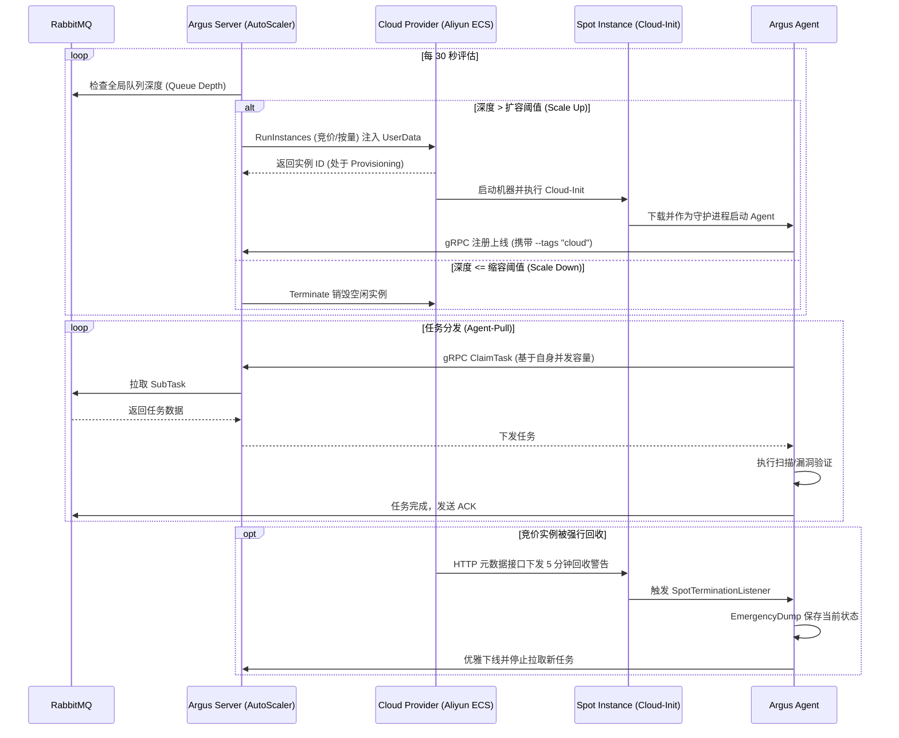

# Argus 云资源动态调度 (Cloud Resource Scheduling)

本文档专门记录 Argus 平台从静态 Docker/节点接入向云原生弹性伸缩架构（云资源动态调度）演进的设计理念、架构细节与实现状态。

## 1. 架构目标

随着分布式扫描的推进，单靠静态配置的 Agent 节点难以应对以下场景：
1. **突发高并发任务**：遇到十万级目标时，固定节点处理过慢。
2. **成本控制**：任务空闲时，大量闲置计算节点浪费云资源。
3. **红队规避封禁**：单一出口 IP 极易被目标安全设备拦截，需要动态切换大量分散的公网 IP。

**目标**：实现一个高度自治的 **AutoScaler (自动伸缩引擎)**，根据队列深度、伸缩策略，自动向云厂商 (如阿里云、AWS) 申请竞价实例 (Spot Instances)，自动注入配置并拉起 Agent，并在任务空闲或实例生命周期到达后自动销毁，实现算力的**按需分配与随用随弃**。

---

## 2. 核心架构设计

### 2.1 模块构成

云资源调度逻辑集中在 `server/internal/cloud/`，由以下核心模块组成：

| 模块 | 职责 | 实现文件 |
|------|------|----------|
| **AutoScaler** | 核心调度引擎，负责 30s 一次的评估决策（扩缩容判定）、实例对账、孤儿回收。 | `autoscaler.go` |
| **Provider Factory** | 注册表模式工厂，提供各云厂商实现的创建入口，打破包循环依赖。 | `provider_factory.go` |
| **CloudProvider** | 屏蔽底层云厂商差异的抽象接口（定义 `Provision` / `Terminate` / `List`）。 | `provider.go` |
| **Aliyun ECS** | 阿里云的具体 Provider 实现，负责调用阿里云 SDK 执行实例生命周期。 | `aliyun/ecs.go` |
| **ResourceManager** | 实例级管理器，桥接 Provider API 与 PostgreSQL 数据库状态同步。 | `manager.go` |
| **Cloud-Init** | 实例初始化模板引擎，使用 Base64 注入带参启动脚本 (AgentID/TenantID/PSK/Addr)。 | `cloudinit.go` |
| **Crypto** | AES-256-GCM 凭证加解密层，保护云厂商 AccessKey 落库安全。 | `crypto.go` |

### 2.2 数据库模型

数据模型存储在 `server/internal/db/cloud_models.go` 中，分为三层：

1. **`CloudAccount` (云账号)**：存储不同云厂商的访问凭证 (AK/SK 加密存储)。
2. **`CloudScalingPolicy` (伸缩策略)**：配置扩缩容阈值 (`scale_up_threshold`, `scale_down_threshold`)、最大最小实例数、竞价策略、TTL 以及基础模板（如镜像、安全组）。
3. **`CloudInstance` (云实例)**：映射真实的云主机，维护其从 `Provisioning` 到 `Running` 再到 `Terminated` 的状态机，并与 `AgentID` 绑定。

---

## 3. 核心流转机制

### 3.1 自动扩缩容决策 (30s 评估循环)

AutoScaler 作为一个守护协程，每 30 秒执行一次全局评估：

- **Scale Up (扩容)**：
  - 条件：`queue_depth > scale_up_threshold` 且 `running_instances < max_instances`。
  - 动作：计算所需实例数（每实例承载约 256 个目标），并发调用 Provider 创建实例，并向新实例写入 Cloud-Init UserData。
- **Scale Down (缩容)**：
  - 条件：`queue_depth <= scale_down_threshold` 且存在空闲实例（关联的 Node.RunningTasks == 0，且运行时长 > 10 分钟）。
  - 动作：向云厂商发起 Terminate 请求，销毁底层实例。

### 3.2 实例状态收敛与双保险兜底

为了防止因为网络异常导致云端计费流失，设计了两套兜底协程：
1. **Reconciler (实例对账 - 5min)**：查询数据库中标记为 `Running` 的实例，向云厂商拉取真实列表；若云端已不存在，则修正数据库状态为 `Terminated`。
2. **OrphanSweeper (孤儿回收 - 10min)**：扫描存活时间超过策略设定的 `instance_ttl_minutes` 的实例，强制进行销毁，防止异常实例无限计费。

### 3.3 Spot 竞价实例回收感知

- **Agent 侧**：启动时检测到环境变量 `ARGUS_SPOT=1` 或 `cloud` 标签时，激活 `StartSpotTerminationListener`。
- **中断响应**：Agent 通过内部 HTTP 元数据接口感知到云厂商（如阿里云提前 5 分钟）的回收警告。
- **自救动作**：立即触发 `EmergencyDump` 将当前处理进度回落，并放弃拉取新任务，优雅等待被系统销毁。

### 3.4 云端任务分发逻辑 (Agent-Pull 协同)

虽然计算资源（实例）是云端动态创建的，但 Argus 的任务分发核心依旧严格遵循**按需拉取 (Agent-Pull)** 架构，结合 RabbitMQ 实现对云端动态实例的无缝分发：

1. **去中心化认领**：Server 端（AutoScaler）只负责根据全局队列深度（Queue Depth）来决定是否要“买机器”。它**绝对不会**硬性指定某台云主机去执行特定的任务。
2. **实例自启动与融入**：通过 Cloud-Init 拉起的 Agent，启动后会自动通过 gRPC 连接 Server，成为一个标准算力节点。
3. **基于信号量的弹药消耗**：Agent 一旦上线，就和普通的物理机节点一样，通过 `NotifyHub` 接收队列更新广播，并根据自身的并发池限制，主动向 Server 发起 `ClaimTask`。
4. **中断容错**：即使发生极端情况（云实例直接被底层基础设施强杀、无响应），该节点上正在执行的子任务也会因为未能向 RabbitMQ 发送 `ACK`，在超时后被 RabbitMQ 和服务端抢救协程（staleSalvage）自动安全回收，并重新投递给其他存活节点，实现**零状态丢失**。

---

## 4. API 设计 (14 个端点)

云管控的 REST API 均在 `server/internal/api/handler_cloud.go` 中实现：

| 领域 | 动作 | API 路径 | 备注 |
|------|------|----------|------|
| **凭证** | CRUD | `/cloud/accounts` | 存储加密，返回脱敏 |
| **凭证** | Test | `/cloud/accounts/:id/test` | 测试云端连通性 |
| **策略** | CRUD | `/cloud/policies` | - |
| **策略** | Toggle | `/cloud/policies/:id/toggle` | 动态启停伸缩策略 |
| **实例** | List | `/cloud/instances` | 实例列表查询 |
| **实例** | Create | `/cloud/instances` | 人工手动弹容 |
| **实例** | Delete | `/cloud/instances/:id` | 人工强制缩容 |
| **大屏** | Dashboard | `/cloud/dashboard` | 活跃账号数、实例统计与最新事件 |

---

## 5. 开发里程碑与现状

> 相关提交：`feat(cloud): implement dynamic cloud resource scheduling` (Phase 1-7)

✅ **Phase 1-7 (已完成)**
- 完成底层所有基础设施：DB 迁移、凭证加密、AutoScaler 核心算法。
- 完成阿里云 ECS 的 Provider 接入，实现 Cloud-Init 的无缝拉起。
- 替换所有的 mock HTTP 接口为真实调度逻辑。
- 将 AutoScaler 与守护协程注入 `main.go` 并与 API 层绑定。
- 采用 Provider 注册表模式（`init()` 自注册）打通包循环依赖。

✅ **Phase 8 (已完成)**
- **前端对接**：Server-UI (`CloudManagement` 页面) 已全面对接 14 个后端 API，实现凭证管理、连通性测试、策略全量配置与仪表盘大屏的数据闭环。

⏳ **Phase 9 (待实施)**
- **多云扩展**：基于已有的 `CloudProvider` 抽象，横向补充 AWS EC2、腾讯云 CVM 等实现。

---

## 6. 现有架构局限与未来演进

从系统架构和生产级高可用的角度来看，当前的云资源调度设计虽然实现了业务闭环，但在大规模、高并发扫描场景下，仍存在以下优化空间：

### 6.1 扩缩容指标过于单一
- **局限**：AutoScaler 目前仅根据 `queue_depth`（队列深度）单一维度进行判定。这种一刀切的方式无法准确评估算力缺口（例如：大量轻量级的存活探测任务 vs 少数耗时的 Web 漏洞扫描）。
- **演进**：引入多维度评估。结合**预计排队时间 (Estimated Wait Time)**、**现有节点的 CPU/Mem 负载水位**以及**任务类型的耗时权重**进行加权决策。

### 6.2 粗粒度的缩容策略
- **局限**：当前的缩容条件是队列为空且实例处于空闲状态即发起销毁。这在面临“脉冲式”突发任务时，容易引发集群频繁抖动（频繁创建与销毁），不仅增加冷启动开销，还可能浪费云厂商的最低计费时长。
- **演进**：引入**阶梯式缩容 (Cooldown)**，并结合云厂商计费周期的**踩点回收**（如：在按小时计费周期结束前 5 分钟再执行释放），最大化利用已购资源。

### 6.3 冷启动效率瓶颈
- **局限**：当前强依赖 `Cloud-Init` 并在机器启动时通过公网动态 `curl` 下载 Agent 二进制文件。这种方式不仅受限于外部网络波动导致超时失败，在未来如果 Agent 引入复杂的环境依赖（如浏览器爬虫、特定 Python 运行库），启动耗时将不可接受。
- **演进**：引入 **黄金镜像机制 (Golden Image / AMI)**。结合 HashiCorp Packer 在流水线中提前打包好包含 Agent 及全套依赖的系统镜像，实现云实例的秒级拉起。

### 6.4 Spot 实例回收感知的盲区
- **局限**：系统完全依赖 Agent 侧定期轮询云主机底层的 Metadata 接口获取 5 分钟警告。在极端资源枯竭情况下，云厂商可能跳过警告直接强杀，导致 `EmergencyDump` 无法执行。
- **演进**：在管控层面打通云厂商的事件总线（如 Aliyun EventBridge / AWS EventBridge）。当底层基础设施产生实例释放事件时，通过 Webhook 毫秒级推给 Server 端，由 Server 立刻标记该节点不可用，并将未完成任务快速重分配，缩小处理盲区。

### 6.5 异构算力池支持不足
- **局限**：当前单套调度策略仅支持一种实例规格设定，无法区分“计算密集型”（如暴破）和“网络密集型”（如端口扫描）任务的特定机型需求。
- **演进**：引入 **Node Pools (节点池)** 的概念。根据全局任务的标签要求（如 `requires: compute-optimized`），定向申请高算力或高带宽的异构资源，并为对应的云实例打上专属处理标签，实现精细化负载路由。
