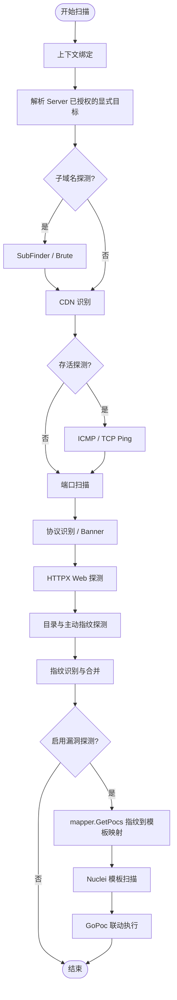

# 分布式扫描架构现状

本文档描述当前仓库已经接入主链路的分布式扫描架构，以及还没有闭环的关键缺口。

## 1. 总体结构

Argus 当前采用典型的 `Control Plane + Data Plane` 结构：

- 控制面 `server/`
  - 负责任务创建、任务拆分、队列调度、节点注册、规则管理、结果聚合、系统管理
- 数据面 `scanner/`
  - 负责节点注册、拉取任务、执行扫描流水线、流式回传结果
- 协议层 `shared/proto/`
  - 负责定义 Agent 与 Server 之间的 gRPC 协议
- 前端 `server-ui/`
  - 负责展示任务、节点、结果、规则和部分系统配置

## 2. 控制面当前职责

### API 层

当前主链路全部走 `server/internal/api/router.go`。

已接入能力：

- JWT 登录与租户识别
- RBAC 中间件
- 任务创建 / 删除 / 取消 / 追加目标
- 结果查询与融合画像
- Arsenal CRUD / 审批 / Manifest / 回滚
- 用户管理、MCP 管理
- 云实例 mock 管理、构建产物列表
- 统计接口与 Agent 日志查询

边界说明：任务、云资源、MCP、构建、日志等领域 handler 已从 `router.go` 拆分到独立文件。控制面主链路是 `api`、`grpc`、`db`、`scheduler`，不存在 `/api/v2`。

### 调度层

当前调度器位于 `server/internal/scheduler/queue.go`，已实现：

- RabbitMQ 多优先级队列
- 内存 fallback
- Dead-Letter 回收
- 旧队列迁移
- 队列深度 / Pending 统计

调度选择器与容量已接入主链路：

- `CreateTaskRequest.agent_selector` 支持扁平标签 map 与 `agent_selector_rules.match/not_match`；`POST /tasks/preview-selector` 与 Agent 认领共用匹配器并返回容量解释。
- Agent 通过 `Subscribe` 流上报 `capacity_update` 空闲槽位，服务端按真实容量参与认领决策。

### gRPC 层

当前 gRPC 服务位于 `server/internal/grpc/server.go`，已实现：

- `Register`
- `Heartbeat`
- `ClaimTask`
- `StreamResult`
- `TaskComplete`
- `EmergencyDump`
- `StreamLogs`

边界说明：`Register` 返回真实 session token（支持过期、吊销和轮换审计），Agent 内部 HTTP 使用 `x-agent-id + x-agent-token` 鉴权。`TaskComplete` 对 `DONE` 场景聚合较完整，但 `FAILED / CANCELLED / TIMEOUT` 的根任务状态收敛仍不完整。

### 结果存储层

当前数据库模型位于 `server/internal/db/db.go`，采用三层结果模型：

- `Asset`
- `FingerprintHit`
- `Vulnerability`

已接入能力：

- PostgreSQL migration runner + schema verify
- BatchWriter 异步防洪落库
- 趋势 / 严重度 / 任务结果统计
- 漏洞 CSV 导出

当前问题：

- 虽然 `Asset` 模型已有 `CertSubject / CertExpiry` 字段，但当前主链路未看到完整证书采集闭环
- 统计接口已完成，Dashboard 仍未完全消费这些真实聚合结果

## 3. 数据面当前职责

### Agent 生命周期

当前 Agent 位于 `scanner/internal/agent/worker.go`，已接入：

- 启动后 `Register`
- 周期性 `Heartbeat`
- `ClaimTask` 认领任务
- 本地执行扫描流水线
- 通过 `StreamResult` 流式回传结果
- 通过 `TaskComplete` 上报完成状态

### 规则同步

Agent 使用注册会话的 `x-agent-id + x-agent-token` 访问内部规则接口。`/api/v1/arsenals/db/hash` 返回租户内已批准规则的聚合身份，只用于判断是否需要下载；`/api/v1/arsenals/db` 继续保留兼容的 `X-Arsenal-Hash`，并通过 `X-Arsenal-SHA256` 绑定实际 SQLite 响应字节。Agent 在写入和物化前复算 SHA-256，不匹配或缺失时安全拒绝。

物化后的 `config/.argus-arsenal.json` 同时保存聚合 `hash`、实际 `package_sha256` 和 `rule_version`。Agent 只用经过验证的 `package_sha256 + rule_version` 复用进程内 Fingerprint、Workflow 和 Dir 只读知识快照；任务配置、结果、URL 去重、Hook、取消器、ResumePlan、POC runner 和 HybridMap 始终按任务隔离。旧 manifest 缺少 `package_sha256` 时会从本地 SQLite 一次性重物化。

网络空间 Provider 凭据只属于 Server 控制面。Agent 内部接口不再提供 `api-config` 同步，Worker 不读取或写入 Provider 配置；Scanner Pipeline 不再包含 Hunter/FOFA/Quake 搜索阶段，Agent 覆盖事件也不再规划或上报 `search_engine`。新任务、追加、派发与领取均拒绝旧 Provider 配置，遗留队列消息会被消费并标记失败而不会下发。任务覆盖解释会忽略历史 `search_engine` 跳过行。被动子域枚举继续保留，但禁用本机 Provider 配置并显式排除 FOFA/Hunter/Quake 来源。

被动子域枚举默认收敛到 Server 端执行：开启被动子域发现且存在 `passive_server=v1` 能力 Agent 时，域名批次在派发前停留 `Queued` 持有态，由 Server collector 按注册根域（eTLD+1，如 `harbor-arm.uhomecp.com` → `uhomecp.com`）统一查询免凭据公共源（crt.name/crt.sh/certspotter，含 DNS 泛解析与解析验证）并按根域缓存（`subdomain_passive_cache`，默认 24h）；密封进 Attempt 前会去掉本批实际输入里已有的主机，结果写入 `SubdomainPassiveResults`（全覆盖时置 `NoSubFinder=true`）后入队，Agent 只对未覆盖根域回退端内 subfinder（同样按输入去重）并继续执行字典爆破与全链路下游。收集超时（8 分钟）或全部源失败时不密封直接派发，行为回退到原 Agent 端收集；无能力标签的旧 Agent 认领时配置不密封。认领时密封（含重试/恢复路径）只对声明 `passive_server=v1` 的 Agent 生效。多 Agent 并发分发不再对同一批免费数据源重复查询，重复任务直接命中缓存。

规则激活与任务执行之间采用版本使用窗口：Context 初始化前登记规则使用者，任务进入 `runningTasks` 后才释放初始化占用；初始化中或运行中的任务存在时，新包只进入 pending，最后一个使用者退出后再激活。risk-validation、恢复计划和覆盖事件始终使用任务开始时捕获的版本，Debug 自定义规则在修改前深拷贝脱离共享快照。

### 取消与中断

当前 Agent 已实现：

- `commandLoop` 轮询控制指令
- `context.Cancel` 中断正在执行的扫描任务

命令轮询使用注册会话的 `x-agent-id + x-agent-token` 鉴权，按节点绑定租户。

### 并发执行

当前 Agent 已具备 Worker Pool 与引擎并发上限协同控制框架。

Worker Pool 与引擎并发上限协同控制；Agent 通过 `capacity_update` 向服务端上报空闲槽位，多 worker 能力可被调度真实利用。

### Spot 回收

当前已有 `StartSpotTerminationListener` 实现，并已在 Agent 启动链路中激活。

- 环境变量 `ARGUS_SPOT=1` 或 `--tags` 中包含 `cloud=...` 时自动启用
- 检测到竞价实例回收通知后，触发 `EmergencyDump` 并通过心跳将任务状态重置回队列

## 4. 任务流转现状

当前真实任务链路如下：

1. 前端或 API 调用 `POST /api/v1/tasks`
2. 服务端规范化目标与配置
3. 服务端生成 `RootTask`
4. 服务端按目标类型与批量上限生成稳定 `TaskBatch`，并为每个批次生成 Attempt 1（数据库兼容表名仍为 `sub_tasks`）
5. 服务端将 Attempt 序列化后写入 RabbitMQ 优先级队列
6. Agent 通过 gRPC `ClaimTask` 认领任务
7. 服务端将命中的 Attempt 状态改为 `Running`，并同步其 `TaskBatch` 最新状态镜像
8. Agent 执行扫描流水线
9. Agent 通过 `StreamResult` 连续回传结果
10. 服务端异步写入结果表
11. Agent 调用 `TaskComplete`
12. 服务端同步 Attempt 与 TaskBatch 状态、聚合 RootTask 进度，并在需要时 ACK 队列消息

`POST /api/v1/tasks` 支持零配置安全创建：省略名称时使用首个规范化目标，省略优先级和超时时分别使用 P1 与 3600 秒；直接目标为空时使用当前已授权 Project 的 `SeedTargets + Scope`。空配置采用 `external-map` 平衡测绘档，启用常用端口、协议/Web/指纹和被动子域枚举，但默认关闭 POC、通用 POC、子域爆破、主动目录探测和密码探测。直接输入的新目标会在创建事务内扩展当前 Project 的 SeedTargets/Scope，并记录创建人、目标来源、安全档位和扩展数量；OSINT 查询语句不会写入项目目标范围。Agent 标签按目标类型自动合并，只有显式高级配置才增加人工选择器。

`POST /api/v1/tasks` 可选接收 `Idempotency-Key`：无 header 的旧客户端保持原有非幂等创建行为；UI 为一次新建意图生成并复用稳定 Key。认证、operator RBAC、项目访问与 active 状态校验始终先于重放。相同 tenant/project/operator/`create_task_v1`/Key 的同规范请求返回首次 Task，异请求返回 409 且无副作用；数据库只保存 Key 的 SHA-256，不保存原始 Key。幂等账本与 RootTask、配置修订、TaskBatch、首个 Attempt、Project Scope/SeedTargets 扩展和创建审计在同一事务提交；仅首次提交后派发。重放从首次配置修订和账本绑定的初始 Attempt/TaskBatch 重建目标与批次摘要，依据这些 Attempt 的当前状态重建派发摘要，但不再次入队。

POC 与普通资产发现链路隔离。POC YAML 通过 `info.metadata.argus-execution-class` 标记 `detection` 或 `verification`；执行风险跟 Nuclei `info.severity`：`info` / `low` / `medium` 不要求二次确认，`high` / `critical`（库中记成 `high`）以及缺省 `severity`（记成 `unknown`）需要二次确认。所有 POC 均需进入显式风险验证并确认：手动执行入口强制独立二次确认；自动派生阶段由 Server 密封目标与指纹，Agent 用本地 `workflow.yaml` 做 `mapper.GetPocs` 匹配，默认剔除 high/unknown，仅当任务策略 `authorization.allow_high_risk_auto_execution` 预授权时才执行这两类模板。需要利用、持久化或状态变更的能力禁止伪装为 POC，必须进入独立 EXP 包、审批与审计链路。

`POST /api/v1/tasks/:id/risk-validation/preview` 是风险验证的只读规划入口。它只读取当前租户、已授权项目和指定任务已经落库的指纹与资产，既可用当前已审核且启用的 Workflow 解析 POC，也可由用户指定已审核且启用的 POC 对当前任务资产生成候选项；返回资产、产品、端点、POC、严重性、执行类别、风险等级、规则/配置版本和预计请求量。请求量是从 Nuclei 模板结构计算的保守上界，无法解析时按单请求回退。响应中的 `plan_hash` 绑定租户、项目、任务、当前规则版本、配置版本、端点和实际 POC 内容哈希，供后续执行前检查预览是否仍有效。该接口不会创建 TaskBatch/Attempt、写审计、入队或向 Agent 下发命令；高风险和未分类候选项仅标记为需要二次确认。

`POST /api/v1/tasks/:id/risk-validation` 是 operator 才能调用的执行入口。Server 会重新生成完整预览并校验 `plan_hash`、当前配置版本、当前规则版本、租户/项目归属和任务终态，只接受预览内的端点、POC 文件与内容哈希；所有候选项都要求授权确认，`high/unknown` 还要求独立二次确认。成功后在原 Task 下追加 `risk_validation` TaskBatch 和不可变 Attempt，关闭自动重试并写入操作者、版本、请求量和确认信息审计。执行接口可选接收 `Idempotency-Key`：同一 tenant/project/task/operator/Key 的规范确认请求只提交一次账本、Batch、Attempt 和审计，并且只在首次提交后派发；响应丢失后的同请求重放直接读取已提交结果，不因任务已进入 Running、规则随后变化或队列暂不可用而再次解释或执行计划，同 Key 改变 plan、候选/指定 POC 或任一确认字段固定返回 409。Key 不是授权凭证；无已提交账本的新请求仍须重新生成当前 preview 并对陈旧配置、规则或 POC 内容失败关闭。只有版本不低于 v2.4.0 且已经同步到该 Attempt 规则版本的 Agent 才能领取风险验证；Agent 执行前还会复核规则版本和每个 POC 文件的实际 MD5，任一不一致都安全失败。通过校验后只运行精确的 Nuclei `端点 → POC 文件` 映射，不执行搜索引擎、子域、存活、端口、协议、HTTP 探测、目录、指纹或 GoPoc。显式重试只在规则版本未变化时复用该确认快照；规则变化必须重新预览确认。

语义化扫描策略的自动闭环另使用共享 `argus.gopoc-catalog/v1`：协议识别阶段只能执行目录中已审核、已启用且由观测服务或安全端口兜底精确命中的 `protocol_check`，回传 `ProtocolCheck` 资产证据，不写漏洞表。自动 `risk_validation` 按资产批次流水线派生兄弟批次：资产批终态后立刻密封该批 `TargetFingerprints`（不再下发端点→POC 显式映射）。有指纹的兄弟批入队供任意合格 Agent 领取并本地匹配 Nuclei；零指纹的空兄弟批在控制面本地完结（不入队），因为覆盖率事件要求至少一个 normalized target。Intent 在每个资产批都有兄弟批且全部终态后才翻转到 complete/failed，中途保持 derived。未预授权时跳过 high/unknown。`credential` 仍在全部资产批终态后进入独立弱口令阶段。目录 SHA-256、规则版本、指纹快照和请求预算进入 Attempt 快照，规则漂移时失败关闭。用户界面不暴露独立 GoPoc 开关。

普通任务创建/配置更新固定要求 `NoPoc=true`、`GolangPoc=false`、`DisableGeneralPoc=true` 且 `PocNameForSearch` 为空；前端不再展示普通扫描 POC 开关。为覆盖修复前的旧任务和旧 Agent，Server 在 Agent 领取前会消费并失败关闭任何未确认 POC 配置，当前 Agent 也会在 Scanner 初始化前再次拒绝。风险验证内部字段同样不被普通配置解析器接受，因此无法从常规创建、更新、重试或旧队列消息绕过确认。

任务创建后可通过 `POST /api/v1/tasks/:id/append` 增加批次。追加链路在事务内锁定 RootTask/Project，规范化并去除本任务已有目标，使用当前配置修订与规则版本创建 TaskBatch/Attempt 1，同时扩展当前 Project 的 SeedTargets 与授权 Scope 并写审计。重复目标为无业务写入的 `unchanged`；跨任务覆盖不会在创建接口静默删除，而是在 Agent 领取时按 WorkKey 建立可解释的复用关联。

`append` 也可选接收 `Idempotency-Key`。UI 在一次“增加批次”意图内复用同一 Key，网络或超时后可直接重试；无 Key 的旧客户端继续使用上述目标去重语义。Server 在认证、operator RBAC、tenant/task/project 对象授权和生命周期校验后，以 tenant/project/task/operator/`append_targets_v1`/Key hash 为唯一作用域：同一规范目标请求返回首次追加结果，Key 已绑定其他请求时返回 409。数据库只保存 Key 与请求的 SHA-256、配置/规则身份、安全计数及首次 Batch/Attempt ID，不复制目标或配置正文。账本与 Batch/Attempt、Project Scope/SeedTargets、RootTask 聚合和 `batch_append` 审计同事务提交；只有首次新增会在提交后派发，重放不会再次入队。`outcome`、目标/批次数、配置版本、范围增量、Task 聚合和 Batch/Attempt 引用均来自首次冻结结果；`dispatched`、`dispatch_pending` 仅投影这些首次 Attempt 的当前投递状态，可能随 `Dispatching`、`Pending`、`Paused` 或终态推进而变化，不属于冻结业务结果，也不会触发二次入队。

阶段记忆使用四类独立 PostgreSQL 存储：`scan_observations` 只追加 Agent/CLI 阶段证据，`scan_coverages` 保存 WorkKey 当前覆盖，`scan_work_claims` 为执行中相同工作提供唯一租约槽，`task_coverage_links` 记录实际执行、历史复用或执行中挂接的来源。所有唯一键和查询边界均显式包含 tenant/project，WorkKey 哈希不能替代对象归属检查。G18 已在 `ClaimTask` 中按完整目标读取有效 Coverage：全量命中直接完成且不占 Agent 容量，部分目标命中只下发剩余目标，并保留来源 Task/Batch/Attempt；旧 Agent 没有覆盖事件时仍视为未知。G19 又把 WorkClaim 的占用和最终 Agent 租约放入同一事务，确保同一项目内相同执行工作只产生一个真实扫描。

Agent v2.5.0 起通过现有 `StreamResult` 的 `coverage_event` 类型额外上报规范 Stage 的终态事件。事件只携带 Attempt/Agent、Server 已分配的目标、实际规则版本、配置与内容哈希、阶段起止时间以及 `success/negative/failed/skipped`；tenant/project/network zone 不由 Agent 声明，Server 根据已领取 Attempt 重新补齐并拒绝 Agent 或目标不匹配的事件。内容哈希仅聚合结果摘要哈希，不上传额外响应正文；并发结果先排序再哈希，避免输出到达顺序造成伪变化。旧 Agent 只上报原 `phase` 时没有 CoverageEvent，Server 会保持 unknown 而不是推断成功。

G21B1 在同一 JSON envelope 中增加可选的 `argus.checkpoint/v1` 检查点。检查点仅对单目标、成功或阴性事件生成，最多 4096 个规范化派生项：存活 IP、开放端点、协议服务、URL 或子域；禁止 URL 凭据、任意文本和 HTTP 响应正文。多目标 Attempt 因无法可靠把合并流水线输出反向归属到原目标，不携带检查点。Server 还会验证 IP/CIDR/范围、URL authority、显式 host:port 或域名后缀归属；域名解析出的 IP 在没有可验证 DNS 映射前不接受为可重放检查点。检查点的规范哈希进入事件身份和 Observation 证据哈希，相同事件 ID 携带不同检查点会被拒绝；B1 只追加存储，不据此跳过阶段。

Server Planner 对单目标生成 `argus.resume-plan/v1`：完整阶段顺序只能划分为历史复用前缀和依赖闭合的执行后缀，检查点必须同时匹配 tenant/project/network zone、WorkKey、TTL、已完成来源 Attempt、Coverage/Observation 来源 ID 与规范哈希。端口结果只恢复协议输入，协议结果只恢复 HTTP 输入；HTTP 正文未持久化，所以指纹、目录或 Host 绑定缺失时会回退重跑 HTTP。域名链在没有可信 DNS 映射时从发现/分类起点重跑。多目标、手动重试、风险验证和任何损坏、过期或漂移证据均回退完整流水线。

只有 Agent v2.6.0 及以上且 Agent 当前规则版本等于 Attempt 规则版本时，Server 才会下发恢复信封。最终领取事务会锁定 Agent、Task/Batch/Attempt、Project Scope、Coverage 和源 Observation，重新构建并规范比对计划；确认后将复用前缀关联、执行 WorkClaim 和 Agent 租约一起提交。Agent 仍会使用实际 Config、唯一目标和本地规则版本独立验证阶段列表与检查点依赖，然后只执行后缀并只上报后缀 CoverageEvent。旧 Agent、规则漂移或无可信检查点时保持完整扫描；计划或检查点篡改时失败关闭，不静默降级为跳扫。

归并器从数据库中的 Project Scope、不可变配置修订、Attempt 规则版本和来源对象重算 WorkKey；Agent 上报的原始配置哈希只用于检测实际下发内容是否漂移。每个事件按目标派生租户内幂等 ID，完全相同的重放不新增记录，相同 ID 携带不同证据会被拒绝；较旧事件不能覆盖较新的当前 Coverage。`success/negative` 仅在配置与规则一致时形成 `complete`，`failed/skipped` 固定为 `incomplete`，任何版本漂移或风险验证缺少 POC/端点内容维度时为 `invalidated`。自动原生风险验证的 `poc_set_hash` 使用 Attempt 密封的 `TargetFingerprints` 产品快照（显式确认路径仍使用端点→POC 内容哈希）；`endpoint_content_hash` 优先取该风险 URL 自身完整 HTTP 探测，没有该 URL 的 HTTP 覆盖时再继承来源资产 Attempt 的完整 HTTP 内容。该 URL 已有失败/不完整 HTTP 探测时不继承。风险验证领取仍绕过历史复用；这些维度只决定覆盖能否记为 complete，供解释与后续契约使用。

Server 为新形成的完整 Coverage 写入阶段 TTL：存活证据 5 分钟、端口 1 小时、资产发现/协议/Web/目录/指纹 6 小时、显式风险验证 24 小时；失败、跳过或失效证据不获得有效期。TTL 过期以及 Scope、配置、规则或网络区域改变都会因完整 WorkKey/有效期校验而安全回退扫描，旧 WorkKey 证据保持不可变以供审计。相同 WorkKey 的上游内容哈希发生变化时，只把完成时间不晚于该事件的依赖 Coverage 标记为 `invalidated`，并记录 `upstream_content_changed:<stage>`；更新更晚的下游证据不会被乱序事件推翻。显式任务/批次重试使用 `manual_retry`，同时绕过历史复用和执行中 WorkClaim，并由新 Attempt 追加新的 Observation。

复用 Planner 只接受同 tenant/project/network zone、Scope/Config/规则版本一致且未过期的完整覆盖，且来源 Attempt 必须已经完成。一个目标所需阶段必须全部命中；端口扫描为阴性时协议识别可视为无后续工作，其余缺失阶段均安全回退为扫描。手动重试、风险验证、搜索引擎输入、旧的不完整配置、非活动 Project/Batch 和非本租户 Alive Agent 固定绕过。部分复用计划不提前写入：剩余目标与 reused links 必须和最终 Agent 租约同事务提交，Agent 在竞态中变化时不会把一个私网区域的决策带到另一区域。

network zone 由 Server 使用数据库中的 Agent 标签和每个规范目标派生，Agent 覆盖事件不能自行声明：公网 IP/CIDR/范围以及无私网标签的普通公网 DNS 使用 `public`；私网、特殊用途地址、保留域名和带区域标签的 split-horizon DNS 使用 `private:<network_zone>`；私网 Agent 缺少有效区域标签时回退到 `agent:<agent_id>`，不会因同名私网 IP 跨 Agent 复用。若带 `network_zone` 的 Agent 确实只解析公网 DNS，可通过现有 `--tags network_zone=corp-a,network_scope=public` 明确标记；该声明不会把私网或保留 IP 提升为公网。标签和目标会在覆盖归并、历史复用、租约提交复核及 WorkClaim 规划中重新读取，tenant/project 边界始终保留。

执行中合并仍遵循 Scanner 的完整目标执行边界：每个剩余目标使用其 `fingerprint` WorkKey 作为整条目标流水线的互斥键，而不是把旧 Scanner 拆成不完整阶段任务。领取事务按 WorkKey 排序并原子创建或回收唯一 `scan_work_claims` 行，同时写 `task_coverage_links(link_type=executed)`、Attempt Agent 租约和节点容量；如果已经存在活动来源，后续 Attempt 改为 `Pending` 并使用 `workclaim:<digest>` 标记，写 `link_type=in_flight/status=waiting` 后 ACK 当前队列消息，因此不会占 Agent 容量。来源成功后等待者重新进入 Planner，优先由 G18 复用刚形成的完整覆盖；来源失败、超时或停止后也会重新规划并竞争唯一 Claim，绝不会把失败当作覆盖。来源终态释放 Claim、等待关联状态和 Attempt 重新派发均使用 CAS，队列失败保留 `Dispatching` 供恢复守护进程重试；守护进程也会定期收敛不经过 `TaskComplete` 的终态来源。

任务详情把 `task_coverage_links`、对应 Coverage/WorkClaim 和失效记录汇总成 `coverage_explanation`。前端分别展示实际执行、历史复用、当前等待来源、失效/过期与节省量，并可追溯同项目来源 Task/Batch/Attempt。风险验证缺口额外投影该目标密封指纹，以及目录按指纹匹配到的 POC 文件名（显式确认路径用密封 POC 清单）；未匹配时原因记为 `fingerprint_unmatched_pocs`，不再把复用维度缺失误写成匹配失败。汇总使用完整关联计数，明细最多返回最近 100 条；失效范围只包括当前任务产生或已复用的 Coverage。API 在读取 RootTask 后再次对所有关联查询施加 tenant/project/root_task 条件，来源任务名称也只从同项目解析，不返回 WorkKey、配置哈希、POC 正文或内部租约信息。

`TaskBatch` 是面向用户和后续运营接口的稳定身份，Attempt 是一次真实调度执行。G05 迁移阶段仍沿用现有 Agent 协议和 `sub_tasks` 表名；旧记录会一对一回填批次，不删除或覆盖历史结果。

批次通过 `GET /api/v1/tasks/:id/batches` 查询，并使用嵌套的 `pause`、`resume`、`stop`、`retry` 和 `DELETE` 归档接口管理。`TaskBatch.status` 始终镜像最新 Attempt 的真实执行状态，独立的 `control_state` 保存暂停或停止意图：暂停未领取批次会清除队列租约，暂停已领取批次允许本次完成但禁止任何自动重试；立即停止将运行 Attempt 置为 `CancelPending`，沿 Agent 现有命令轮询下发取消；恢复和显式重试都不会覆盖旧 Attempt。

任务级控制只操作每个未归档批次的最新 Attempt。任务暂停会冻结未领取 Attempt，但不会覆盖用户单独暂停的 Batch；已领取 Attempt 可以收敛，若暂停期间失败则 RootTask 保持 `Paused`，恢复时追加新 Attempt。任务立即停止可从运行态或暂停态执行，冻结未领取工作并向运行 Agent 下发取消，规范接口是 `POST /api/v1/tasks/:id/stop`，旧 `cancel` 路径保留为兼容别名。`POST /api/v1/tasks/:id/retry` 只为失败、超时或已停止的当前批次追加 Attempt，成功批次不会重复扫描；该显式动作标记为强制复测，供后续增量去重逻辑绕过历史复用。

任务级 `retry` 可选接收 `Idempotency-Key`。UI 在一次“重试失败批次”确认意图内复用同一 Key，网络或超时后可安全重试；无 Key 的旧客户端保留原状态机语义。Server 在认证、operator RBAC、tenant/task/project 对象授权和归档校验后，以 tenant/project/task/operator/`retry_task_v1`/Key hash 为唯一作用域；同一请求重放首次新增的 Attempt 与跳过计数，异请求返回 409。数据库只保存 Key/请求的 SHA-256、状态、安全计数和首次 Attempt ID，账本与 Attempt、RootTask 状态及单条 `retry` 审计同事务提交。只有首次提交后主动派发；重放即使任务已进入 Running 或队列暂不可用也不会再次入队。`dispatch_pending` 是首次 Attempt 的当前投递状态投影，可能随队列恢复推进而变化，不是新的重试动作。

单批次 `POST /api/v1/tasks/:id/batches/:batch_id/retry` 同样可选接收 `Idempotency-Key`，但其唯一作用域额外包含稳定 Batch ID，不能与同一 Task 的其他批次互相重放。Server 在认证、operator RBAC、tenant/project/task/batch 对象授权和归档校验后，才读取单批次重试账本；同一 Key 的同一版本化请求返回首次追加的 Attempt、编号、配置和规则版本，异请求返回 409。账本、新 Attempt、Task/Batch 状态和单条 `batch_retry` 审计在 RootTask → TaskBatch → latest Attempt 的既有锁序中原子提交，只有首次提交后主动派发。重放不会再次派发，即使队列暂不可用或该 Attempt 已推进到其他状态仍返回首次业务结果；`dispatch_pending` 仅是该 Attempt 当前投递状态的只读投影。

失败、超时、Agent 掉线或 Spot 回收需要再次执行时，Server 会先终结原 Attempt 并保留执行 Agent、开始/结束时间、配置/规则版本和失败原因，再原子追加新的 Attempt；新 Attempt 使用当前任务配置修订与当前规则版本。队列发布失败只恢复同一个尚未执行的 Attempt，不会虚增历史。

补充链路：

- 死节点恢复：由 `server/cmd/argus-server/main.go` 周期扫描掉线节点并重入队
- 超时重试：由 `StartTaskTimeoutDaemon` 扫描 `timeout_sec`，可重试则重入队，不可重试则标记 `Timeout`
- 批次暂停保护：TaskComplete、超时、死节点和 Spot 恢复在追加新 Attempt 前校验 `control_state`，暂停批次只收敛当前执行证据

当前问题：

- `DONE` 之外的终态收敛还不完整
- 根任务状态机仍偏粗

## 5. 规则中心现状

当前规则中心由 `arsenals` 与结构化规则表共同组成：

- `arsenals`
  - 作为原始规则仓库
  - 直接服务 Agent 同步
- 结构化规则表
  - 作为检索、统计、治理层

当前已接入：

- POC / Finger / Workflow / Dir 四类规则管理
- 审批状态 `Draft / Approved`
- `hash` / `previous_hash`
- `manifest`
- 回滚接口
- 启动时结构化回填

当前问题：

- AI 审查仍是 mock
- GoPoc 已有编译期共享治理目录与确定哈希，但还没有可由管理员动态发布的元数据中心；EXP 使用独立 Yaksha 权威模型

## 6. 云资源编排现状

当前云资源编排代码位于：

- `server/internal/cloud/provider.go` — CloudProvider 抽象接口 + InstanceConfig
- `server/internal/cloud/provider_factory.go` — Provider 注册表模式工厂（打破循环导入）
- `server/internal/cloud/autoscaler.go` — AutoScaler 自动伸缩引擎
- `server/internal/cloud/manager.go` — ResourceManager 实例生命周期管理（含 DB 持久化）
- `server/internal/cloud/cloudinit.go` — Cloud-Init 模板引擎
- `server/internal/cloud/crypto.go` — AES-256-GCM 凭证加解密
- `server/internal/cloud/aliyun/ecs.go` — 阿里云 ECS Provider（已 init 自注册）

### 已实现并接入主链路

- **AutoScaler 决策循环**：在 `main.go` 中启动，每 30 秒评估队列深度与伸缩策略
  - Scale Up：队列积压 > threshold 且 实例数 < max → 创建 ECS 实例
  - Scale Down：队列空闲 且 存在闲置实例 且 实例数 > min → 销毁实例
  - 冷却期机制防止扩缩容震荡
- **实例对账协程**：每 5 分钟对比 DB 中 Running 实例与云端实际状态
- **孤儿回收协程**：每 10 分钟清理超过策略 TTL 的实例
- **数据库持久化**：`cloud_accounts`、`cloud_scaling_policies`、`cloud_instances` 三表
- **凭证安全**：AES-256-GCM 加密存储 AccessKey，API 返回脱敏
- **Cloud-Init 自动化**：Go template 渲染 Agent 启动脚本，注入 Server 地址、AgentID、PSK
- **实例状态真相收敛**：OS ready 只会把实例维持在 `WaitingReady`；只有 Agent 成功 `Register` 后才会进入 `Running`
- **云管控 REST API**：覆盖凭证、策略、实例、OSS 分发、价格推荐、权限检查和一键配置
- **Provider 注册表模式**：aliyun 包在 `init()` 中自注册，`cloud` 包不直接导入 Provider 子包
- **Spot 实例支持**：Agent 启动时自动激活 `StartSpotTerminationListener`（检测 `ARGUS_SPOT=1` 或 `cloud=...` 标签）

### 当前限制

- 仅实现阿里云 ECS Provider，AWS/腾讯云需通过注册表扩展
- 未实现人工审批流（扩容直接执行）

## 7. 前端现状

管理控制台页面（Login、Dashboard、NodeManagement、TaskManagement、TaskResults、ProfilesView、规则配置页、AssetDiscovery、CloudManagement、ClientBuild、AgentLogs、RoleManagement、ApiKeysConfig、AIConfig）均已接入真实 `/api/v1` 数据链路与 WebSocket 重连刷新；逐页能力清单见 [implementation-status.md](implementation-status.md)。剩余体验类优化以后端状态文档的 ⚠️ 条目为准。

## 8. 当前最关键的缺口

如果只看主链路，当前更需要关注的是（历史缺口中的 Agent 鉴权、容量/标签调度和遥测日志前端均已闭环）：

1. 根任务非 `DONE` 终态收敛与状态机细化
2. replay 日志保留期清理与归档长期化
3. 真实云账号下的弹容、回收与 OSS 发布 smoke（见发布检查清单）

## 9. 建议阅读顺序

如果要继续推进分布式能力，建议按下面顺序阅读文档：

1. `docs/project-structure.md`
2. `docs/implementation-status.md`
3. 本文档
4. `docs/db_schema.md`

---

## 10. Agent-Pull 调度模型

Argus 的分布式调度已经从早期“Server 强管控下推”演进为“Agent 按需拉取”。Server 是任务池维护者与事件通知器，Agent 是主动消费方，根据本地并发槽和任务标签自行认领任务。这个模型解决跨网络 NAT、长连接风暴和中心化容量判断漂移问题。

核心解耦点：

- Server 通过 RabbitMQ 多优先级队列维护任务池，不直接把任务强推给特定 Agent。
- Agent 通过本地 semaphore 判断是否还有容量；容量不足时忽略通知，容量可用时调用 `ClaimTask`。
- RabbitMQ 未确认投递 + `ACK/NACK` 保证队列层可回收；数据库心跳与死节点恢复负责兜底补投。
- 标签匹配发生在领取阶段；不匹配的任务会 `NACK requeue` 并继续尝试后续任务。

核心流转：

1. 用户创建任务，Server 切分 `SubTask` 并按优先级入队。
2. `NotifyHub` 向在线 Agent 的 `Subscribe` 流广播队列可用事件。
3. Agent 有空闲容量时发起 `ClaimTask`，Server 从队列原子领取并校验标签。
4. Agent 执行扫描，使用 `StreamResult` 实时回传漏洞、资产、指纹等中间结果。
5. Agent 完成后调用 `TaskComplete`，Server 更新子任务状态、执行队列 `ACK`、刷新 RootTask 聚合状态。
6. 如果队列仍有积压，Server 在完成回报后再次通知当前 Agent，避免资源空闲。

容错策略：

- Agent 正常完成：`TaskComplete` 后 ACK 队列消息。
- Agent 异常掉线：队列层未 ACK 消息由 stale salvage 执行 NACK 回收。
- 死节点兜底：心跳判断离线后，将数据库中仍处于 `Running / CancelPending` 的子任务重置并补投。
- Spot 回收：Agent 侧监听云厂商中断信号并尽量执行 `EmergencyDump`，无预警强杀时依赖心跳与队列回收。

## 11. Agent 扫描流水线

Agent 端扫描任务由 `scanner/internal/engine/pipeline.go` 编排，主流程如下：

指纹到模板映射由 `mapper.GetPocs()` 完成：

- 输入是 `target -> fingerprint[]` 的识别结果和 workflow 规则。
- 指纹关联规则按产品名精确匹配，例如 `Tomcat -> tomcat-manager-weak.yaml`。
- `General-Poc-*` 是通用主动探测规则，会追加到所有 HTTP 目标，不依赖指纹命中。
- 模板按 URL 层级和文件名去重后交给 Nuclei 执行。
- Nuclei 结果会通过 `nucleiResultCollector` 传给 GoPoc 调度器，实现如 Shiro 检测命中后触发 Key 爆破的联动。

以上图示描述离线 CLI 流水线。Server 使用共享目录和精确目标契约；GoPoc 在产品层只作为 Nuclei、协议识别和弱口令阶段的内部执行来源展示。

`General-Poc-*` 的设计价值是“反向指纹识别”：用主动 Probe 判定技术栈，补齐被动/目录指纹未识别的场景。以 Shiro 为例，通用模板对 HTTP 目标发送 `rememberMe` 探测请求，命中后可继续触发 GoPoc 的 Shiro Key 爆破链路。
