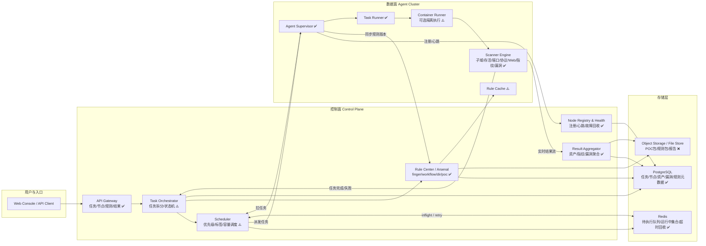
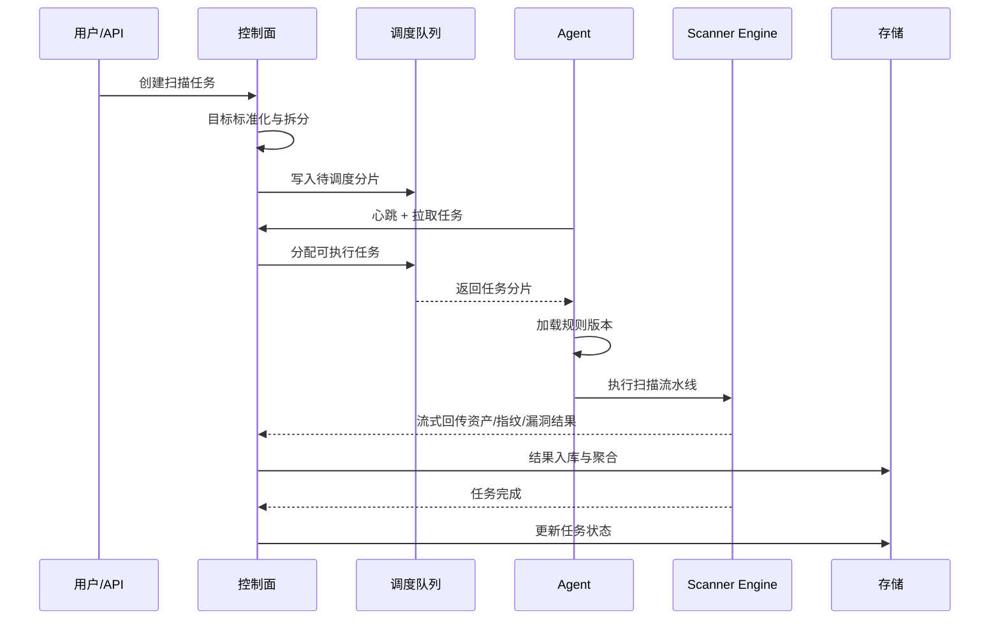

# 分布式资产探测与漏洞识别架构设计

> [!NOTE]
> 标注说明：✅ = 已实现 | ⚠️ = 部分实现/骨架代码 | ❌ = 未实现

## 1. 设计目标

本方案面向当前 `dddd` 的分布式扫描能力，目标不是重做一套全新系统，而是在现有 `server + agent + engine` 基础上，形成一套可持续扩展的控制面与数据面架构。

核心目标：

1. ✅ 支持分布式资产探测、指纹识别、漏洞识别的一体化调度。
2. ✅ 支持规则库热更新，包括 `finger.yaml`、`workflow.yaml`、`dir.yaml`、POC 文件集。
3. ⚠️ 支持任务拆分、节点调度、失败重试、超时回收、结果实时回传。**（任务拆分 ✅、节点调度 ✅、结果回传 ✅、死节点任务回收 ✅、Dead-Letter 死信回收 ✅、基于 timeout_sec 的超时终止 ❌、retry_count 重试 ❌。）**
4. ⚠️ 支持未来扩展多租户、节点标签路由、容器化扫描执行和隔离。**（多租户 JWT 网关 ✅、节点标签路由 ❌、容器化 Provider 代码 ⚠️。）**
5. ✅ 尽量复用当前代码结构，降低重构风险。

## 2. 当前代码现状映射

当前仓库已经具备分布式雏形，可直接作为第一阶段基础：

- 控制面入口：
  - ✅ `server/cmd/dddd-server/main.go`
  - ✅ `server/internal/api/router.go`
  - ✅ `server/internal/grpc/server.go`
  - ✅ `server/internal/scheduler/queue.go`
  - ✅ `server/internal/db/db.go`
- 数据面入口：
  - ✅ `scanner/cmd/agent/main.go`
  - ✅ `scanner/internal/agent/worker.go`
- 扫描执行内核：
  - ✅ `scanner/internal/engine/pipeline.go`
  - ✅ `scanner/internal/finger/engine.go`
  - ✅ `scanner/internal/vuln/mapper/mapper.go`

当前已具备的能力：

- ✅ Server 负责任务创建、任务入队、节点注册/心跳、结果入库、规则文件 API。
- ✅ Agent 负责注册、心跳、拉取任务、执行扫描、流式回传结果。
- ✅ Engine 已具备完整流水线：
  - ✅ 资产输入/空间引擎
  - ✅ 子域枚举
  - ✅ 存活探测
  - ✅ 端口扫描
  - ✅ 协议识别
  - ✅ Web 探测
  - ✅ 主动/被动指纹识别
  - ✅ Workflow 映射
  - ✅ Nuclei / GoPoc 漏洞检测

当前明显缺口：

1. ⚠️ 任务粒度仍偏粗，缺少"父任务 -> 子任务 -> 分片任务"的统一模型。**（✅ 已实现 RootTask -> SubTask 两级拆分，但 ❌ 缺少更细粒度的分片任务模型。）**
2. ⚠️ 调度器目前是简单队列，没有优先级、租户隔离、节点能力约束。**（✅ 已升级为 Redis Streams + 消费组模式，但 ❌ 优先级调度、❌ 节点标签路由、❌ 容量限额均未实现。）**
3. ✅ Agent 目前仅同步 POC，没有同步指纹库和 workflow/目录指纹数据库。**（已补齐：Agent syncRules 现在同步 poc / finger / workflow / dir 四类。）**
4. ⚠️ 规则下发没有版本号、校验、增量同步和回滚。**（✅ Hash 校验已有、⚠️ 版本号字段 RuleVersion 在 DB Model 里存在但未使用、❌ 增量同步未实现、❌ 回滚未实现。）**
5. ✅ 结果存储较粗，只是原始 payload 落库，没有资产视图、指纹视图、漏洞视图的分层索引。**（已实现 Asset / FingerprintHit / Vulnerability 三层分类存储。）**
6. ⚠️ Agent 运行模式仍是"进程内直接跑引擎"，尚未具备容器级隔离能力。**（✅ 仍为进程内执行，⚠️ Docker/阿里云 Provider 代码已写但未集成到任务流。）**

## 3. 目标架构

### 3.1 总体思路

整体采用"两面一库"模式：

- ✅ 控制面（Control Plane）：
  - 管理任务、规则、节点、调度、结果聚合、权限
- ✅ 数据面（Data Plane）：
  - 由多个扫描 Agent 执行具体探测、指纹和漏洞识别
- ⚠️ 知识库（Knowledge Base）：
  - ✅ 存储指纹库、目录指纹库、workflow 映射、POC（通过 Arsenal 表）
  - ❌ EXP 管理、模板元数据单独管理

### 3.2 控制面模块

1. ✅ API Gateway / Web Console
   - 提供任务创建、节点管理、规则管理、结果查询、报表展示
   - 复用当前 `server/internal/api` + `server-ui` 前端

2. ⚠️ Task Orchestrator
   - ✅ 负责父任务创建、目标标准化、分片
   - ⚠️ 新增任务状态机（当前使用简单字符串状态 Pending/Running/DONE/FAILED/FINISHED/CancelPending/Cancelled）：
     - ✅ `Created` (⇒ Pending)
     - ✅ `Queued` (⇒ Pending)
     - ❌ `Dispatching`
     - ✅ `Running`
     - ❌ `PartialDone`
     - ✅ `Done` (⇒ FINISHED for RootTask)
     - ✅ `Failed`
     - ❌ `Timeout`
     - ✅ `Cancelled`

3. ⚠️ Scheduler
   - ✅ 负责把任务分配给合适节点
   - 调度维度：
     - ✅ 节点在线状态 (heartbeat + dead node sweep)
     - ❌ 节点标签
     - ❌ 并发容量
     - ❌ 任务类型
     - ❌ 租户优先级
   - ~~短期可基于当前 Redis List 增强~~ ✅ 已升级为 Redis Streams
   - ✅ 中期建议升级为 Redis Streams 或消息队列 Ack 模式（已完成）

4. ⚠️ Node Registry & Health Manager
   - ✅ 管理节点注册、心跳
   - ❌ 版本、❌ 能力标签、❌ 最近任务记录
   - ✅ 健康状态（死节点扫描 + 标记 Offline）
   - ✅ 与失败任务回收器联动

5. ⚠️ Rule Center / Arsenal Center
   - 统一管理：
     - ✅ 指纹库
     - ✅ 主动目录指纹库
     - ✅ workflow 映射
     - ✅ nuclei POC
     - ❌ GoPoc / EXP 元数据 (GoPoc 为编译内嵌，非动态管理)
   - ⚠️ 支持版本号(⚠️ 字段存在但未使用)、✅ 哈希校验、✅ 审批、❌ 发布流程、❌ 回滚

6. ⚠️ Result Aggregator
   - ✅ 将 Agent 回传的原始结果拆成三层：
     - ✅ 资产层：IP、端口、协议、URL、标题、证书
     - ✅ 指纹层：目标、产品、版本、命中规则
     - ✅ 漏洞层：漏洞名、严重度、POC、证据、任务、目标
   - ⚠️ 结果解析粗糙：当前 `AddResultAsync` 仅按 payloadType 简单分类，字段提取不够精细

### 3.3 数据面模块

1. ✅ Agent Supervisor
   - ✅ 保持与控制面的 gRPC 长连接
   - ✅ 上报节点状态
   - ✅ 拉取任务
   - ✅ 拉取规则版本
   - ✅ 管理本地执行器

2. ✅ Task Runner
   - ✅ 承接单个任务执行
   - ✅ 每个 Runner 对应一次扫描上下文 `ScanContext`
   - ✅ 负责超时控制（context cancellation）、取消、结果回传

3. ✅ Scanner Engine
   - ✅ 复用当前 `scanner/internal/engine/pipeline.go`
   - ✅ 作为数据面核心执行链

4. ⚠️ Rule Cache
   - ✅ 本地缓存规则版本（写入 config/ 目录）
   - ❌ 支持校验失败回滚到上一个稳定版本

5. ⚠️ Container Runner（建议新增）
   - ✅ 短期：Agent 内直接运行引擎（当前状态）
   - ⚠️ 中期：Task Runner 以 Docker/容器方式启动扫描执行器（**Docker Provider 代码存在，但未集成到 Agent 执行链**）
   - ❌ 目标是隔离：
     - ❌ 网络代理
     - ❌ 模板文件
     - ❌ 缓存文件
     - ❌ CPU/内存限制

## 4. 推荐架构图

## 5. 核心任务流

### 5.1 任务执行流

✅ **已实现核心闭环**：用户创建 → 目标拆分 → 入队 → Agent 领取 → 引擎执行 → 流式回传 → 落库 → 状态聚合

### 5.2 规则同步流

1. ✅ 控制面发布规则版本，例如 `rule_bundle:v2026.04.18.1`（**当前直接通过 Arsenal API 管理，无显式版本号**）
2. ⚠️ Agent 心跳时携带本地规则版本（**当前心跳不携带规则版本，而是通过 commandLoop 轮询 reload_rules 信号**）
3. ✅ 控制面对比版本后返回 `should_update=true`（**通过 GlobalArsenalReloadCounter 全局计数器触发**）
4. ✅ Agent 拉取规则包并校验哈希（**当前直接拉取全量规则内容写入本地文件**）
5. ❌ 校验通过后切换到新版本（**无版本切换机制**）
6. ❌ 校验失败则回滚旧版本并上报告警

## 6. 推荐数据模型

### 6.1 任务模型

- `task` (当前实现为 `RootTask` + `SubTask`)
  - ✅ `id`
  - ❌ `parent_id` (当前用 `root_task_id` 在 SubTask 中链接)
  - ✅ `tenant_id`
  - ✅ `name`
  - ❌ `type` (任务类型字段未设计)
  - ⚠️ `priority` (字段存在于 RootTask，但创建任务时未使用)
  - ✅ `status`
  - ✅ `targets`
  - ✅ `config`
  - ⚠️ `rule_version` (字段存在于 RootTask，但未实际填充)
  - ❌ `agent_selector`
  - ⚠️ `timeout_sec` (字段存在于 RootTask/SubTask，但未使用)
  - ⚠️ `retry_count` (字段存在于 SubTask，但未使用)
  - ✅ `created_at`
  - ✅ `updated_at`

### 6.2 节点模型

- `node`
  - ✅ `agent_id`
  - ❌ `version` (注册时传入但未存储到 Node 模型)
  - ✅ `status`
  - ⚠️ `tags` (字段存在但未使用)
  - ❌ `capacity`
  - ❌ `running_tasks`
  - ✅ `last_beat`
  - ❌ `rule_version`

### 6.3 结果模型

- ✅ `asset`
  - 资产基础信息（Target, Protocol, Port, URL, Title, Service）
- ✅ `fingerprint_hit`
  - 命中的产品、规则、命中证据
- ✅ `vulnerability`
  - 漏洞名称、严重度、POC、目标、原始 payload
- ❌ `task_result`
  - 聚合任务维度的执行统计（未实现）

## 7. 与当前代码的落地映射

### 7.1 可直接复用

1. ✅ `server/internal/grpc/server.go`
   - 已具备 Register / Heartbeat / FetchTask / StreamResult / TaskComplete / EmergencyDump
2. ✅ `scanner/internal/agent/worker.go`
   - 已具备 Agent 生命周期和任务执行骨架
3. ✅ `scanner/internal/engine/pipeline.go`
   - 已具备完整扫描链
4. ✅ `server/internal/api/router.go`
   - 已具备任务、节点、规则和结果查询入口
5. ✅ `server/internal/scheduler/queue.go`
   - 已具备 Redis Streams 队列能力

### 7.2 建议优先补齐

1. ✅ **规则同步扩展** （已完成）
   - ~~目前只同步 `POC`~~
   - ✅ 已补齐：
     - ✅ `finger.yaml`
     - ✅ `workflow.yaml`
     - ✅ `dir.yaml`
     - ⚠️ 版本号 / hash（hash 在 Arsenal 表中存在，版本号未实际使用）

2. ⚠️ **任务模型增强**
   - ✅ 当前任务有 priority、timeout_sec、retry_count 字段
   - ❌ 但这些字段在创建和调度时均**未被使用**
   - ❌ 父子关系仅有 RootTask -> SubTask，缺少更灵活的层级

3. ⚠️ **调度器增强**
   - ✅ inflight 集合（Redis Streams pending list）
   - ✅ ack（XACK 确认机制）
   - ⚠️ nack（通过死节点扫描间接实现，无显式 nack）
   - ✅ timeout reclaim（Dead-Letter 守护协程，1h idle 回收）
   - ❌ 节点标签过滤

4. ✅ **结果结构化** （已完成）
   - ~~当前 `AddVuln` 仅存 `payload_type + payload`~~
   - ✅ 已按资产、指纹、漏洞三层结构化存储

5. ⚠️ **执行隔离**
   - ✅ 当前 Agent 直接进程内执行
   - ⚠️ Docker/阿里云容器化 Provider 代码存在但未集成
   - ❌ 建议演进为容器化 Runner

## 8. 分阶段落地建议

### Phase 1：最小可用增强

目标：在不大改架构的情况下，把当前分布式链路补完整。

实现内容：

1. ✅ 扩展 Arsenal 同步为完整规则包同步。
2. ⚠️ 任务表增加 `priority`、`timeout_sec`、`retry_count`、`rule_version`。**（字段已添加，但业务逻辑未使用。）**
3. ✅ 队列增加 `running/inflight` 集合和超时回收机制。
4. ✅ 结果回传时拆分为资产、指纹、漏洞三类落库。
5. ⚠️ 节点注册时增加 `tags`、`capacity`、`version`。**（tags 字段存在但未使用，capacity/version 未存储。）**

### Phase 2：调度与隔离增强

目标：从"能跑"升级为"可扩展、可控、可恢复"。

实现内容：

1. ✅ Redis List 升级为 Redis Streams 或具备 Ack 的消息模型。
2. ⚠️ 引入容器化执行器，支持每任务隔离。**（Provider 代码存在，未集成。）**
3. ✅ 增加任务取消、中断（cancelTask + commandLoop + context cancel 联动）。⚠️ 超时终止**（字段存在但未生效）**。
4. ⚠️ 增加租户维度和配额限制。**（JWT 多租户中间件 ✅，配额限制 ❌。）**

### Phase 3：规则中心与运营能力

目标：让系统从扫描工具升级为漏洞运营平台。

实现内容：

1. ⚠️ 多租户规则提交与审批。**（✅ 审批 API 已有，❌ 但审批流程单一，无多级审批。）**
2. ✅ 指纹/POC/workflow 可视化管理。**（server-ui 弹药库管理页面已实现。）**
3. ⚠️ 结果关联资产画像、漏洞趋势、报表导出。**（✅ 融合画像 ProfilesView 已实现，✅ CSV 导出已实现，❌ 漏洞趋势图未实现。）**
4. ⚠️ 支持 AI 辅助规则审查和去重归并。**（⚠️ Mock AI 分析 API 已有，❌ 真实 LLM 未对接。）**

## 9. 结论

如果以"当前仓库能最快落地"为前提，推荐采用下面这条主线：

1. ✅ 保留现有 `server + agent + engine` 分层。
2. ✅ 把 `server` 明确为控制面，把 `agent` 明确为数据面。
3. ⚠️ 先补规则中心（✅ 已完，含四类规则）、任务状态机（⚠️ 基本可用但状态不够细）、失败回收（✅ 已完）和结果结构化（✅ 已完）。
4. ⚠️ 再演进到容器化 Runner（⚠️ Provider 代码已有）和更强的调度队列（❌ 优先级/标签/容量待补）。

这样做的优点是：

- 不推翻当前扫描内核；
- 与现有代码结构高度兼容；
- 先解决分布式可用性，再解决平台化能力；
- 便于后续接入租户、审批、AI 辅助和大屏展示。
