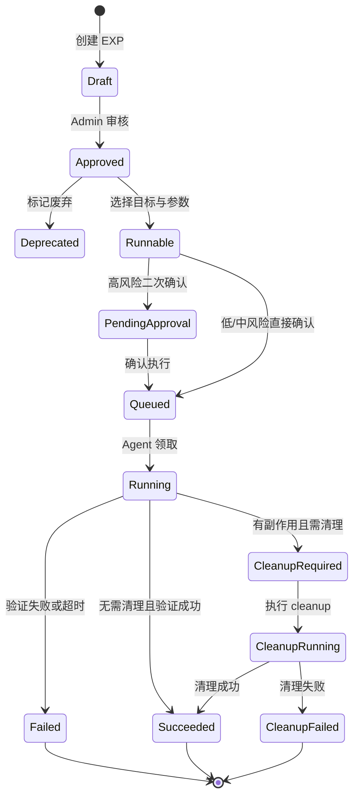

# Argus EXP 能力规划

本文档规划 Argus 后续 EXP（Exploit / 受控利用验证）能力。EXP 将作为弹药库管理中的独立规则类型统一治理、统一迁移、统一审核，但不复用 POC 的规则表或执行链路；POC 只作为可选关联，用于提供漏洞命中上下文、推荐候选 EXP 和验证证据闭环。

## 1. 定位与边界

### 1.1 目标

EXP 的目标是为授权环境提供受控的漏洞复现、影响确认、修复验证与证据固化能力：

1. **漏洞确认**：在 POC 命中后，人工选择合适 EXP 验证漏洞是否可被实际利用。
2. **影响评估**：收集最小化证据，例如安全的命令回显、版本信息、临时文件写入证明或权限边界证明。
3. **修复验证**：修复后重新运行同一 EXP，确认利用链不可达。
4. **审计闭环**：记录谁在什么授权范围内，对哪个目标运行了哪个 EXP，以及清理是否完成。

### 1.2 与 POC 的关系

EXP 与 POC 是两套独立资产：

| 维度 | POC | EXP |
|------|-----|-----|
| 规则类型 | `poc` | `exp` |
| 核心目标 | 检测漏洞是否疑似存在 | 受控复现和证明影响 |
| 默认执行 | 可自动批量检测 | 默认只能人工触发 |
| 副作用 | 默认只读或低影响 | 可能产生副作用，必须声明 |
| 审批要求 | 草稿 / 审核 | 更严格的风险审批 |
| 执行记录 | 扫描结果 | 独立 EXP 执行审计 |
| POC 关系 | 不依赖 EXP | 可选关联一个或多个 POC |

POC 关联只承担三件事：

- 从 POC 命中结果推荐可用 EXP。
- 帮助 EXP 自动填充产品、CVE、目标、漏洞上下文。
- 在报告中形成“POC 命中 → EXP 验证 → 清理结果”的证据链。

EXP 不应因为 POC 存在而自动执行，也不应阻塞 POC 的原有检测流程。

## 2. 核心功能点

### 2.1 弹药库统一管理与迁移

EXP 在产品形态上归入“弹药库管理”，与 `workflow`、`poc`、`finger`、`dir` 同一个治理入口、同一套草稿/审核/回滚/导出迁移体验，但实现上保持独立：

| 层级 | 设计 |
|------|------|
| 原始资产 | 使用 `arsenals.type = exp` 保存 EXP YAML 包内容 |
| 结构化索引 | 物化到 `exploit_rules`，供检索、候选推荐、风险过滤 |
| 执行记录 | 独立写入 `exploit_runs` / `exploit_artifacts` |
| 页面入口 | 在弹药库管理新增 `EXP 验证库` 页签 |
| 安装迁移 | `arsenal_seed.db` 导出与导入必须包含 `exp` 类型 |
| Agent 同步 | 运行期 EXP 包单独同步，不混入 POC 自动扫描规则 |

需要适配现有迁移链路：

1. `CanonicalArsenalType` 增加 `exp`。
2. `ArsenalTypeAliases` 增加 `exp`，预留历史别名如 `exploit`。
3. 弹药库安装 DB 导出 `/arsenals/seed-db` 包含 `exp` 类型。
4. `SeedArsenalFromSQLite` 导入后同步物化 `exploit_rules`。
5. Agent 侧规则同步增加 EXP 专用 manifest 或 DB 分区，避免普通扫描自动加载 EXP。
6. README 和部署文档说明：迁移弹药库时 EXP 会随 seed DB 一起迁移，但默认不会自动执行。

建议新增或扩展的数据表：

```text
arsenals(type = exp)       # 原始 EXP YAML 包
exploit_rules              # EXP 结构化索引
exploit_runs               # EXP 执行审计
exploit_artifacts          # EXP 证据附件
```

`exploit_rules` 从 `arsenals(type=exp)` 物化而来，保存可检索字段、风险字段、能力字段和 POC 关联字段；真实执行内容仍以原始 YAML 包为准，便于导出迁移和版本回滚。

EXP 规则元数据建议包含：

- `id`：EXP 唯一 ID。
- `name`：规则名称。
- `target_product`：适用产品。
- `cve`：关联 CVE，可为空。
- `linked_pocs`：关联 POC 名称列表。
- `risk_level`：`low / medium / high / destructive`。
- `requires_auth`：是否需要认证凭据。
- `side_effects`：副作用声明，例如写文件、创建账号、触发回连、修改配置。
- `cleanup_supported`：是否提供清理步骤。
- `cleanup_required`：是否强制清理。
- `capabilities`：能力声明，例如 `http_write`、`command_echo`、`file_probe`。
- `params_schema`：执行参数 schema。
- `timeout_sec`：执行超时。
- `state`：`Draft / Approved / Deprecated`。
- `enabled`：是否启用。

### 2.2 YAML + 脚本通用 EXP 包

EXP 采用“YAML 元数据 + 受控脚本”的通用包格式：

- YAML 负责声明元数据、参数、风险、副作用、能力、POC 关联、输入输出 schema。
- 脚本负责处理复杂验证逻辑，但只能调用 Agent 暴露的受控 API。
- 简单 EXP 可以只写声明式 `steps`，复杂 EXP 再启用 `scripts`。
- cleanup 与 run 分离，必须能被 Server 独立调度和重试。

推荐单文件包格式，便于继续存入 `arsenals.content` 并通过 seed DB 迁移：

```yaml
kind: argus-exp/v1
id: exp-example-safe-proof

info:
  name: Example Safe Proof
  description: Uses a controlled proof step and records minimal evidence.
  author: security-team
  risk_level: medium
  target_product: ExampleProduct
  cve: CVE-XXXX-YYYY
  linked_pocs:
    - CVE-XXXX-YYYY.yaml
  tags:
    - safe-proof

policy:
  requires_auth: false
  cleanup_supported: true
  cleanup_required: true
  dry_run_supported: true
  timeout_sec: 60
  max_concurrency: 1
  capabilities:
    - http.request
    - evidence.write
    - cleanup.defer
  side_effects:
    - creates temporary proof marker

params:
  marker:
    type: string
    required: true
    description: Operator-provided proof marker.

runtime:
  engine: starlark
  version: "1"
  entry: run

scripts:
  run: |
    def run(ctx):
        resp = http.request(
            method = "POST",
            url = ctx.target.url,
            body = {"marker": ctx.params.marker},
        )
        if resp.status_code == 200:
            evidence.add("proof_status", "accepted")
            cleanup.defer("cleanup")
            return result.success("proof accepted")
        return result.failure("proof was not accepted")

  cleanup: |
    def cleanup(ctx):
        resp = http.request(
            method = "DELETE",
            url = ctx.target.url,
            body = {"marker": ctx.params.marker},
        )
        if resp.status_code in [200, 404]:
            return result.success("cleanup complete")
        return result.failure("cleanup failed")
```

脚本语言建议优先选择 **Starlark**：

- Go 生态成熟，可嵌入。
- 默认无文件系统、无进程、无网络能力。
- 所有能力都由宿主显式注入。
- 易于做超时、步数、内存和输出限制。

可选路线：

| 方案 | 优点 | 风险与约束 |
|------|------|------------|
| Starlark | 可控、确定性强、适合内嵌 Agent | 生态不如 JS 丰富 |
| JavaScript 沙箱 | 编写门槛低 | 必须严格限制模块、网络、时间和内存 |
| WASM | 隔离强，适合高级能力 | 工程复杂度较高 |
| 外部脚本进程 | 兼容性强 | 第一阶段不建议，审计和隔离成本高 |

### 2.3 受控脚本能力模型

脚本不能直接访问操作系统能力，必须通过声明的 `capabilities` 调用宿主 API。Server 审核和 Agent 执行都要校验实际调用不超过声明能力。

第一阶段建议提供这些宿主 API：

| Capability | 宿主 API | 用途 |
|------------|----------|------|
| `http.request` | `http.request(...)` | 发送受控 HTTP 请求 |
| `tcp.connect` | `tcp.connect(...)` | 受控 TCP 探测 |
| `evidence.write` | `evidence.add(...)` | 写入最小化证据 |
| `extract.match` | `extract.regex(...)` / `extract.json(...)` | 提取证明字段 |
| `cleanup.defer` | `cleanup.defer("cleanup")` | 注册清理步骤 |
| `result.write` | `result.success(...)` / `result.failure(...)` | 返回执行结果 |

默认禁止：

- 任意文件读写。
- 任意系统命令。
- 直接访问环境变量。
- 直接创建反连监听。
- 直接访问内网非目标地址。
- 动态下载并执行代码。

如后续确实需要文件写入、命令回显、凭据验证等高风险 capability，必须拆成单独能力开关，并要求 admin 审核、二次确认、强审计和 cleanup。

### 2.4 EXP 包校验

保存草稿时做基础校验，审核时做严格校验，执行前做最终校验。

校验项：

- YAML schema 合法。
- `kind` 和版本受支持。
- `id`、`risk_level`、`policy.capabilities` 必填。
- `linked_pocs` 指向存在的 POC 时给出健康状态；不存在时允许保存但标记为“关联缺失”。
- `side_effects` 与高风险 capability 必须匹配。
- `cleanup_required=true` 时必须存在 cleanup 入口。
- 脚本入口函数存在。
- 脚本静态扫描不包含禁用符号。
- 参数 schema 可渲染为前端表单。

### 2.5 兼容声明式 steps

除受控脚本模式外，保留更低门槛的声明式 `steps` 模式。简单 EXP 可以不写脚本，只通过 YAML 描述固定请求、匹配、提取和清理动作：

```yaml
id: exp-example-safe-proof
info:
  name: Example Safe Proof
  risk_level: medium
  linked_pocs:
    - CVE-XXXX-YYYY.yaml
  side_effects:
    - writes temporary proof marker
  cleanup_supported: true

params:
  marker:
    type: string
    required: true

steps:
  - type: http
    method: POST
    path: /example
    body: "{{marker}}"
    matchers:
      - type: status
        status: [200]

cleanup:
  - type: http
    method: DELETE
    path: /example/{{marker}}
```

声明式 steps 可编译成同一套受控执行计划。这样简单 EXP 不需要脚本，复杂 EXP 使用脚本，两者共享同一个安全闸门、审计和 cleanup 生命周期。

声明式 steps 初期只支持：

- HTTP 请求。
- TCP 探测。
- 参数模板渲染。
- matcher / extractor。
- cleanup 步骤。
- 证据字段提取。

### 2.6 执行入口

EXP 执行入口应保持人工、单目标优先：

1. 漏洞详情页：从某条漏洞或 POC 命中结果进入 EXP 候选列表。
2. 资产详情页：选择目标资产后手动运行 EXP。
3. EXP 规则库：选择规则后输入目标和参数执行。
4. 扫描报告页：对已确认漏洞执行修复后复验。

第一阶段不开放批量 EXP。批量能力应在审计、限流、授权范围和清理机制成熟后再加入。

### 2.7 安全闸门

EXP 默认关闭，需要显式启用：

- `EXP_ENABLED=false`：全局 EXP 开关。
- `EXP_ALLOW_HIGH_RISK=false`：是否允许高风险 EXP。
- `EXP_ALLOW_DESTRUCTIVE=false`：是否允许破坏性 EXP。
- `EXP_REQUIRE_APPROVED_RULE=true`：只允许运行已审核 EXP。
- `EXP_MAX_CONCURRENCY=1`：默认单 Agent 串行或低并发。

执行前必须校验：

- 当前用户角色满足要求。
- 目标属于当前租户和项目授权范围。
- EXP 已审核且启用。
- 参数通过 schema 校验。
- 风险确认已完成。
- 高危或破坏性 EXP 经过 admin 二次确认。

### 2.8 权限模型

建议权限分层：

| 操作 | viewer | operator | admin |
|------|--------|----------|-------|
| 查看 EXP 规则 | 是 | 是 | 是 |
| 创建 EXP 草稿 | 否 | 是 | 是 |
| 编辑 EXP 草稿 | 否 | 是 | 是 |
| 审核 EXP | 否 | 否 | 是 |
| 运行 low / medium EXP | 否 | 是 | 是 |
| 运行 high EXP | 否 | 需 admin 授权 | 是 |
| 运行 destructive EXP | 否 | 否 | 需全局开关 + 二次确认 |
| 查看执行审计 | 项目内只读 | 项目内 | 全租户 |

### 2.9 审计与证据

所有 EXP 执行必须落库，不允许只在日志里记录。

建议新增：

```text
exploit_rules
exploit_runs
exploit_artifacts
```

`exploit_runs` 核心字段：

- `id`
- `tenant_id`
- `project_id`
- `asset_id`
- `target`
- `exploit_id`
- `linked_poc_id`
- `operator_id`
- `risk_level`
- `status`
- `params_digest`
- `started_at`
- `finished_at`
- `evidence`
- `side_effects`
- `cleanup_status`
- `cleanup_evidence`
- `error_message`

证据存储原则：

- 默认保存摘要和最小证明。
- 避免保存敏感凭据、完整响应包、隐私数据。
- 大型附件进入 `exploit_artifacts`，并设置保留周期。

### 2.10 清理机制

EXP 规则应优先提供 cleanup 步骤。若声明了副作用但没有 cleanup，UI 和审核页必须显著标注。

清理能力包括：

- 执行后自动清理。
- 手动重新清理。
- 清理失败重试。
- 清理结果进入审计。

对于 `cleanup_required=true` 的 EXP：

- 执行成功后必须进入 cleanup 阶段。
- cleanup 失败时运行记录保持 `CleanupFailed`。
- UI 在资产和漏洞详情页展示未清理风险。

## 3. 生命周期



## 4. 后端 API 草案

弹药库统一管理接口沿用现有 Arsenal 风格：

```text
GET    /api/v1/arsenals/exp?all=1
POST   /api/v1/arsenals/exp/:filename
POST   /api/v1/arsenals/exp/:filename/approve
POST   /api/v1/arsenals/exp/:filename/rollback
DELETE /api/v1/arsenals/exp/:filename
GET    /api/v1/arsenals/seed-db        # 需要包含 exp
```

结构化 EXP 查询与执行接口独立提供：

```text
GET    /api/v1/exploits
POST   /api/v1/exploits
GET    /api/v1/exploits/:id
PUT    /api/v1/exploits/:id
POST   /api/v1/exploits/:id/approve
POST   /api/v1/exploits/:id/deprecate
DELETE /api/v1/exploits/:id

POST   /api/v1/exploit-runs
GET    /api/v1/exploit-runs
GET    /api/v1/exploit-runs/:id
POST   /api/v1/exploit-runs/:id/cancel
POST   /api/v1/exploit-runs/:id/cleanup

GET    /api/v1/vulns/:id/exploit-candidates
GET    /api/v1/assets/:id/exploit-candidates
```

Agent gRPC 草案：

```text
SyncExploitBundle(ExploitBundleReq) returns (ExploitBundleResp)
RunExploit(ExploitRunReq) returns (ExploitRunResp)
CleanupExploit(ExploitCleanupReq) returns (ExploitCleanupResp)
```

## 5. 前端页面规划

### 5.1 EXP 弹药库

在现有弹药库管理中新增独立页签：

- EXP 列表。
- 风险等级筛选。
- 关联 POC 筛选。
- Capability 筛选。
- 审核状态。
- 最近执行结果。
- 是否支持 cleanup。
- 编辑器与参数 schema 预览。
- POC 关联健康状态。
- seed DB 迁移兼容状态。

### 5.2 运行确认面板

运行前展示：

- 目标资产。
- 关联项目。
- EXP 名称和风险等级。
- 关联 POC 命中信息。
- 参数表单。
- 副作用声明。
- cleanup 支持情况。
- 执行超时和并发限制。

高风险 EXP 需要显式确认风险文本。

### 5.3 执行结果页

展示：

- 执行状态。
- 证据摘要。
- 提取字段。
- 目标响应摘要。
- cleanup 状态。
- 操作人和时间线。
- 可导出的审计记录。

## 6. 实施阶段

### Phase 1：规则库与数据模型 ✅ 已完成

- [x] `CanonicalArsenalType` / `ArsenalTypeAliases` 支持 `exp` / `exploit` 别名。
- [x] `ExploitRule` 模型 + `exploit_rules` 建表 migration（含 `description`、`dry_run_supported` 字段）。
- [x] `materializeExploitRule` / `parseExploitMeta` YAML 解析物化链路。
- [x] EXP 列表 API `GET /api/v1/exploits`（筛选：risk_level / product / cve / 关键词）。
- [x] EXP CRUD API：approve / deprecate / delete。
- [x] EXP 包校验 `validateExpPackage`（基础/严格两级），集成到 `saveArsenal` / `approveArsenal`。
- [x] 漏洞/资产 → EXP 候选推荐 `GET /api/v1/vulns/:id/exploit-candidates` / `GET /api/v1/assets/:id/exploit-candidates`。
- [x] RBAC 权限规则覆盖全部 EXP 端点。
- [x] 前端弹药库 `EXP 验证库` 页签（列表/筛选/新增/编辑/详情面板）。
- [x] `/arsenals/seed-db` 导出包含 `exp`，`SeedArsenalFromSQLite` 导入后物化 EXP。
- [x] 单元测试 `TestCanonicalArsenalTypeEXP` / `TestMaterializeExploitRule`。

涉及文件：
- `server/internal/db/rule_catalog.go` — 模型、解析、物化
- `server/internal/db/migrations/100_add_exploit_rules.sql` — 建表
- `server/internal/db/migrations/120_add_exploit_rule_metadata_columns.sql` — 补齐 `description` / `dry_run_supported` 迁移字段
- `server/internal/api/handler_exploits.go` — 校验、CRUD、候选推荐
- `server/internal/api/router.go` — 路由注册
- `server/internal/api/middleware_rbac.go` — RBAC 规则
- `server-ui/src/pages/config/ExploitConfig.tsx` — 前端页签
- `server-ui/src/pages/config/ConfigLayout.tsx` — Tab 集成
- `server-ui/src/routes.tsx` — 路由
- `server-ui/src/services/api.ts` — API 函数
- `server-ui/src/services/typings.d.ts` — 类型定义

### Phase 2：单目标 dry-run ✅ 已完成

- [x] 参数 schema 校验 `validateExpParams`（必填检查、类型匹配：string / int / bool）。
- [x] 脚本静态扫描 `scanScriptForForbiddenSymbols`（20+ 禁用符号：import / exec / eval / os / subprocess 等）。
- [x] dry-run 端点 `POST /api/v1/exploits/:id/dry-run`（解析 EXP YAML 返回执行计划预览）。
- [x] 支持 scripts 模式（返回 script_preview / cleanup_preview）和 steps 模式（返回 steps / cleanup）。
- [x] 前端 dry-run 面板（目标输入、动态参数表单、预览结果：风险/副作用/capabilities/脚本预览）。
- [x] RBAC `POST:/exploits/*/dry-run` → operator。

涉及文件：
- `server/internal/api/handler_exploits.go` — validateExpParams / dryRunExploit / 脚本扫描
- `server/internal/api/router.go` — dry-run 路由
- `server-ui/src/pages/config/ExploitConfig.tsx` — 预览按钮和 Drawer
- `server-ui/src/services/api.ts` — dryRunExploit 函数
- `server-ui/src/services/typings.d.ts` — DryRunResponse 类型

### Phase 3：单目标受控执行（Server 侧）✅ 已完成

- [x] `ExploitRun` 模型 + AutoMigrate 注册。
- [x] `exploit_runs` / `exploit_artifacts` 建表 migration（`110_add_exploit_runs.sql`）。
- [x] 创建执行 `POST /api/v1/exploit-runs`（参数校验 + 全局并发限制 + 目标级并发保护）。
- [x] 执行列表 `GET /api/v1/exploit-runs`（支持 exploit_id / status / target 筛选）。
- [x] 执行详情 `GET /api/v1/exploit-runs/:id`。
- [x] 取消执行 `POST /api/v1/exploit-runs/:id/cancel`（仅 Pending / Running）。
- [x] 手动清理 `POST /api/v1/exploit-runs/:id/cleanup`（仅 Succeeded / CleanupFailed）。
- [x] `ExploitResultHook` 回调，供 gRPC StreamDebug 接收 Agent 执行结果。
- [x] 前端执行确认面板（目标输入、参数表单、风险确认、副作用声明）。
- [x] RBAC 全套 exploit-runs 端点权限。

涉及文件：
- `server/internal/db/db.go` — ExploitRun 模型 + ExploitResultHook
- `server/internal/db/schema_runtime.go` — AutoMigrate 注册
- `server/internal/db/migrations/110_add_exploit_runs.sql` — 建表
- `server/internal/api/handler_exploits.go` — exploit-runs CRUD
- `server/internal/api/router.go` — 路由注册
- `server-ui/src/pages/config/ExploitConfig.tsx` — 执行确认面板
- `server-ui/src/services/api.ts` — exploit-runs API 函数
- `server-ui/src/services/typings.d.ts` — ExploitRun 类型

待完成（Agent 侧）：
- Agent Starlark 引擎嵌入（声明式 steps 编译 + Starlark 脚本沙箱执行）
- Agent 通过 gRPC ClaimTask 认领 EXP 任务
- Agent 通过 StreamDebug 回传执行结果
- Server 侧 ExploitResultHook 实现状态流转和证据入库

### Phase 4：清理与审计闭环 🔲 待开始

- 支持 cleanup 自动执行和手动重试。
- 支持执行证据和清理证据入库。
- 漏洞详情页展示 EXP 验证状态。

### Phase 5：高风险能力 🔲 待开始

- 引入 high 风险二次确认。
- 引入 admin 授权流。
- 引入全局开关和租户级开关。
- 评估是否开放有限批量复验。

### Phase 6：隔离执行扩展 🔲 待开始

- 评估 WASM / 容器 / 独立 worker。
- 支持更复杂协议和脚本能力。
- 对危险 capability 做单独授权和审计。

## 7. 非目标

第一阶段明确不做：

- 不做自动批量 EXP。
- 不做未授权目标执行。
- 不做默认开启。
- 不做不受控的任意脚本直接执行。
- 不做绕过审计的临时运行入口。
- 不把 EXP 混进 POC 执行流水线。

## 8. 关键设计原则

1. EXP 独立于 POC 实现，只保留关联关系。
2. EXP 默认人工触发，不自动跟随扫描执行。
3. EXP 必须有风险声明、副作用声明和审计记录。
4. EXP 优先单目标、低并发、可取消。
5. 有副作用的 EXP 优先支持 cleanup。
6. 证据最小化，敏感信息默认脱敏。
7. 高危能力通过全局开关、角色权限和二次确认共同约束。

## 9. 补充设计

### 9.1 执行层数据表 Schema

`exploit_runs` 记录每次 EXP 执行的完整审计链：

```sql
CREATE TABLE IF NOT EXISTS exploit_runs (
    id BIGSERIAL PRIMARY KEY,
    tenant_id TEXT NOT NULL DEFAULT 'default',
    project_id TEXT,
    asset_id TEXT,
    target TEXT NOT NULL,
    exploit_id TEXT NOT NULL,
    linked_poc_id TEXT,
    operator_id TEXT NOT NULL,
    risk_level TEXT NOT NULL DEFAULT 'medium',
    status TEXT NOT NULL DEFAULT 'Pending',
    params_digest TEXT,
    started_at TIMESTAMPTZ,
    finished_at TIMESTAMPTZ,
    evidence JSONB,
    side_effects JSONB,
    cleanup_status TEXT,
    cleanup_evidence JSONB,
    error_message TEXT,
    created_at TIMESTAMPTZ NOT NULL DEFAULT NOW(),
    updated_at TIMESTAMPTZ NOT NULL DEFAULT NOW()
);
```

`exploit_artifacts` 存储大型证据附件，设置保留周期：

```sql
CREATE TABLE IF NOT EXISTS exploit_artifacts (
    id BIGSERIAL PRIMARY KEY,
    tenant_id TEXT NOT NULL DEFAULT 'default',
    run_id BIGINT NOT NULL,
    artifact_type TEXT NOT NULL,
    file_name TEXT,
    content BYTEA,
    content_hash TEXT,
    size_bytes BIGINT,
    created_at TIMESTAMPTZ NOT NULL DEFAULT NOW()
);
```

### 9.2 EXP 包校验集成点

校验分三级，嵌入现有弹药库管理流程：

| 阶段 | 时机 | 校验内容 |
|------|------|----------|
| 基础校验 | `saveArsenal` (type=exp) | YAML schema 合法、kind 版本受支持、id/risk_level/capabilities 必填、cleanup_required=true 时必须有 cleanup 入口 |
| 严格校验 | `approveArsenal` (type=exp) | 基础校验全部通过 + capability 值在允许列表内 + linked_pocs 指向存在的 POC 时检查健康状态 + 脚本入口函数存在 + 脚本静态扫描无禁用符号 |
| 运行前校验 | 执行前 | 严格校验全部通过 + 参数通过 params_schema 校验 + 风险确认已完成 + 高危/破坏性 EXP 经 admin 二次确认 |

校验失败的 EXP 在 `exploit_rules` 物化时标记为 `state=Invalid`，并记录错误摘要到 `RuleCatalogBootstrap.LastError`。

### 9.3 漏洞/资产 → EXP 候选推荐匹配逻辑

候选推荐基于三个维度匹配，返回按风险等级排序的结果：

| 匹配维度 | 逻辑 | 优先级 |
|----------|------|--------|
| CVE 匹配 | `exploit_rules.cve = vuln.cve` | 最高 |
| 产品匹配 | `exploit_rules.target_product IN (资产指纹产品列表)` | 高 |
| POC 关联 | `exploit_rules.linked_pocs @> [已命中的 POC 规则名]` | 中 |

API 端点：
- `GET /api/v1/vulns/:id/exploit-candidates` — 基于漏洞 plugin 匹配 EXP target_product
- `GET /api/v1/assets/:id/exploit-candidates` — 基于资产指纹产品和关联漏洞 plugin 匹配

### 9.4 EXP 执行限流策略

| 层级 | 策略 | 实现 |
|------|------|------|
| 全局 | `EXP_MAX_CONCURRENCY` 限制同一租户同时运行的 EXP 数量 | Server 侧 `exploit_runs` 计数 |
| 单规则 | `policy.max_concurrency` 限制同一 EXP 同时运行数 | Server 侧 `exploit_runs WHERE exploit_id = ? AND status = 'Running'` 计数 |
| 目标级 | 同一目标同一时间只能有一个 EXP 运行 | Server 侧 `exploit_runs WHERE target = ? AND status = 'Running'` 计数 |

限流超限时返回 `429 Too Many Requests`，不排队。原因：EXP 是人工触发的单次操作，排队会混淆操作意图。

### 9.5 Agent 侧 EXP 规则同步策略

EXP 规则**不**进入 Agent 的常规扫描规则同步（`agentSyncArsenalTypes()` 不包含 `exp`）。

同步方式：
- **预同步**：Agent 通过 `/arsenals/exp/db` 独立端点拉取 EXP 规则 DB，与常规 `/arsenals/db` 分离
- **按需拉取**：Server 下发 EXP 执行指令时附带完整 EXP 包内容，Agent 无需预存
- **隔离存储**：Agent 侧 EXP 规则存入独立的 `exp_rules` 表或独立 DB 文件，扫描引擎不加载

建议 Phase 3 实现按需拉取，Phase 5+ 评估是否需要预同步。

### 9.6 EXP 执行结果通知

EXP 执行状态变更通过现有 WebSocket 广播机制推送到前端：

- `exploit_run.created` — 执行已创建
- `exploit_run.started` — Agent 开始执行
- `exploit_run.completed` — 执行完成（成功/失败）
- `exploit_run.cleanup_started` — 开始清理
- `exploit_run.cleanup_completed` — 清理完成/失败

复用 `Hub.BroadcastToTenant(tenantID, event, payload)` 机制，前端通过现有 WebSocket 连接监听。

### 9.7 测试策略

| 层级 | 测试内容 | 时机 |
|------|----------|------|
| 单元测试 | YAML 解析（parseExploitMeta）、字段校验、capability 校验、物化链路 | 每次提交 |
| API 测试 | CRUD + 权限校验（viewer/operator/admin 角色覆盖） | 每次提交 |
| 集成测试 | EXP 包保存 → 物化 → 列表查询 → 审核 → 候选推荐完整链路 | 每次提交 |
| 执行 mock 测试 | 声明式 steps 编译、Starlark 脚本沙箱执行、超时/取消、cleanup 生命周期 | Phase 3+ |
| 安全测试 | 禁用符号检测、capability 越权检测、脚本沙箱逃逸检测 | Phase 3+ |

### 9.8 状态机完整定义

EXP 执行状态流转：

```
Pending → Running → Succeeded
                  → Failed
                  → CleanupRequired → CleanupRunning → Succeeded
                                                     → CleanupFailed
                  → Cancelled
```

`exploit_runs.status` 枚举值：
- `Pending` — 已创建，等待 Agent 领取
- `Running` — Agent 正在执行
- `Succeeded` — 验证成功
- `Failed` — 验证失败或超时
- `CleanupRequired` — 需要清理
- `CleanupRunning` — 正在清理
- `CleanupFailed` — 清理失败
- `Cancelled` — 操作人取消

## 10. 变更记录

| 日期 | 阶段 | 内容 |
|------|------|------|
| 2026-04-30 | Phase 1 | 规则库闭环：ExploitRule 模型、migration、YAML 解析物化、CRUD API、EXP 包校验（基础/严格）、候选推荐、RBAC、前端 EXP 验证库页签（列表/筛选/新增/编辑/详情）、seed DB 导出、单元测试 |
| 2026-04-30 | Phase 2 | dry-run 预览：参数 schema 校验、脚本静态扫描（20+ 禁用符号）、dry-run 端点（scripts/steps 两种模式预览）、前端预览面板（目标输入/动态参数表单/风险/副作用/脚本预览） |
| 2026-04-30 | Phase 3 | Server 侧执行生命周期：ExploitRun 模型、exploit_runs 建表、创建执行（并发限制+参数校验）、列表/详情/取消/清理 API、ExploitResultHook 回调、前端执行确认面板（风险确认+副作用声明） |
| 2026-04-30 | Review Hardening | 修复 EXP 审核/废弃/删除只改索引不改原始 Arsenal 的生命周期问题；修复 `runtime.entry` 校验字段；补充脚本调用能力与声明能力一致性检查；执行创建默认受 `EXP_ENABLED` 保护，并增加风险确认、租户级并发、项目归属和 target 级并发边界；AutoScaler 对账/缩容/TTL 回收按实例地域选择 provider |
